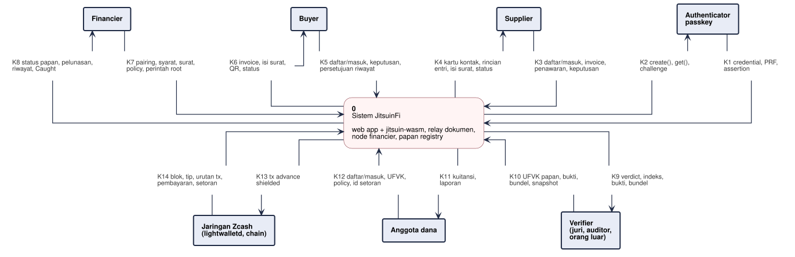

# DFD-0 - Diagram Konteks

**Bagian dari:** [[08 - FlowDiagrams]] · Legenda: [[FD-00 - Arsitektur Target dan Legenda]] · Turunan: [[DFD-1 - Proses Utama]]

JitsuinFi sebagai satu proses dengan semua pihak di luarnya. Sistem mencakup web app + `jitsuin-wasm` (di perangkat pengguna), relay dokumen (usulan P-04), node financier (`jitsuin-flow` + wallet), papan registry (memo di chain yang dibaca lewat UFVK papan), serta alat lokal yang berjalan di perangkat pihak itu sendiri: `jitsuin` CLI milik juri atau auditor dan pemindai watch-only milik anggota dana (`zcash-devtool`). UFVK yang masuk lewat K10 dan K12 hanya diproses oleh alat lokal itu, tidak dikirim ke server (P-10). Kolom "Di level 1" ditulis ulang oleh `scripts/build-dfd.py`.



```plantuml
@startuml dfd-0
!include dfd-style.iuml
skinparam nodesep 30
skinparam ranksep 30
rectangle "Authenticator\npasskey" <<entity>> as A
rectangle "Supplier" <<entity>> as S
rectangle "Buyer" <<entity>> as B
rectangle "Financier" <<entity>> as F
rectangle "K1 credential, PRF,\nassertion" <<flow>> as k1
rectangle "K2 create(), get(),\nchallenge" <<flow>> as k2
rectangle "K3 daftar/masuk, kontak, invoice,\npenawaran, keputusan" <<flow>> as k3
rectangle "K4 kartu kontak, rincian\nentri, isi surat, status" <<flow>> as k4
rectangle "K5 daftar/masuk, key invoice,\nkeputusan, persetujuan riwayat" <<flow>> as k5
rectangle "K6 invoice, isi surat,\nQR, status" <<flow>> as k6
rectangle "K7 pairing, syarat, surat,\npolicy, perintah dana" <<flow>> as k7
rectangle "K8 sesi konsol, status papan,\npelunasan, riwayat, Caught" <<flow>> as k8
rectangle "**0**\nSistem JitsuinFi\n\nweb app + jitsuin-wasm, relay dokumen,\nnode financier, papan registry,\nCLI juri dan pemindai anggota (lokal)" <<process>> as P
rectangle "K9 verdict, indeks, bukti,\nbundel, snapshot, uraian memo" <<flow>> as k9
rectangle "K10 UFVK papan, bukti,\nbundel, snapshot" <<flow>> as k10
rectangle "K11 kartu kontak, laporan,\nstatus inklusi" <<flow>> as k11
rectangle "K12 daftar/masuk, UFVK,\npolicy, id setoran" <<flow>> as k12
rectangle "K13 tx advance\nshielded" <<flow>> as k13
rectangle "K14 blok, tip, urutan tx,\npembayaran, setoran" <<flow>> as k14
rectangle "Verifier\n(juri, auditor,\norang luar)" <<entity>> as V
rectangle "Anggota dana" <<entity>> as M
rectangle "Jaringan Zcash\n(lightwalletd)" <<entity>> as Z
A -down- k1
k1 -down-> P
P -up- k2
k2 -up-> A
S -down- k3
k3 -down-> P
P -up- k4
k4 -up-> S
B -down- k5
k5 -down-> P
P -up- k6
k6 -up-> B
F -down- k7
k7 -down-> P
P -up- k8
k8 -up-> F
P -down- k9
k9 -down-> V
V -up- k10
k10 -up-> P
P -down- k11
k11 -down-> M
M -up- k12
k12 -up-> P
P -down- k13
k13 -down-> Z
Z -up- k14
k14 -up-> P
@enduml
```

## Aliran data

| Aliran | Dari | Ke | Data | Di level 1 |
|---|---|---|---|---|
| K1 | Authenticator | Sistem | Credential, output PRF (first, second, stempel), attestation passkey konsol, assertion | F1 |
| K2 | Sistem | Authenticator | `create()` sekali per orang dan untuk rp konsol node, `get()` dengan salt peran dan salt inbox, challenge | F2 |
| K3 | Supplier | Sistem | Daftar/masuk dan stempel, kartu kontak rekan, data invoice + file syarat, penawaran, keputusan setuju, nominal di Zodl (jalur lemah) | F9, F20, F31, F50 |
| K4 | Sistem | Supplier | Kartu kontak, backup key (saat ini), status tanda tangan, rincian entri, isi surat, status advance, status pelunasan | F10, F21, F32, F51, F69 |
| K5 | Buyer | Sistem | Daftar/masuk dan stempel, kartu kontak rekan, key invoice k, keputusan, minta QR, persetujuan riwayat, cek riwayat sendiri | F3, F18, F47, F66, F80 |
| K6 | Sistem | Buyer | Kartu kontak, isi invoice + hasil cek hash, isi surat, QR ZIP-321, status pelunasan, permintaan riwayat, status riwayat | F4, F19, F48, F67, F81 |
| K7 | Financier | Sistem | Pairing node (pendaftaran financier), buka konsol, kartu kontak rekan, syarat deal, PDF surat, tanggal kuitansi, permintaan riwayat + policy, buat bundel, id anggota, perintah root | F5, F29, F49, F82, F98, F106 |
| K8 | Sistem | Financier | Kartu kontak, kode pairing, sesi konsol, status cek papan, entri ditolak, status pelunasan + bukti sengketa, penolakan riwayat, lulus/tolak, berhenti / Caught | F6, F30, F68, F83, F92 |
| K9 | Sistem | Verifier | Bukti JTSP, verdict, indeks bunga, bundel, snapshot, uraian memo | F93, F100 |
| K10 | Verifier | Sistem | UFVK papan, bukti, bundel, k, memo, snapshot | F99 |
| K11 | Sistem | Anggota dana | Kartu kontak, laporan solvabilitas, status inklusi setoran (kuitansi dan jalur Merkle tiba lewat kotak surat D7) | F8, F108 |
| K12 | Anggota dana | Sistem | Daftar/masuk, UFVK + birthday + `manager_pk`, tenggang dan tanggal, potongan, id setoran | F7, F107 |
| K13 | Sistem | Jaringan Zcash | Transaksi advance shielded | F53 |
| K14 | Jaringan Zcash | Sistem | Blok, tinggi tip, urutan tx, waktu blok, tx wallet, output advance (wallet supplier), pembayaran pelunasan, setoran | F33, F52, F70, F101, F109 |

Nomor F merujuk tabel aliran [[DFD-1 - Proses Utama]]. Tiga jenis tulisan ke chain digambar sebagai tulisan ke penyimpanan di dalam sistem, padahal secara fisik semuanya transaksi shielded ke jaringan Zcash:

- Entri papan (register, `settled`) ke D1: 10 000 zat ke alamat papan + fee ZIP-317 per posting.
- Root kewajiban JTLR ke D6: self-send 10 000 zat ke akun operasional dana; uangnya kembali ke dana, yang terpakai hanya fee.
- Transaksi advance muncul dua kali: sebagai K13 (uang ke supplier) dan sebagai tulisan ke D6 (memo JTN1 yang dibaca anggota dari akun operasional). Keduanya satu transaksi yang sama.
