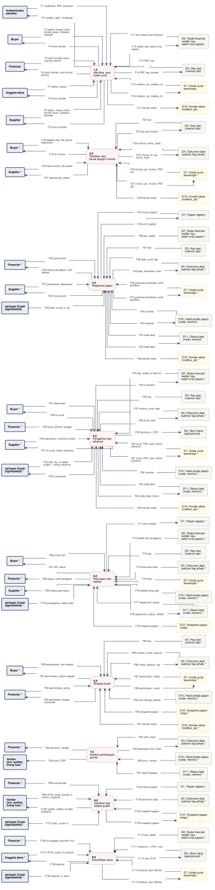

# DFD-1 - Proses Utama

**Bagian dari:** [[08 - FlowDiagrams]] · Legenda: [[FD-00 - Arsitektur Target dan Legenda]] · Induk: [[DFD-0 - Diagram Konteks]]

Sembilan proses utama. Level 1 ini **dibuat oleh `scripts/build-dfd.py` dari level 2** (`scripts/dfd_model.py`): setiap aliran level 1 adalah gabungan aliran level 2 satu proses dengan entitas atau penyimpanan yang sama dan arah yang sama, dan kolom terakhir tabel aliran menyebut aliran level 2-nya. Skrip yang sama menulis ulang kolom "Di level 1" di [[DFD-0 - Diagram Konteks]] dan gagal bila ada aliran entitas tanpa baris level 0. Jangan edit file DFD-1 dan DFD-2.x langsung. Penyimpanan yang dipakai lebih dari satu proses digambar di sini; penyimpanan lokal hanya muncul di level 2.

Posting ke papan digambar sebagai tulisan ke D1 (secara fisik transaksi 10 000 zat + fee ZIP-317 ke alamat papan). Pembayaran uang (advance, pelunasan, setoran) dan data chain (tinggi tip, waktu blok, urutan tx) melewati entitas Jaringan Zcash. Satu transaksi advance muncul dua kali: sebagai tx ke Jaringan Zcash (uang ke supplier) dan sebagai tulisan ke D6 (memo JTN1 yang dibaca anggota dana dari akun operasional).

Satu jalur = satu proses. Kotak bertanda `*` adalah entitas atau penyimpanan yang sama, digambar ulang supaya garis tidak bersilang. Proses bergaris penuh = ADA atau PARSIAL (rinciannya di kolom Status), kuning putus-putus = USULAN.



```plantuml
@startuml dfd-1
!include dfd-style.iuml
left to right direction
skinparam nodesep 12
skinparam ranksep 35
rectangle "D7 | Kotak surat\nterenkripsi *" <<storeproposal>> as D7_9
rectangle "D6 | Akun dana\n(operasional) *" <<store>> as D6_9
rectangle "D2 | Node financier\n(wallet, key,\nwatch-only papan) *" <<store>> as D2_9
rectangle "Jaringan Zcash\n(lightwalletd) *" <<entity>> as Z_9
rectangle "Anggota dana *" <<entity>> as M_9
rectangle "Financier *" <<entity>> as F_9
rectangle "D12 | Snapshot papan\n(relay) *" <<storeproposal>> as D12_8
rectangle "D4 | Dokumen deal\n(salinan tiap pihak) *" <<store>> as D4_8
rectangle "D1 | Papan registry *" <<store>> as D1_8
rectangle "Jaringan Zcash\n(lightwalletd) *" <<entity>> as Z_8
rectangle "Verifier\n(juri, auditor,\norang luar) *" <<entity>> as V_8
rectangle "Financier *" <<entity>> as F_8
rectangle "D11 | Status deal\n(node, memori) *" <<store>> as D11_7
rectangle "D10 | Hasil pindai papan\n(node, memori) *" <<store>> as D10_7
rectangle "D4 | Dokumen deal\n(salinan tiap pihak) *" <<store>> as D4_7
rectangle "Verifier\n(juri, auditor,\norang luar)" <<entity>> as V_7
rectangle "Financier *" <<entity>> as F_7
rectangle "D19 | Kontak rekan\n(mailbox_pk) *" <<storeproposal>> as D19_6
rectangle "D12 | Snapshot papan\n(relay) *" <<storeproposal>> as D12_6
rectangle "D10 | Hasil pindai papan\n(node, memori) *" <<store>> as D10_6
rectangle "D7 | Kotak surat\nterenkripsi *" <<storeproposal>> as D7_6
rectangle "D4 | Dokumen deal\n(salinan tiap pihak) *" <<store>> as D4_6
rectangle "D3 | Key sesi\n(memori tab) *" <<store>> as D3_6
rectangle "Financier *" <<entity>> as F_6
rectangle "Buyer *" <<entity>> as B_6
rectangle "D12 | Snapshot papan\n(relay)" <<storeproposal>> as D12_5
rectangle "D11 | Status deal\n(node, memori) *" <<store>> as D11_5
rectangle "D10 | Hasil pindai papan\n(node, memori) *" <<store>> as D10_5
rectangle "D7 | Kotak surat\nterenkripsi *" <<storeproposal>> as D7_5
rectangle "D4 | Dokumen deal\n(salinan tiap pihak) *" <<store>> as D4_5
rectangle "D3 | Key sesi\n(memori tab) *" <<store>> as D3_5
rectangle "D2 | Node financier\n(wallet, key,\nwatch-only papan) *" <<store>> as D2_5
rectangle "D1 | Papan registry *" <<store>> as D1_5
rectangle "Jaringan Zcash\n(lightwalletd) *" <<entity>> as Z_5
rectangle "Supplier *" <<entity>> as S_5
rectangle "Financier *" <<entity>> as F_5
rectangle "Buyer *" <<entity>> as B_5
rectangle "D19 | Kontak rekan\n(mailbox_pk) *" <<storeproposal>> as D19_4
rectangle "D11 | Status deal\n(node, memori) *" <<store>> as D11_4
rectangle "D10 | Hasil pindai papan\n(node, memori) *" <<store>> as D10_4
rectangle "D7 | Kotak surat\nterenkripsi *" <<storeproposal>> as D7_4
rectangle "D6 | Akun dana\n(operasional)" <<store>> as D6_4
rectangle "D4 | Dokumen deal\n(salinan tiap pihak) *" <<store>> as D4_4
rectangle "D3 | Key sesi\n(memori tab) *" <<store>> as D3_4
rectangle "D2 | Node financier\n(wallet, key,\nwatch-only papan) *" <<store>> as D2_4
rectangle "Jaringan Zcash\n(lightwalletd) *" <<entity>> as Z_4
rectangle "Supplier *" <<entity>> as S_4
rectangle "Financier *" <<entity>> as F_4
rectangle "Buyer *" <<entity>> as B_4
rectangle "D19 | Kontak rekan\n(mailbox_pk) *" <<storeproposal>> as D19_3
rectangle "D11 | Status deal\n(node, memori)" <<store>> as D11_3
rectangle "D10 | Hasil pindai papan\n(node, memori)" <<store>> as D10_3
rectangle "D7 | Kotak surat\nterenkripsi *" <<storeproposal>> as D7_3
rectangle "D4 | Dokumen deal\n(salinan tiap pihak) *" <<store>> as D4_3
rectangle "D3 | Key sesi\n(memori tab) *" <<store>> as D3_3
rectangle "D2 | Node financier\n(wallet, key,\nwatch-only papan) *" <<store>> as D2_3
rectangle "D1 | Papan registry" <<store>> as D1_3
rectangle "Jaringan Zcash\n(lightwalletd)" <<entity>> as Z_3
rectangle "Supplier *" <<entity>> as S_3
rectangle "Financier *" <<entity>> as F_3
rectangle "D19 | Kontak rekan\n(mailbox_pk) *" <<storeproposal>> as D19_2
rectangle "D7 | Kotak surat\nterenkripsi *" <<storeproposal>> as D7_2
rectangle "D4 | Dokumen deal\n(salinan tiap pihak)" <<store>> as D4_2
rectangle "D3 | Key sesi\n(memori tab) *" <<store>> as D3_2
rectangle "Supplier *" <<entity>> as S_2
rectangle "Buyer *" <<entity>> as B_2
rectangle "D19 | Kontak rekan\n(mailbox_pk)" <<storeproposal>> as D19_1
rectangle "D7 | Kotak surat\nterenkripsi" <<storeproposal>> as D7_1
rectangle "D3 | Key sesi\n(memori tab)" <<store>> as D3_1
rectangle "D2 | Node financier\n(wallet, key,\nwatch-only papan)" <<store>> as D2_1
rectangle "Supplier" <<entity>> as S_1
rectangle "Anggota dana" <<entity>> as M_1
rectangle "Financier" <<entity>> as F_1
rectangle "Buyer" <<entity>> as B_1
rectangle "Authenticator\npasskey" <<entity>> as A_1
rectangle "**9.0**\nSolvabilitas dana" <<process>> as P9
rectangle "**8.0**\nVerifikasi dan\nindeks publik" <<process>> as P8
rectangle "**7.0**\nDeteksi pembiayaan\nganda" <<process>> as P7
rectangle "**6.0**\nRiwayat buyer" <<process>> as P6
rectangle "**5.0**\nPelunasan dan\nsettled" <<process>> as P5
rectangle "**4.0**\nPengalihan dan\nadvance" <<process>> as P4
rectangle "**3.0**\nRegistrasi papan" <<process>> as P3
rectangle "**2.0**\nTerbitkan dan\ntanda tangani invoice" <<process>> as P2
rectangle "**1.0**\nIdentitas, sesi,\nkotak surat" <<process>> as P1
rectangle "F1 credential, PRF, assertion" <<flow>> as f_F1
rectangle "F2 create(), get(), challenge" <<flow>> as f_F2
rectangle "F3 daftar, masuk, kartu\nkontak rekan, tindakan\nstempel" <<flow>> as f_F3
rectangle "F4 kartu kontak" <<flow>> as f_F4
rectangle "F5 kartu kontak rekan,\npairing, konsol" <<flow>> as f_F5
rectangle "F6 kartu kontak, sesi konsol,\npairing" <<flow>> as f_F6
rectangle "F7 daftar, masuk" <<flow>> as f_F7
rectangle "F8 kartu kontak" <<flow>> as f_F8
rectangle "F9 daftar, masuk, kartu\nkontak rekan, tindakan\nstempel" <<flow>> as f_F9
rectangle "F10 kartu kontak" <<flow>> as f_F10
rectangle "F11 key kotak surat financier" <<flow>> as f_F11
rectangle "F12 wallet, key, watch-only\npapan" <<flow>> as f_F12
rectangle "F13 PRF, key" <<flow>> as f_F13
rectangle "F14 PRF, key" <<flow>> as f_F14
rectangle "F15 mailbox_pk, mailbox_id" <<flow>> as f_F15
rectangle "F16 mailbox_pk, mailbox_id" <<flow>> as f_F16
rectangle "F17 kontak rekan" <<flow>> as f_F17
rectangle "F18 bagikan key, file syarat,\nkeputusan" <<flow>> as f_F18
rectangle "F19 isi invoice" <<flow>> as f_F19
rectangle "F20 data invoice, file syarat" <<flow>> as f_F20
rectangle "F21 backup key, status" <<flow>> as f_F21
rectangle "F22 key" <<flow>> as f_F22
rectangle "F23 key per invoice" <<flow>> as f_F23
rectangle "F24 invoice, terms_hash" <<flow>> as f_F24
rectangle "F25 invoice, N, sig,\nterms_hash" <<flow>> as f_F25
rectangle "F26 invoice_pk, invoice, PDF,\nsig" <<flow>> as f_F26
rectangle "F27 invoice_pk, invoice, PDF,\nsig" <<flow>> as f_F27
rectangle "F28 kontak rekan" <<flow>> as f_F28
rectangle "F29 syarat deal" <<flow>> as f_F29
rectangle "F30 status cek papan, entri\nditolak" <<flow>> as f_F30
rectangle "F31 penawaran, keputusan" <<flow>> as f_F31
rectangle "F32 rincian entri" <<flow>> as f_F32
rectangle "F33 blok, urutan tx, tip" <<flow>> as f_F33
rectangle "F34 memo papan" <<flow>> as f_F34
rectangle "F35 entri register" <<flow>> as f_F35
rectangle "F36 key, wallet" <<flow>> as f_F36
rectangle "F37 key" <<flow>> as f_F37
rectangle "F38 deal, surat, tag" <<flow>> as f_F38
rectangle "F39 deal, komitmen, entri" <<flow>> as f_F39
rectangle "F40 pembuka komitmen, entri,\nsertifikat" <<flow>> as f_F40
rectangle "F41 pembuka komitmen, entri,\nsertifikat" <<flow>> as f_F41
rectangle "F42 records" <<flow>> as f_F42
rectangle "F43 records" <<flow>> as f_F43
rectangle "F44 state deal" <<flow>> as f_F44
rectangle "F45 state deal" <<flow>> as f_F45
rectangle "F46 kontak rekan" <<flow>> as f_F46
rectangle "F47 keputusan" <<flow>> as f_F47
rectangle "F48 isi surat" <<flow>> as f_F48
rectangle "F49 surat, alamat, tanggal" <<flow>> as f_F49
rectangle "F50 keputusan, nominal di Zodl" <<flow>> as f_F50
rectangle "F51 isi surat, status advance" <<flow>> as f_F51
rectangle "F52 blok, tip, tx wallet,\noutput + memo advance" <<flow>> as f_F52
rectangle "F53 tx advance" <<flow>> as f_F53
rectangle "F54 key, wallet, tx terkirim" <<flow>> as f_F54
rectangle "F55 tx terkirim" <<flow>> as f_F55
rectangle "F56 key" <<flow>> as f_F56
rectangle "F57 invoice, surat, seal" <<flow>> as f_F57
rectangle "F58 surat, seal" <<flow>> as f_F58
rectangle "F59 advance + JTN1" <<flow>> as f_F59
rectangle "F60 surat, PDF, seal, memo\nadvance" <<flow>> as f_F60
rectangle "F61 surat, PDF, seal, memo\nadvance" <<flow>> as f_F61
rectangle "F62 records" <<flow>> as f_F62
rectangle "F63 state deal" <<flow>> as f_F63
rectangle "F64 state deal, memo" <<flow>> as f_F64
rectangle "F65 kontak rekan" <<flow>> as f_F65
rectangle "F66 minta QR" <<flow>> as f_F66
rectangle "F67 QR, status" <<flow>> as f_F67
rectangle "F68 status, bukti sengketa" <<flow>> as f_F68
rectangle "F69 status pelunasan" <<flow>> as f_F69
rectangle "F70 pembayaran, waktu blok" <<flow>> as f_F70
rectangle "F71 entri settled" <<flow>> as f_F71
rectangle "F72 wallet, key, tenggang" <<flow>> as f_F72
rectangle "F73 key" <<flow>> as f_F73
rectangle "F74 dokumen deal" <<flow>> as f_F74
rectangle "F75 seal" <<flow>> as f_F75
rectangle "F76 settled yang ada" <<flow>> as f_F76
rectangle "F77 repayment, status" <<flow>> as f_F77
rectangle "F78 repayment, status, settled" <<flow>> as f_F78
rectangle "F79 snapshot papan" <<flow>> as f_F79
rectangle "F80 persetujuan, cek riwayat" <<flow>> as f_F80
rectangle "F81 permintaan, status riwayat" <<flow>> as f_F81
rectangle "F82 permintaan, policy" <<flow>> as f_F82
rectangle "F83 penolakan riwayat,\nlulus/tolak" <<flow>> as f_F83
rectangle "F84 key" <<flow>> as f_F84
rectangle "F85 invoice, rantai, laporan" <<flow>> as f_F85
rectangle "F86 rantai, laporan, tag" <<flow>> as f_F86
rectangle "F87 permintaan, rantai" <<flow>> as f_F87
rectangle "F88 permintaan, rantai" <<flow>> as f_F88
rectangle "F89 entri bertag, settled" <<flow>> as f_F89
rectangle "F90 snapshot papan" <<flow>> as f_F90
rectangle "F91 kontak rekan" <<flow>> as f_F91
rectangle "F92 berhenti, Caught" <<flow>> as f_F92
rectangle "F93 bukti JTSP" <<flow>> as f_F93
rectangle "F94 entri, bukti" <<flow>> as f_F94
rectangle "F95 pasangan entri, bukti" <<flow>> as f_F95
rectangle "F96 entri + posisi" <<flow>> as f_F96
rectangle "F97 state Stopped" <<flow>> as f_F97
rectangle "F98 buat bundel" <<flow>> as f_F98
rectangle "F99 UFVK, bukti, bundel, k,\nmemo, snapshot" <<flow>> as f_F99
rectangle "F100 verdict, indeks, bundel,\nsnapshot" <<flow>> as f_F100
rectangle "F101 blok, urutan tx" <<flow>> as f_F101
rectangle "F102 memo papan" <<flow>> as f_F102
rectangle "F103 dokumen deal" <<flow>> as f_F103
rectangle "F104 snapshot papan" <<flow>> as f_F104
rectangle "F105 snapshot papan" <<flow>> as f_F105
rectangle "F106 id anggota, perintah root" <<flow>> as f_F106
rectangle "F107 UFVK, policy, id setoran" <<flow>> as f_F107
rectangle "F108 laporan" <<flow>> as f_F108
rectangle "F109 setoran, tx akun" <<flow>> as f_F109
rectangle "F110 key, wallet" <<flow>> as f_F110
rectangle "F111 advance + JTN1, root" <<flow>> as f_F111
rectangle "F112 root JTLR" <<flow>> as f_F112
rectangle "F113 kuitansi, jalur Merkle" <<flow>> as f_F113
rectangle "F114 kuitansi, jalur Merkle" <<flow>> as f_F114
A_1 -- f_F1
f_F1 --> P1
A_1 <-- f_F2
f_F2 -- P1
B_1 -- f_F3
f_F3 --> P1
B_1 <-- f_F4
f_F4 -- P1
F_1 -- f_F5
f_F5 --> P1
F_1 <-- f_F6
f_F6 -- P1
M_1 -- f_F7
f_F7 --> P1
M_1 <-- f_F8
f_F8 -- P1
S_1 -- f_F9
f_F9 --> P1
S_1 <-- f_F10
f_F10 -- P1
P1 <-- f_F11
f_F11 -- D2_1
P1 -- f_F12
f_F12 --> D2_1
P1 <-- f_F13
f_F13 -- D3_1
P1 -- f_F14
f_F14 --> D3_1
P1 <-- f_F15
f_F15 -- D7_1
P1 -- f_F16
f_F16 --> D7_1
P1 -- f_F17
f_F17 --> D19_1
B_2 -- f_F18
f_F18 --> P2
B_2 <-- f_F19
f_F19 -- P2
S_2 -- f_F20
f_F20 --> P2
S_2 <-- f_F21
f_F21 -- P2
P2 <-- f_F22
f_F22 -- D3_2
P2 -- f_F23
f_F23 --> D3_2
P2 <-- f_F24
f_F24 -- D4_2
P2 -- f_F25
f_F25 --> D4_2
P2 <-- f_F26
f_F26 -- D7_2
P2 -- f_F27
f_F27 --> D7_2
P2 <-- f_F28
f_F28 -- D19_2
F_3 -- f_F29
f_F29 --> P3
F_3 <-- f_F30
f_F30 -- P3
S_3 -- f_F31
f_F31 --> P3
S_3 <-- f_F32
f_F32 -- P3
Z_3 -- f_F33
f_F33 --> P3
P3 <-- f_F34
f_F34 -- D1_3
P3 -- f_F35
f_F35 --> D1_3
P3 <-- f_F36
f_F36 -- D2_3
P3 <-- f_F37
f_F37 -- D3_3
P3 <-- f_F38
f_F38 -- D4_3
P3 -- f_F39
f_F39 --> D4_3
P3 <-- f_F40
f_F40 -- D7_3
P3 -- f_F41
f_F41 --> D7_3
P3 <-- f_F42
f_F42 -- D10_3
P3 -- f_F43
f_F43 --> D10_3
P3 <-- f_F44
f_F44 -- D11_3
P3 -- f_F45
f_F45 --> D11_3
P3 <-- f_F46
f_F46 -- D19_3
B_4 -- f_F47
f_F47 --> P4
B_4 <-- f_F48
f_F48 -- P4
F_4 -- f_F49
f_F49 --> P4
S_4 -- f_F50
f_F50 --> P4
S_4 <-- f_F51
f_F51 -- P4
Z_4 -- f_F52
f_F52 --> P4
Z_4 <-- f_F53
f_F53 -- P4
P4 <-- f_F54
f_F54 -- D2_4
P4 -- f_F55
f_F55 --> D2_4
P4 <-- f_F56
f_F56 -- D3_4
P4 <-- f_F57
f_F57 -- D4_4
P4 -- f_F58
f_F58 --> D4_4
P4 -- f_F59
f_F59 --> D6_4
P4 <-- f_F60
f_F60 -- D7_4
P4 -- f_F61
f_F61 --> D7_4
P4 <-- f_F62
f_F62 -- D10_4
P4 <-- f_F63
f_F63 -- D11_4
P4 -- f_F64
f_F64 --> D11_4
P4 <-- f_F65
f_F65 -- D19_4
B_5 -- f_F66
f_F66 --> P5
B_5 <-- f_F67
f_F67 -- P5
F_5 <-- f_F68
f_F68 -- P5
S_5 <-- f_F69
f_F69 -- P5
Z_5 -- f_F70
f_F70 --> P5
P5 -- f_F71
f_F71 --> D1_5
P5 <-- f_F72
f_F72 -- D2_5
P5 <-- f_F73
f_F73 -- D3_5
P5 <-- f_F74
f_F74 -- D4_5
P5 <-- f_F75
f_F75 -- D7_5
P5 <-- f_F76
f_F76 -- D10_5
P5 <-- f_F77
f_F77 -- D11_5
P5 -- f_F78
f_F78 --> D11_5
P5 <-- f_F79
f_F79 -- D12_5
B_6 -- f_F80
f_F80 --> P6
B_6 <-- f_F81
f_F81 -- P6
F_6 -- f_F82
f_F82 --> P6
F_6 <-- f_F83
f_F83 -- P6
P6 <-- f_F84
f_F84 -- D3_6
P6 <-- f_F85
f_F85 -- D4_6
P6 -- f_F86
f_F86 --> D4_6
P6 <-- f_F87
f_F87 -- D7_6
P6 -- f_F88
f_F88 --> D7_6
P6 <-- f_F89
f_F89 -- D10_6
P6 <-- f_F90
f_F90 -- D12_6
P6 <-- f_F91
f_F91 -- D19_6
F_7 <-- f_F92
f_F92 -- P7
V_7 <-- f_F93
f_F93 -- P7
P7 <-- f_F94
f_F94 -- D4_7
P7 -- f_F95
f_F95 --> D4_7
P7 <-- f_F96
f_F96 -- D10_7
P7 <-- f_F97
f_F97 -- D11_7
F_8 -- f_F98
f_F98 --> P8
V_8 -- f_F99
f_F99 --> P8
V_8 <-- f_F100
f_F100 -- P8
Z_8 -- f_F101
f_F101 --> P8
P8 <-- f_F102
f_F102 -- D1_8
P8 <-- f_F103
f_F103 -- D4_8
P8 <-- f_F104
f_F104 -- D12_8
P8 -- f_F105
f_F105 --> D12_8
F_9 -- f_F106
f_F106 --> P9
M_9 -- f_F107
f_F107 --> P9
M_9 <-- f_F108
f_F108 -- P9
Z_9 -- f_F109
f_F109 --> P9
P9 <-- f_F110
f_F110 -- D2_9
P9 <-- f_F111
f_F111 -- D6_9
P9 -- f_F112
f_F112 --> D6_9
P9 <-- f_F113
f_F113 -- D7_9
P9 -- f_F114
f_F114 --> D7_9
@enduml
```

## Proses

| Proses | Rincian | Status | Subproses |
|---|---|---|---|
| 1.0 Identitas, sesi, kotak surat | [[DFD-2.1 - Identitas dan Sesi]] | PARSIAL: passkey buyer ADA; peran lain, kotak surat, sesi, node USULAN (P-01 – P-07, P-11) | 1.1, 1.2, 1.3, 1.4, 1.5, 1.6, 1.7 |
| 2.0 Terbitkan dan tanda tangani invoice | [[DFD-2.2 - Penerbitan dan Tanda Tangan Invoice]] | PARSIAL: core dan wasm ADA; kirim lewat relay dan cek di layar USULAN | 2.1, 2.2, 2.3, 2.4, 2.5, 2.6, 2.7, 2.8 |
| 3.0 Registrasi papan | [[DFD-2.3 - Registrasi Papan]] | PARSIAL: flow ADA (diuji testnet); kelas, salt dari library, API node USULAN | 3.1, 3.2, 3.3, 3.4, 3.5, 3.6, 3.7, 3.8, 3.9 |
| 4.0 Pengalihan dan advance | [[DFD-2.4 - Pengalihan dan Advance]] | PARSIAL: seal dan Sign-to-Pay ADA; tampilan isi surat, cek advance oleh supplier USULAN | 4.1, 4.2, 4.3, 4.4, 4.5, 4.6, 4.7, 4.8 |
| 5.0 Pelunasan dan settled | [[DFD-2.5 - Pelunasan dan Settled]] | PARSIAL: QR, pencocokan, status, settled ADA; penjadwal dan cek oleh pihak USULAN | 5.1, 5.2, 5.3, 5.4, 5.5, 5.6 |
| 6.0 Riwayat buyer | [[DFD-2.6 - Riwayat Buyer]] | PARSIAL: sertifikat dan verifikasi ADA; alur permintaan dan penyimpanan rantai USULAN | 6.1, 6.2, 6.3, 6.4, 6.5, 6.6, 6.7, 6.8 |
| 7.0 Deteksi pembiayaan ganda | [[DFD-2.7 - Deteksi Pembiayaan Ganda]] | PARSIAL: lookup dan bukti dari dua entri di papan ADA; bukti dari entri tawaran USULAN P-14 | 7.1, 7.2, 7.3, 7.4, 7.5 |
| 8.0 Verifikasi dan indeks publik | [[DFD-2.8 - Verifikasi dan Indeks Publik]] | ADA (CLI); snapshot relay, halaman indeks, cek posisi di web USULAN | 8.1, 8.2, 8.3, 8.4, 8.5, 8.6, 8.7, 8.8 |
| 9.0 Solvabilitas dana | [[DFD-2.9 - Solvabilitas Dana]] | PARSIAL: tampilan dana dan solvabilitas ADA; Merkle sum tree dan halaman anggota USULAN | 9.1, 9.2, 9.3, 9.4, 9.5, 9.6, 9.7, 9.8 |

## Penyimpanan data (semua level)

| Penyimpanan | Isi | Level | Status |
|---|---|---|---|
| D1 | Papan registry | 1 dan 2 | ADA |
| D2 | Node financier (wallet, key, watch-only papan) | 1 dan 2 | ADA (zcash-devtool di node) |
| D3 | Key sesi (memori tab) | 1 dan 2 | ADA (buyer) |
| D4 | Dokumen deal (salinan tiap pihak) | 1 dan 2 | ADA (memori / file pengguna) |
| D5 | Allowlist dan policy | 2 (lokal 6.0) | ADA (struktur `HistoryPolicy`) |
| D6 | Akun dana (operasional) | 1 dan 2 | ADA (memo di chain) |
| D7 | Kotak surat terenkripsi | 1 dan 2 | USULAN P-04 |
| D8 | Profil lokal (non-rahasia) | 2 (lokal 1.0) | USULAN P-01 |
| D9 | Credential terdaftar di node | 2 (lokal 1.0) | USULAN P-05 |
| D10 | Hasil pindai papan (node, memori) | 1 dan 2 | ADA (memori; dipindai ulang tiap panggilan) |
| D11 | Status deal (node, memori) | 1 dan 2 | ADA (memori, tanpa persistensi) |
| D12 | Snapshot papan (relay) | 1 dan 2 | USULAN P-06 |
| D13 | Rantai sertifikat buyer | 2 (lokal 6.0) | USULAN P-09 |
| D14 | Wallet watch-only papan (juri) | 2 (lokal 8.0) | ADA (zcash-devtool) |
| D15 | Merkle sum tree kewajiban | 2 (lokal 9.0) | USULAN HNK-15.T1 |
| D16 | Wallet watch-only dana (anggota) | 2 (lokal 9.0) | ADA (zcash-devtool) |
| D17 | Tampilan dana (lokal) | 2 (lokal 9.0) | ADA (memori) |
| D18 | Hasil pindai (juri) | 2 (lokal 8.0) | ADA (memori / snapshot) |
| D19 | Kontak rekan (mailbox_pk) | 1 dan 2 | USULAN P-04 |

## Aliran data

| Aliran | Dari | Ke | Data | Level 2 |
|---|---|---|---|---|
| F1 | Authenticator passkey | 1.0 Identitas, sesi, kotak surat | credential, PRF, assertion | F1.05, F1.12, F1.31, F1.36, F1.41 |
| F2 | 1.0 Identitas, sesi, kotak surat | Authenticator passkey | create(), get(), challenge | F1.04, F1.11, F1.30, F1.35, F1.40 |
| F3 | Buyer | 1.0 Identitas, sesi, kotak surat | daftar, masuk, kartu kontak rekan, tindakan stempel | F1.02, F1.08, F1.21, F1.29 |
| F4 | 1.0 Identitas, sesi, kotak surat | Buyer | kartu kontak | F1.25 |
| F5 | Financier | 1.0 Identitas, sesi, kotak surat | kartu kontak rekan, pairing, konsol | F1.22, F1.33, F1.39 |
| F6 | 1.0 Identitas, sesi, kotak surat | Financier | kartu kontak, sesi konsol, pairing | F1.26, F1.34, F1.43 |
| F7 | Anggota dana | 1.0 Identitas, sesi, kotak surat | daftar, masuk | F1.03, F1.09 |
| F8 | 1.0 Identitas, sesi, kotak surat | Anggota dana | kartu kontak | F1.27 |
| F9 | Supplier | 1.0 Identitas, sesi, kotak surat | daftar, masuk, kartu kontak rekan, tindakan stempel | F1.01, F1.07, F1.20, F1.28 |
| F10 | 1.0 Identitas, sesi, kotak surat | Supplier | kartu kontak | F1.24 |
| F11 | D2 Node financier (wallet, key, watch-only papan) | 1.0 Identitas, sesi, kotak surat | key kotak surat financier | F1.17 |
| F12 | 1.0 Identitas, sesi, kotak surat | D2 Node financier (wallet, key, watch-only papan) | wallet, key, watch-only papan | F1.38 |
| F13 | D3 Key sesi (memori tab) | 1.0 Identitas, sesi, kotak surat | PRF, key | F1.14, F1.16 |
| F14 | 1.0 Identitas, sesi, kotak surat | D3 Key sesi (memori tab) | PRF, key | F1.13, F1.15, F1.32 |
| F15 | D7 Kotak surat terenkripsi | 1.0 Identitas, sesi, kotak surat | mailbox_pk, mailbox_id | F1.19 |
| F16 | 1.0 Identitas, sesi, kotak surat | D7 Kotak surat terenkripsi | mailbox_pk, mailbox_id | F1.18 |
| F17 | 1.0 Identitas, sesi, kotak surat | D19 Kontak rekan (mailbox_pk) | kontak rekan | F1.23 |
| F18 | Buyer | 2.0 Terbitkan dan tanda tangani invoice | bagikan key, file syarat, keputusan | F2.01, F2.23 |
| F19 | 2.0 Terbitkan dan tanda tangani invoice | Buyer | isi invoice | F2.22 |
| F20 | Supplier | 2.0 Terbitkan dan tanda tangani invoice | data invoice, file syarat | F2.05, F2.09, F2.11 |
| F21 | 2.0 Terbitkan dan tanda tangani invoice | Supplier | backup key, status | F2.08, F2.31 |
| F22 | D3 Key sesi (memori tab) | 2.0 Terbitkan dan tanda tangani invoice | key | F2.02, F2.06, F2.13, F2.20, F2.25 |
| F23 | 2.0 Terbitkan dan tanda tangani invoice | D3 Key sesi (memori tab) | key per invoice | F2.07 |
| F24 | D4 Dokumen deal (salinan tiap pihak) | 2.0 Terbitkan dan tanda tangani invoice | invoice, terms_hash | F2.14, F2.16, F2.24, F2.29 |
| F25 | 2.0 Terbitkan dan tanda tangani invoice | D4 Dokumen deal (salinan tiap pihak) | invoice, N, sig, terms_hash | F2.10, F2.15, F2.21, F2.30 |
| F26 | D7 Kotak surat terenkripsi | 2.0 Terbitkan dan tanda tangani invoice | invoice_pk, invoice, PDF, sig | F2.12, F2.19, F2.28 |
| F27 | 2.0 Terbitkan dan tanda tangani invoice | D7 Kotak surat terenkripsi | invoice_pk, invoice, PDF, sig | F2.04, F2.18, F2.27 |
| F28 | D19 Kontak rekan (mailbox_pk) | 2.0 Terbitkan dan tanda tangani invoice | kontak rekan | F2.03, F2.17, F2.26 |
| F29 | Financier | 3.0 Registrasi papan | syarat deal | F3.02 |
| F30 | 3.0 Registrasi papan | Financier | status cek papan, entri ditolak | F3.03, F3.21, F3.31 |
| F31 | Supplier | 3.0 Registrasi papan | penawaran, keputusan | F3.01, F3.24 |
| F32 | 3.0 Registrasi papan | Supplier | rincian entri | F3.23 |
| F33 | Jaringan Zcash (lightwalletd) | 3.0 Registrasi papan | blok, urutan tx, tip | F3.14, F3.19, F3.40 |
| F34 | D1 Papan registry | 3.0 Registrasi papan | memo papan | F3.13 |
| F35 | 3.0 Registrasi papan | D1 Papan registry | entri register | F3.35 |
| F36 | D2 Node financier (wallet, key, watch-only papan) | 3.0 Registrasi papan | key, wallet | F3.05, F3.12, F3.34 |
| F37 | D3 Key sesi (memori tab) | 3.0 Registrasi papan | key | F3.25 |
| F38 | D4 Dokumen deal (salinan tiap pihak) | 3.0 Registrasi papan | deal, surat, tag | F3.06, F3.10, F3.17, F3.26, F3.29, F3.39 |
| F39 | 3.0 Registrasi papan | D4 Dokumen deal (salinan tiap pihak) | deal, komitmen, entri | F3.04, F3.08, F3.32, F3.42 |
| F40 | D7 Kotak surat terenkripsi | 3.0 Registrasi papan | pembuka komitmen, entri, sertifikat | F3.22, F3.28 |
| F41 | 3.0 Registrasi papan | D7 Kotak surat terenkripsi | pembuka komitmen, entri, sertifikat | F3.09, F3.27 |
| F42 | D10 Hasil pindai papan (node, memori) | 3.0 Registrasi papan | records | F3.16, F3.38 |
| F43 | 3.0 Registrasi papan | D10 Hasil pindai papan (node, memori) | records | F3.15 |
| F44 | D11 Status deal (node, memori) | 3.0 Registrasi papan | state deal | F3.18, F3.33, F3.37 |
| F45 | 3.0 Registrasi papan | D11 Status deal (node, memori) | state deal | F3.11, F3.20, F3.30, F3.36, F3.41 |
| F46 | D19 Kontak rekan (mailbox_pk) | 3.0 Registrasi papan | kontak rekan | F3.07 |
| F47 | Buyer | 4.0 Pengalihan dan advance | keputusan | F4.17 |
| F48 | 4.0 Pengalihan dan advance | Buyer | isi surat | F4.16 |
| F49 | Financier | 4.0 Pengalihan dan advance | surat, alamat, tanggal | F4.01, F4.29 |
| F50 | Supplier | 4.0 Pengalihan dan advance | keputusan, nominal di Zodl | F4.10, F4.44 |
| F51 | 4.0 Pengalihan dan advance | Supplier | isi surat, status advance | F4.09, F4.45 |
| F52 | Jaringan Zcash (lightwalletd) | 4.0 Pengalihan dan advance | blok, tip, tx wallet, output + memo advance | F4.26, F4.41 |
| F53 | 4.0 Pengalihan dan advance | Jaringan Zcash (lightwalletd) | tx advance | F4.36 |
| F54 | D2 Node financier (wallet, key, watch-only papan) | 4.0 Pengalihan dan advance | key, wallet, tx terkirim | F4.03, F4.27, F4.30, F4.35 |
| F55 | 4.0 Pengalihan dan advance | D2 Node financier (wallet, key, watch-only papan) | tx terkirim | F4.37 |
| F56 | D3 Key sesi (memori tab) | 4.0 Pengalihan dan advance | key | F4.11, F4.18 |
| F57 | D4 Dokumen deal (salinan tiap pihak) | 4.0 Pengalihan dan advance | invoice, surat, seal | F4.02, F4.08, F4.15, F4.21, F4.31, F4.43 |
| F58 | 4.0 Pengalihan dan advance | D4 Dokumen deal (salinan tiap pihak) | surat, seal | F4.05, F4.12 |
| F59 | 4.0 Pengalihan dan advance | D6 Akun dana (operasional) | advance + JTN1 | F4.39 |
| F60 | D7 Kotak surat terenkripsi | 4.0 Pengalihan dan advance | surat, PDF, seal, memo advance | F4.07, F4.14, F4.20, F4.42 |
| F61 | 4.0 Pengalihan dan advance | D7 Kotak surat terenkripsi | surat, PDF, seal, memo advance | F4.06, F4.13, F4.19, F4.40 |
| F62 | D10 Hasil pindai papan (node, memori) | 4.0 Pengalihan dan advance | records | F4.25 |
| F63 | D11 Status deal (node, memori) | 4.0 Pengalihan dan advance | state deal | F4.22, F4.24, F4.32, F4.34 |
| F64 | 4.0 Pengalihan dan advance | D11 Status deal (node, memori) | state deal, memo | F4.23, F4.28, F4.33, F4.38 |
| F65 | D19 Kontak rekan (mailbox_pk) | 4.0 Pengalihan dan advance | kontak rekan | F4.04 |
| F66 | Buyer | 5.0 Pelunasan dan settled | minta QR | F5.01 |
| F67 | 5.0 Pelunasan dan settled | Buyer | QR, status | F5.05, F5.26 |
| F68 | 5.0 Pelunasan dan settled | Financier | status, bukti sengketa | F5.14 |
| F69 | 5.0 Pelunasan dan settled | Supplier | status pelunasan | F5.27 |
| F70 | Jaringan Zcash (lightwalletd) | 5.0 Pelunasan dan settled | pembayaran, waktu blok | F5.06, F5.16 |
| F71 | 5.0 Pelunasan dan settled | D1 Papan registry | entri settled | F5.22 |
| F72 | D2 Node financier (wallet, key, watch-only papan) | 5.0 Pelunasan dan settled | wallet, key, tenggang | F5.07, F5.12, F5.18, F5.21 |
| F73 | D3 Key sesi (memori tab) | 5.0 Pelunasan dan settled | key | F5.04 |
| F74 | D4 Dokumen deal (salinan tiap pihak) | 5.0 Pelunasan dan settled | dokumen deal | F5.02, F5.08, F5.11, F5.25 |
| F75 | D7 Kotak surat terenkripsi | 5.0 Pelunasan dan settled | seal | F5.03 |
| F76 | D10 Hasil pindai papan (node, memori) | 5.0 Pelunasan dan settled | settled yang ada | F5.17 |
| F77 | D11 Status deal (node, memori) | 5.0 Pelunasan dan settled | repayment, status | F5.10, F5.15, F5.20 |
| F78 | 5.0 Pelunasan dan settled | D11 Status deal (node, memori) | repayment, status, settled | F5.09, F5.13, F5.19, F5.23 |
| F79 | D12 Snapshot papan (relay) | 5.0 Pelunasan dan settled | snapshot papan | F5.24 |
| F80 | Buyer | 6.0 Riwayat buyer | persetujuan, cek riwayat | F6.06, F6.29 |
| F81 | 6.0 Riwayat buyer | Buyer | permintaan, status riwayat | F6.05, F6.32 |
| F82 | Financier | 6.0 Riwayat buyer | permintaan, policy | F6.01, F6.27 |
| F83 | 6.0 Riwayat buyer | Financier | penolakan riwayat, lulus/tolak | F6.22, F6.25 |
| F84 | D3 Key sesi (memori tab) | 6.0 Riwayat buyer | key | F6.07, F6.12 |
| F85 | D4 Dokumen deal (salinan tiap pihak) | 6.0 Riwayat buyer | invoice, rantai, laporan | F6.08, F6.18, F6.23 |
| F86 | 6.0 Riwayat buyer | D4 Dokumen deal (salinan tiap pihak) | rantai, laporan, tag | F6.17, F6.21, F6.26 |
| F87 | D7 Kotak surat terenkripsi | 6.0 Riwayat buyer | permintaan, rantai | F6.04, F6.15 |
| F88 | 6.0 Riwayat buyer | D7 Kotak surat terenkripsi | permintaan, rantai | F6.03, F6.14 |
| F89 | D10 Hasil pindai papan (node, memori) | 6.0 Riwayat buyer | entri bertag, settled | F6.19 |
| F90 | D12 Snapshot papan (relay) | 6.0 Riwayat buyer | snapshot papan | F6.31 |
| F91 | D19 Kontak rekan (mailbox_pk) | 6.0 Riwayat buyer | kontak rekan | F6.02, F6.13 |
| F92 | 7.0 Deteksi pembiayaan ganda | Financier | berhenti, Caught | F7.02, F7.10 |
| F93 | 7.0 Deteksi pembiayaan ganda | Verifier (juri, auditor, orang luar) | bukti JTSP | F7.12 |
| F94 | D4 Dokumen deal (salinan tiap pihak) | 7.0 Deteksi pembiayaan ganda | entri, bukti | F7.04, F7.06, F7.08, F7.11 |
| F95 | 7.0 Deteksi pembiayaan ganda | D4 Dokumen deal (salinan tiap pihak) | pasangan entri, bukti | F7.05, F7.07 |
| F96 | D10 Hasil pindai papan (node, memori) | 7.0 Deteksi pembiayaan ganda | entri + posisi | F7.03, F7.09 |
| F97 | D11 Status deal (node, memori) | 7.0 Deteksi pembiayaan ganda | state Stopped | F7.01 |
| F98 | Financier | 8.0 Verifikasi dan indeks publik | buat bundel | F8.12 |
| F99 | Verifier (juri, auditor, orang luar) | 8.0 Verifikasi dan indeks publik | UFVK, bukti, bundel, k, memo, snapshot | F8.01, F8.06, F8.09, F8.15, F8.19, F8.25 |
| F100 | 8.0 Verifikasi dan indeks publik | Verifier (juri, auditor, orang luar) | verdict, indeks, bundel, snapshot | F8.07, F8.11, F8.14, F8.18, F8.21, F8.26 |
| F101 | Jaringan Zcash (lightwalletd) | 8.0 Verifikasi dan indeks publik | blok, urutan tx | F8.05, F8.23 |
| F102 | D1 Papan registry | 8.0 Verifikasi dan indeks publik | memo papan | F8.04, F8.22 |
| F103 | D4 Dokumen deal (salinan tiap pihak) | 8.0 Verifikasi dan indeks publik | dokumen deal | F8.13 |
| F104 | D12 Snapshot papan (relay) | 8.0 Verifikasi dan indeks publik | snapshot papan | F8.17 |
| F105 | 8.0 Verifikasi dan indeks publik | D12 Snapshot papan (relay) | snapshot papan | F8.24 |
| F106 | Financier | 9.0 Solvabilitas dana | id anggota, perintah root | F9.02, F9.05 |
| F107 | Anggota dana | 9.0 Solvabilitas dana | UFVK, policy, id setoran | F9.09, F9.14, F9.17, F9.23 |
| F108 | 9.0 Solvabilitas dana | Anggota dana | laporan | F9.18, F9.24, F9.26 |
| F109 | Jaringan Zcash (lightwalletd) | 9.0 Solvabilitas dana | setoran, tx akun | F9.01, F9.12 |
| F110 | D2 Node financier (wallet, key, watch-only papan) | 9.0 Solvabilitas dana | key, wallet | F9.07 |
| F111 | D6 Akun dana (operasional) | 9.0 Solvabilitas dana | advance + JTN1, root | F9.13 |
| F112 | 9.0 Solvabilitas dana | D6 Akun dana (operasional) | root JTLR | F9.08 |
| F113 | D7 Kotak surat terenkripsi | 9.0 Solvabilitas dana | kuitansi, jalur Merkle | F9.21 |
| F114 | 9.0 Solvabilitas dana | D7 Kotak surat terenkripsi | kuitansi, jalur Merkle | F9.04, F9.20 |
