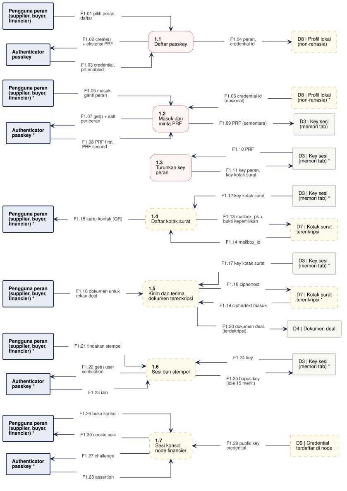

# DFD-2.1 - Identitas dan Sesi

**Bagian dari:** [[08 - FlowDiagrams]] · Legenda: [[FD-00 - Arsitektur Target dan Legenda]] · Induk: [[DFD-1 - Proses Utama]] · Sequence: [[SEQ-00 - Autentikasi dan Onboarding]]

Proses 1.0 dirinci: daftar dan masuk dengan passkey (WebAuthn PRF), turunan key per peran, kotak surat dan kontak, sesi dan stempel, pairing node financier, dan sesi konsol node. Pengiriman dokumen antarpihak tidak digambar di sini: setiap proses lain menulis dan membaca D7 sendiri dengan `mailbox_pk` penerima dari D19. Dasar: `src/lib/passkey.ts`, wasm `buyerKeys`, usulan P-01 – P-05, P-07, P-11.

Satu jalur = satu proses. Kotak bertanda `*` adalah entitas atau penyimpanan yang sama, digambar ulang supaya garis tidak bersilang. Proses bergaris penuh = ADA atau PARSIAL (rinciannya di kolom Status), kuning putus-putus = USULAN. Penyimpanan lokal proses ini (tidak muncul di level 1): D8 Profil lokal (non-rahasia), D9 Credential terdaftar di node.



```plantuml
@startuml dfd-2-1
!include dfd-style.iuml
left to right direction
skinparam nodesep 12
skinparam ranksep 35
rectangle "D9 | Credential\nterdaftar di node *" <<storeproposal>> as D9_7
rectangle "Authenticator\npasskey *" <<entity>> as A_7
rectangle "Financier *" <<entity>> as F_7
rectangle "D2 | Node financier\n(wallet, key,\nwatch-only papan) *" <<store>> as D2_6
rectangle "D9 | Credential\nterdaftar di node" <<storeproposal>> as D9_6
rectangle "Authenticator\npasskey *" <<entity>> as A_6
rectangle "Financier *" <<entity>> as F_6
rectangle "D3 | Key sesi\n(memori tab) *" <<store>> as D3_5
rectangle "Authenticator\npasskey *" <<entity>> as A_5
rectangle "Buyer *" <<entity>> as B_5
rectangle "Supplier *" <<entity>> as S_5
rectangle "Anggota dana *" <<entity>> as M_4
rectangle "D19 | Kontak rekan\n(mailbox_pk)" <<storeproposal>> as D19_4
rectangle "Financier" <<entity>> as F_4
rectangle "Buyer *" <<entity>> as B_4
rectangle "Supplier *" <<entity>> as S_4
rectangle "D7 | Kotak surat\nterenkripsi" <<storeproposal>> as D7_4
rectangle "D2 | Node financier\n(wallet, key,\nwatch-only papan)" <<store>> as D2_4
rectangle "D3 | Key sesi\n(memori tab) *" <<store>> as D3_4
rectangle "D3 | Key sesi\n(memori tab) *" <<store>> as D3_3
rectangle "D3 | Key sesi\n(memori tab)" <<store>> as D3_2
rectangle "Authenticator\npasskey *" <<entity>> as A_2
rectangle "D8 | Profil lokal\n(non-rahasia) *" <<storeproposal>> as D8_2
rectangle "Anggota dana *" <<entity>> as M_2
rectangle "Buyer *" <<entity>> as B_2
rectangle "Supplier *" <<entity>> as S_2
rectangle "D8 | Profil lokal\n(non-rahasia)" <<storeproposal>> as D8_1
rectangle "Authenticator\npasskey" <<entity>> as A_1
rectangle "Anggota dana" <<entity>> as M_1
rectangle "Buyer" <<entity>> as B_1
rectangle "Supplier" <<entity>> as S_1
rectangle "**1.7**\nSesi konsol\nnode financier" <<proposal>> as P7
rectangle "**1.6**\nPasangkan node\nfinancier" <<proposal>> as P6
rectangle "**1.5**\nSesi dan stempel" <<process>> as P5
rectangle "**1.4**\nKotak surat\ndan kontak" <<proposal>> as P4
rectangle "**1.3**\nTurunkan key\nperan" <<process>> as P3
rectangle "**1.2**\nMasuk dan\nminta PRF" <<process>> as P2
rectangle "**1.1**\nDaftar passkey" <<process>> as P1
rectangle "F1.01 daftar sebagai supplier" <<flow>> as f_F1_01
rectangle "F1.02 daftar sebagai buyer" <<flow>> as f_F1_02
rectangle "F1.03 daftar sebagai anggota" <<flow>> as f_F1_03
rectangle "F1.04 create() sekali per orang\n+ ekstensi PRF" <<flow>> as f_F1_04
rectangle "F1.05 credential, prf.enabled" <<flow>> as f_F1_05
rectangle "F1.06 credential id,\nperan yang dipakai" <<flow>> as f_F1_06
rectangle "F1.07 masuk" <<flow>> as f_F1_07
rectangle "F1.08 masuk" <<flow>> as f_F1_08
rectangle "F1.09 masuk" <<flow>> as f_F1_09
rectangle "F1.10 credential id\n(allowCredentials)" <<flow>> as f_F1_10
rectangle "F1.11 get() + salt peran\ndan salt inbox" <<flow>> as f_F1_11
rectangle "F1.12 PRF first,\nPRF second" <<flow>> as f_F1_12
rectangle "F1.13 PRF (sementara)" <<flow>> as f_F1_13
rectangle "F1.14 PRF" <<flow>> as f_F1_14
rectangle "F1.15 key publik peran,\nkey kotak surat" <<flow>> as f_F1_15
rectangle "F1.16 key kotak surat,\nkey publik peran" <<flow>> as f_F1_16
rectangle "F1.17 key kotak surat financier\n(di node)" <<flow>> as f_F1_17
rectangle "F1.18 mailbox_pk +\nbukti kepemilikan" <<flow>> as f_F1_18
rectangle "F1.19 mailbox_id =\nBLAKE2b(mailbox_pk)" <<flow>> as f_F1_19
rectangle "F1.20 kartu kontak rekan" <<flow>> as f_F1_20
rectangle "F1.21 kartu kontak rekan" <<flow>> as f_F1_21
rectangle "F1.22 kartu kontak rekan" <<flow>> as f_F1_22
rectangle "F1.23 kontak: peran,\nmailbox_pk, key publik" <<flow>> as f_F1_23
rectangle "F1.24 kartu kontak" <<flow>> as f_F1_24
rectangle "F1.25 kartu kontak\n(tanpa identity_pk)" <<flow>> as f_F1_25
rectangle "F1.26 kartu kontak" <<flow>> as f_F1_26
rectangle "F1.27 kartu kontak" <<flow>> as f_F1_27
rectangle "F1.28 tindakan stempel" <<flow>> as f_F1_28
rectangle "F1.29 tindakan stempel" <<flow>> as f_F1_29
rectangle "F1.30 get() user\nverification" <<flow>> as f_F1_30
rectangle "F1.31 PRF (stempel)" <<flow>> as f_F1_31
rectangle "F1.32 key tanda tangan sekali\npakai; sesi terkunci" <<flow>> as f_F1_32
rectangle "F1.33 pairing, UFVK papan\n+ birthday" <<flow>> as f_F1_33
rectangle "F1.34 kode pairing\n+ challenge" <<flow>> as f_F1_34
rectangle "F1.35 create() untuk\nrp konsol node" <<flow>> as f_F1_35
rectangle "F1.36 attestation\n(passkey konsol)" <<flow>> as f_F1_36
rectangle "F1.37 public key\ncredential" <<flow>> as f_F1_37
rectangle "F1.38 wallet baru (seed di node), key\nfinancier, key kotak surat,\nwatch-only papan" <<flow>> as f_F1_38
rectangle "F1.39 buka konsol" <<flow>> as f_F1_39
rectangle "F1.40 challenge" <<flow>> as f_F1_40
rectangle "F1.41 assertion" <<flow>> as f_F1_41
rectangle "F1.42 public key\ncredential" <<flow>> as f_F1_42
rectangle "F1.43 sesi konsol\n(cookie __Host-)" <<flow>> as f_F1_43
S_1 -- f_F1_01
f_F1_01 --> P1
B_1 -- f_F1_02
f_F1_02 --> P1
M_1 -- f_F1_03
f_F1_03 --> P1
A_1 <-- f_F1_04
f_F1_04 -- P1
A_1 -- f_F1_05
f_F1_05 --> P1
P1 -- f_F1_06
f_F1_06 --> D8_1
S_2 -- f_F1_07
f_F1_07 --> P2
B_2 -- f_F1_08
f_F1_08 --> P2
M_2 -- f_F1_09
f_F1_09 --> P2
P2 <-- f_F1_10
f_F1_10 -- D8_2
A_2 <-- f_F1_11
f_F1_11 -- P2
A_2 -- f_F1_12
f_F1_12 --> P2
P2 -- f_F1_13
f_F1_13 --> D3_2
P3 <-- f_F1_14
f_F1_14 -- D3_3
P3 -- f_F1_15
f_F1_15 --> D3_3
P4 <-- f_F1_16
f_F1_16 -- D3_4
P4 <-- f_F1_17
f_F1_17 -- D2_4
P4 -- f_F1_18
f_F1_18 --> D7_4
P4 <-- f_F1_19
f_F1_19 -- D7_4
S_4 -- f_F1_20
f_F1_20 --> P4
B_4 -- f_F1_21
f_F1_21 --> P4
F_4 -- f_F1_22
f_F1_22 --> P4
P4 -- f_F1_23
f_F1_23 --> D19_4
S_4 <-- f_F1_24
f_F1_24 -- P4
B_4 <-- f_F1_25
f_F1_25 -- P4
F_4 <-- f_F1_26
f_F1_26 -- P4
M_4 <-- f_F1_27
f_F1_27 -- P4
S_5 -- f_F1_28
f_F1_28 --> P5
B_5 -- f_F1_29
f_F1_29 --> P5
A_5 <-- f_F1_30
f_F1_30 -- P5
A_5 -- f_F1_31
f_F1_31 --> P5
P5 -- f_F1_32
f_F1_32 --> D3_5
F_6 -- f_F1_33
f_F1_33 --> P6
F_6 <-- f_F1_34
f_F1_34 -- P6
A_6 <-- f_F1_35
f_F1_35 -- P6
A_6 -- f_F1_36
f_F1_36 --> P6
P6 -- f_F1_37
f_F1_37 --> D9_6
P6 -- f_F1_38
f_F1_38 --> D2_6
F_7 -- f_F1_39
f_F1_39 --> P7
A_7 <-- f_F1_40
f_F1_40 -- P7
A_7 -- f_F1_41
f_F1_41 --> P7
P7 <-- f_F1_42
f_F1_42 -- D9_7
F_7 <-- f_F1_43
f_F1_43 -- P7
rectangle " " <<spacer>> as sp_P3_a
rectangle " " <<spacer>> as sp_P3_b
sp_P3_a -[hidden]- sp_P3_b
sp_P3_b -[hidden]- P3
@enduml
```

## Proses

| Proses | Isi | Status | Kode / item |
|---|---|---|---|
| 1.1 Daftar passkey | Supplier, buyer, anggota dana di web app (financier tidak daftar di sini, lihat 1.6). Satu `create()` per orang (user.name netral peran, `excludeCredentials`), `residentKey` dan `userVerification` required, ekstensi PRF; tolak authenticator tanpa PRF dan minta pengguna menghapus credential yatim. Menambah peran = `get()` dengan salt peran itu, bukan `create()` baru | ADA (HNK-22.T1, PR #4; authenticator nyata belum diuji, HNK-22.T7) | `registerPasskey`, P-01 |
| 1.2 Masuk dan minta PRF | `get()` dengan `allowCredentials` dari profil bila ada; `prf.eval.first` = SHA-256("jitsuin/<peran>/master/v1") (bukan financier), `second` = SHA-256("jitsuin/<peran>/inbox/v1") | ADA (HNK-22.T2, PR #4: supplier, buyer, anggota; salt buyer tetap; authenticator nyata belum diuji) | `evaluatePrf`, P-02 |
| 1.3 Turunkan key peran | Buyer: key identitas + key per invoice (keyed BLAKE2b). Supplier: master untuk key per invoice (P-03). Financier: tanpa key tanda tangan di browser (P-05). Tampilkan sidik jari key publik supaya pengguna tahu passkey yang dipilih benar | ADA (buyer, supplier; sidik jari HMAC master, DEV-18) | wasm `buyerKeysBytes`, `supplierInvoicePublicKeyBytes`, `fingerprint` |
| 1.4 Kotak surat dan kontak | X25519 dari PRF second (financier: key dibuat dan disimpan di node, P-11); `mailbox_id` = BLAKE2b(`mailbox_pk`), jadi bisa dihitung ulang di perangkat baru. Kartu kontak rekan disimpan di D19; kartu buyer tanpa `identity_pk`. Baca kotak surat wajib bukti kepemilikan: relay mengenkripsi challenge ke `mailbox_pk`, klien membukanya | USULAN | P-04 |
| 1.5 Sesi dan stempel | Di sesi hanya key kotak surat dan key publik. Setiap stempel meminta PRF baru dan memanggil export wasm `*Bytes`, yang menolkan `Uint8Array` itu setelah dipakai (HNK-27.T9). Ini pengecekan niat (UX), bukan kontrol keamanan: skrip di tab yang sama tetap bisa meminta PRF | ADA (HNK-22.T4, PR #4: stempel per tanda tangan, kunci 15 menit) | U-HNK-22.1, P-07 |
| 1.6 Pasangkan node financier | Satu-satunya pendaftaran financier. Node: seed, key financier, dan key kotak surat dibuat di node, UFVK papan diimpor watch-only. Konsol: kode pairing sekali pakai + challenge, `create()` untuk rp domain node, attestation disimpan di D9. Node butuh domain + HTTPS (atau localhost/tunnel SSH) | USULAN (sekarang manual lewat CLI) | P-05 |
| 1.7 Sesi konsol node financier | Challenge sekali pakai dengan kedaluwarsa; node memeriksa signature, origin, rpIdHash, flag UV; cookie `Secure`, `__Host-`, `HttpOnly`, `SameSite=Strict` | USULAN | P-05, P-11, HNK-05.T3 |

## Aliran data

| Aliran | Dari | Ke | Data |
|---|---|---|---|
| F1.01 | Supplier | 1.1 Daftar passkey | daftar sebagai supplier |
| F1.02 | Buyer | 1.1 Daftar passkey | daftar sebagai buyer |
| F1.03 | Anggota dana | 1.1 Daftar passkey | daftar sebagai anggota |
| F1.04 | 1.1 Daftar passkey | Authenticator passkey | create() sekali per orang + ekstensi PRF |
| F1.05 | Authenticator passkey | 1.1 Daftar passkey | credential, prf.enabled |
| F1.06 | 1.1 Daftar passkey | D8 Profil lokal (non-rahasia) | credential id, peran yang dipakai |
| F1.07 | Supplier | 1.2 Masuk dan minta PRF | masuk |
| F1.08 | Buyer | 1.2 Masuk dan minta PRF | masuk |
| F1.09 | Anggota dana | 1.2 Masuk dan minta PRF | masuk |
| F1.10 | D8 Profil lokal (non-rahasia) | 1.2 Masuk dan minta PRF | credential id (allowCredentials) |
| F1.11 | 1.2 Masuk dan minta PRF | Authenticator passkey | get() + salt peran dan salt inbox |
| F1.12 | Authenticator passkey | 1.2 Masuk dan minta PRF | PRF first, PRF second |
| F1.13 | 1.2 Masuk dan minta PRF | D3 Key sesi (memori tab) | PRF (sementara) |
| F1.14 | D3 Key sesi (memori tab) | 1.3 Turunkan key peran | PRF |
| F1.15 | 1.3 Turunkan key peran | D3 Key sesi (memori tab) | key publik peran, key kotak surat |
| F1.16 | D3 Key sesi (memori tab) | 1.4 Kotak surat dan kontak | key kotak surat, key publik peran |
| F1.17 | D2 Node financier (wallet, key, watch-only papan) | 1.4 Kotak surat dan kontak | key kotak surat financier (di node) |
| F1.18 | 1.4 Kotak surat dan kontak | D7 Kotak surat terenkripsi | mailbox_pk + bukti kepemilikan |
| F1.19 | D7 Kotak surat terenkripsi | 1.4 Kotak surat dan kontak | mailbox_id = BLAKE2b(mailbox_pk) |
| F1.20 | Supplier | 1.4 Kotak surat dan kontak | kartu kontak rekan |
| F1.21 | Buyer | 1.4 Kotak surat dan kontak | kartu kontak rekan |
| F1.22 | Financier | 1.4 Kotak surat dan kontak | kartu kontak rekan |
| F1.23 | 1.4 Kotak surat dan kontak | D19 Kontak rekan (mailbox_pk) | kontak: peran, mailbox_pk, key publik |
| F1.24 | 1.4 Kotak surat dan kontak | Supplier | kartu kontak |
| F1.25 | 1.4 Kotak surat dan kontak | Buyer | kartu kontak (tanpa identity_pk) |
| F1.26 | 1.4 Kotak surat dan kontak | Financier | kartu kontak |
| F1.27 | 1.4 Kotak surat dan kontak | Anggota dana | kartu kontak |
| F1.28 | Supplier | 1.5 Sesi dan stempel | tindakan stempel |
| F1.29 | Buyer | 1.5 Sesi dan stempel | tindakan stempel |
| F1.30 | 1.5 Sesi dan stempel | Authenticator passkey | get() user verification |
| F1.31 | Authenticator passkey | 1.5 Sesi dan stempel | PRF (stempel) |
| F1.32 | 1.5 Sesi dan stempel | D3 Key sesi (memori tab) | key tanda tangan sekali pakai; sesi terkunci |
| F1.33 | Financier | 1.6 Pasangkan node financier | pairing, UFVK papan + birthday |
| F1.34 | 1.6 Pasangkan node financier | Financier | kode pairing + challenge |
| F1.35 | 1.6 Pasangkan node financier | Authenticator passkey | create() untuk rp konsol node |
| F1.36 | Authenticator passkey | 1.6 Pasangkan node financier | attestation (passkey konsol) |
| F1.37 | 1.6 Pasangkan node financier | D9 Credential terdaftar di node | public key credential |
| F1.38 | 1.6 Pasangkan node financier | D2 Node financier (wallet, key, watch-only papan) | wallet baru (seed di node), key financier, key kotak surat, watch-only papan |
| F1.39 | Financier | 1.7 Sesi konsol node financier | buka konsol |
| F1.40 | 1.7 Sesi konsol node financier | Authenticator passkey | challenge |
| F1.41 | Authenticator passkey | 1.7 Sesi konsol node financier | assertion |
| F1.42 | D9 Credential terdaftar di node | 1.7 Sesi konsol node financier | public key credential |
| F1.43 | 1.7 Sesi konsol node financier | Financier | sesi konsol (cookie __Host-) |
