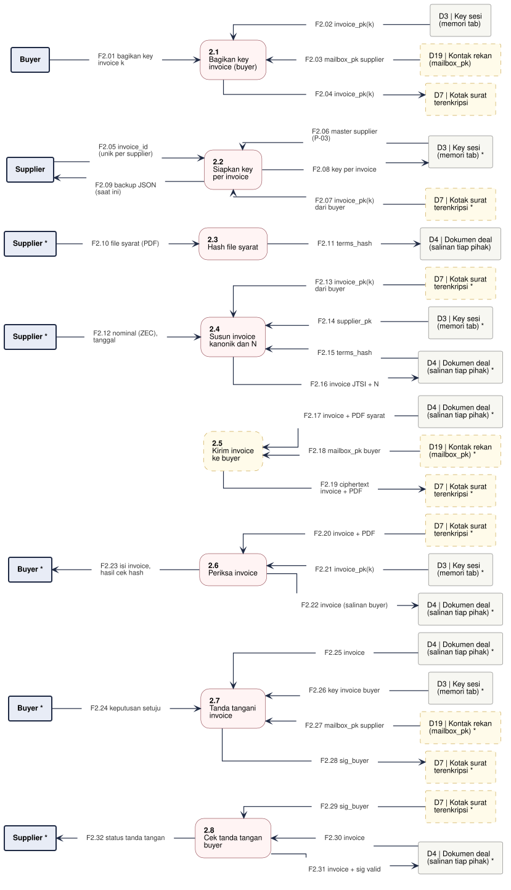

# DFD-2.2 - Penerbitan dan Tanda Tangan Invoice

**Bagian dari:** [[08 - FlowDiagrams]] · Legenda: [[FD-00 - Arsitektur Target dan Legenda]] · Induk: [[DFD-1 - Proses Utama]] · Sequence: [[SEQ-01 - Supplier]] · [[SEQ-02 - Buyer]]

Proses 2.0 dirinci: supplier menyiapkan key per invoice dan invoice kanonik, buyer memeriksa dan menandatanganinya. Dasar: `src/pages/supplier.ts`, `src/pages/buyer.ts`, `src/lib/core.ts`, wasm `publicKey`, `documentHash`, `invoiceEncode`, `invoiceDecode`, `buyerSignInvoice`, `bundleBuild`, `verifyBundle`; format di [[Format Data]].

Satu jalur = satu proses. Kotak bertanda `*` adalah entitas atau penyimpanan yang sama, digambar ulang supaya garis tidak bersilang. Kotak bergaris putus-putus kuning = usulan.



```plantuml
@startuml dfd-2-2
!include dfd-style.iuml
left to right direction
skinparam nodesep 12
skinparam ranksep 35
rectangle "Supplier *" <<entity>> as S_7
rectangle "D4 | Dokumen deal\n(lokal) *" <<store>> as D4_7
rectangle "D7 | Kotak surat\nterenkripsi *" <<storeproposal>> as D7_7
rectangle "D7 | Kotak surat\nterenkripsi *" <<storeproposal>> as D7_6
rectangle "D3 | Key sesi\n(memori tab) *" <<store>> as D3_6
rectangle "Buyer *" <<entity>> as B_6
rectangle "D3 | Key sesi\n(memori tab) *" <<store>> as D3_5
rectangle "Buyer" <<entity>> as B_5
rectangle "D7 | Kotak surat\nterenkripsi *" <<storeproposal>> as D7_5
rectangle "D7 | Kotak surat\nterenkripsi" <<storeproposal>> as D7_4
rectangle "D3 | Key sesi\n(memori tab) *" <<store>> as D3_4
rectangle "D4 | Dokumen deal\n(lokal) *" <<store>> as D4_4
rectangle "D4 | Dokumen deal\n(lokal) *" <<store>> as D4_3
rectangle "D3 | Key sesi\n(memori tab) *" <<store>> as D3_3
rectangle "Supplier *" <<entity>> as S_3
rectangle "D4 | Dokumen deal\n(lokal)" <<store>> as D4_2
rectangle "Supplier *" <<entity>> as S_2
rectangle "Supplier" <<entity>> as S_1
rectangle "D3 | Key sesi\n(memori tab)" <<store>> as D3_1
rectangle "**2.7**\nCek tanda tangan\nbuyer" <<process>> as P7
rectangle "**2.6**\nTandatangani\ninvoice" <<process>> as P6
rectangle "**2.5**\nPeriksa invoice" <<process>> as P5
rectangle "**2.4**\nKirim invoice\nke buyer" <<proposal>> as P4
rectangle "**2.3**\nSusun invoice\nkanonik dan N" <<process>> as P3
rectangle "**2.2**\nHash file syarat" <<process>> as P2
rectangle "**2.1**\nSiapkan key\nper invoice" <<process>> as P1
rectangle "F2.01 master supplier\n(P-03)" <<flow>> as f_F2_01
rectangle "F2.02 key per invoice" <<flow>> as f_F2_02
rectangle "F2.03 backup JSON\n(saat ini)" <<flow>> as f_F2_03
rectangle "F2.04 file syarat (PDF)" <<flow>> as f_F2_04
rectangle "F2.05 terms_hash" <<flow>> as f_F2_05
rectangle "F2.06 id, nominal (ZEC),\ntanggal, buyer_pk" <<flow>> as f_F2_06
rectangle "F2.07 supplier_pk" <<flow>> as f_F2_07
rectangle "F2.08 terms_hash" <<flow>> as f_F2_08
rectangle "F2.09 invoice JTSI + N" <<flow>> as f_F2_09
rectangle "F2.10 invoice" <<flow>> as f_F2_10
rectangle "F2.11 key kotak surat" <<flow>> as f_F2_11
rectangle "F2.12 ciphertext invoice" <<flow>> as f_F2_12
rectangle "F2.13 invoice" <<flow>> as f_F2_13
rectangle "F2.14 file syarat" <<flow>> as f_F2_14
rectangle "F2.15 invoice_pk(k)" <<flow>> as f_F2_15
rectangle "F2.16 isi invoice,\nhasil cek" <<flow>> as f_F2_16
rectangle "F2.17 keputusan setuju" <<flow>> as f_F2_17
rectangle "F2.18 key invoice buyer" <<flow>> as f_F2_18
rectangle "F2.19 sig_buyer" <<flow>> as f_F2_19
rectangle "F2.20 sig_buyer" <<flow>> as f_F2_20
rectangle "F2.21 invoice" <<flow>> as f_F2_21
rectangle "F2.22 invoice + sig valid" <<flow>> as f_F2_22
rectangle "F2.23 status tanda tangan" <<flow>> as f_F2_23
P1 <-- f_F2_01
f_F2_01 -- D3_1
P1 -- f_F2_02
f_F2_02 --> D3_1
S_1 <-- f_F2_03
f_F2_03 -- P1
S_2 -- f_F2_04
f_F2_04 --> P2
P2 -- f_F2_05
f_F2_05 --> D4_2
S_3 -- f_F2_06
f_F2_06 --> P3
P3 <-- f_F2_07
f_F2_07 -- D3_3
P3 <-- f_F2_08
f_F2_08 -- D4_3
P3 -- f_F2_09
f_F2_09 --> D4_3
P4 <-- f_F2_10
f_F2_10 -- D4_4
P4 <-- f_F2_11
f_F2_11 -- D3_4
P4 -- f_F2_12
f_F2_12 --> D7_4
P5 <-- f_F2_13
f_F2_13 -- D7_5
B_5 -- f_F2_14
f_F2_14 --> P5
P5 <-- f_F2_15
f_F2_15 -- D3_5
B_5 <-- f_F2_16
f_F2_16 -- P5
B_6 -- f_F2_17
f_F2_17 --> P6
P6 <-- f_F2_18
f_F2_18 -- D3_6
P6 -- f_F2_19
f_F2_19 --> D7_6
P7 <-- f_F2_20
f_F2_20 -- D7_7
P7 <-- f_F2_21
f_F2_21 -- D4_7
P7 -- f_F2_22
f_F2_22 --> D4_7
S_7 <-- f_F2_23
f_F2_23 -- P7
rectangle " " <<spacer>> as sp_P4_a
rectangle " " <<spacer>> as sp_P4_b
sp_P4_a -[hidden]- sp_P4_b
sp_P4_b -[hidden]- P4
@enduml
```

## Proses

| Proses | Isi | Status | Kode / item |
|---|---|---|---|
| 2.1 Siapkan key per invoice | Sekarang: 32 byte dari `crypto.getRandomValues` di JS + unduh backup JSON plaintext (temuan TM #10). Target: turunan master supplier dan `invoice_id` | ADA (akan diganti) / USULAN P-03 | `src/lib/core.ts`, `supplier.ts` |
| 2.2 Hash file syarat | SHA-256 file di browser; file tidak diunggah | ADA | wasm `documentHash` |
| 2.3 Susun invoice kanonik dan N | Nominal diisi dalam ZEC lalu dikonversi ke zat; JTSI dengan decoder ketat; N = BLAKE2b-256("JitsuinNullifier", byte kanonik) | ADA | wasm `invoiceEncode`, `invoiceDecode` |
| 2.4 Kirim invoice ke buyer | Lewat kotak surat buyer; sekarang salin-tempel | USULAN | P-04 |
| 2.5 Periksa invoice | Decode dan tampilkan; cek `buyer_pk` = `invoice_pk(k)` dan hash file belum ada di layar Buyer | PARSIAL | wasm `invoiceDecode`, `documentHash` |
| 2.6 Tandatangani invoice | Ed25519 atas byte kanonik dengan key invoice buyer | ADA | wasm `buyerSignInvoice` |
| 2.7 Cek tanda tangan buyer | `verify_strict` lewat bundel; belum ada fungsi verifikasi tunggal | PARSIAL | wasm `bundleBuild` + `verifyBundle` |

## Aliran data

| Aliran | Dari | Ke | Data |
|---|---|---|---|
| F2.01 | D3 Key sesi (memori tab) | 2.1 Siapkan key per invoice | master supplier (P-03) |
| F2.02 | 2.1 Siapkan key per invoice | D3 Key sesi (memori tab) | key per invoice |
| F2.03 | 2.1 Siapkan key per invoice | Supplier | backup JSON (saat ini) |
| F2.04 | Supplier | 2.2 Hash file syarat | file syarat (PDF) |
| F2.05 | 2.2 Hash file syarat | D4 Dokumen deal (lokal) | terms_hash |
| F2.06 | Supplier | 2.3 Susun invoice kanonik dan N | id, nominal (ZEC), tanggal, buyer_pk |
| F2.07 | D3 Key sesi (memori tab) | 2.3 Susun invoice kanonik dan N | supplier_pk |
| F2.08 | D4 Dokumen deal (lokal) | 2.3 Susun invoice kanonik dan N | terms_hash |
| F2.09 | 2.3 Susun invoice kanonik dan N | D4 Dokumen deal (lokal) | invoice JTSI + N |
| F2.10 | D4 Dokumen deal (lokal) | 2.4 Kirim invoice ke buyer | invoice |
| F2.11 | D3 Key sesi (memori tab) | 2.4 Kirim invoice ke buyer | key kotak surat |
| F2.12 | 2.4 Kirim invoice ke buyer | D7 Kotak surat terenkripsi | ciphertext invoice |
| F2.13 | D7 Kotak surat terenkripsi | 2.5 Periksa invoice | invoice |
| F2.14 | Buyer | 2.5 Periksa invoice | file syarat |
| F2.15 | D3 Key sesi (memori tab) | 2.5 Periksa invoice | invoice_pk(k) |
| F2.16 | 2.5 Periksa invoice | Buyer | isi invoice, hasil cek |
| F2.17 | Buyer | 2.6 Tandatangani invoice | keputusan setuju |
| F2.18 | D3 Key sesi (memori tab) | 2.6 Tandatangani invoice | key invoice buyer |
| F2.19 | 2.6 Tandatangani invoice | D7 Kotak surat terenkripsi | sig_buyer |
| F2.20 | D7 Kotak surat terenkripsi | 2.7 Cek tanda tangan buyer | sig_buyer |
| F2.21 | D4 Dokumen deal (lokal) | 2.7 Cek tanda tangan buyer | invoice |
| F2.22 | 2.7 Cek tanda tangan buyer | D4 Dokumen deal (lokal) | invoice + sig valid |
| F2.23 | 2.7 Cek tanda tangan buyer | Supplier | status tanda tangan |
