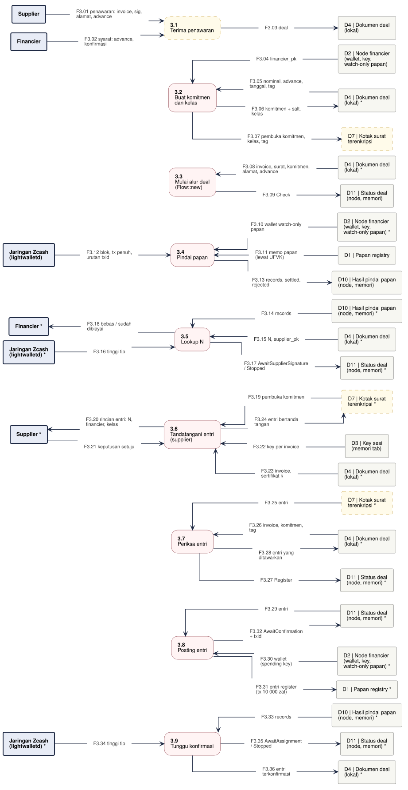

# DFD-2.3 - Registrasi Papan

**Bagian dari:** [[08 - FlowDiagrams]] · Legenda: [[FD-00 - Arsitektur Target dan Legenda]] · Induk: [[DFD-1 - Proses Utama]] · Sequence: [[SEQ-03 - Financier]] · [[SEQ-01 - Supplier]]

Proses 3.0 dirinci: dari penawaran sampai entri financier menjadi entri valid pertama untuk N dan terkonfirmasi. `Flow::new` sudah membutuhkan surat pengalihan (4.1) dan komitmen (3.2) sebelum cek papan. Dasar: `jitsuin-flow::financier` (`Deal`, `Flow`, `check`, `register`, `wait_for_confirmation`), `jitsuin-board` (`scan`, `collect`, `lookup`, `lwd`), wasm `supplierRegisterEntry`, `supplierRegisterHistoryEntry`, `jitsuin-core::index::classes_for`.

Satu jalur = satu proses. Kotak bertanda `*` adalah entitas atau penyimpanan yang sama, digambar ulang supaya garis tidak bersilang. Kotak bergaris putus-putus kuning = usulan.



```plantuml
@startuml dfd-2-3
!include dfd-style.iuml
left to right direction
skinparam nodesep 12
skinparam ranksep 35
rectangle "D4 | Dokumen deal\n(lokal) *" <<store>> as D4_9
rectangle "D11 | Status deal\n(node, memori) *" <<store>> as D11_9
rectangle "Jaringan Zcash\n(lightwalletd) *" <<entity>> as Z_9
rectangle "D10 | Hasil pindai papan\n(node, memori) *" <<store>> as D10_9
rectangle "D1 | Papan registry *" <<store>> as D1_8
rectangle "D2 | Node financier\n(wallet, key,\nwatch-only papan) *" <<store>> as D2_8
rectangle "D11 | Status deal\n(node, memori) *" <<store>> as D11_8
rectangle "D11 | Status deal\n(node, memori) *" <<store>> as D11_7
rectangle "D4 | Dokumen deal\n(lokal) *" <<store>> as D4_7
rectangle "D7 | Kotak surat\nterenkripsi *" <<storeproposal>> as D7_7
rectangle "D4 | Dokumen deal\n(lokal) *" <<store>> as D4_6
rectangle "D3 | Key sesi\n(memori tab)" <<store>> as D3_6
rectangle "Supplier *" <<entity>> as S_6
rectangle "D7 | Kotak surat\nterenkripsi *" <<storeproposal>> as D7_6
rectangle "Financier *" <<entity>> as F_5
rectangle "D11 | Status deal\n(node, memori) *" <<store>> as D11_5
rectangle "Jaringan Zcash\n(lightwalletd) *" <<entity>> as Z_5
rectangle "D4 | Dokumen deal\n(lokal) *" <<store>> as D4_5
rectangle "D10 | Hasil pindai papan\n(node, memori) *" <<store>> as D10_5
rectangle "D10 | Hasil pindai papan\n(node, memori)" <<store>> as D10_4
rectangle "Jaringan Zcash\n(lightwalletd)" <<entity>> as Z_4
rectangle "D1 | Papan registry" <<store>> as D1_4
rectangle "D2 | Node financier\n(wallet, key,\nwatch-only papan) *" <<store>> as D2_4
rectangle "D11 | Status deal\n(node, memori)" <<store>> as D11_3
rectangle "D4 | Dokumen deal\n(lokal) *" <<store>> as D4_3
rectangle "D7 | Kotak surat\nterenkripsi" <<storeproposal>> as D7_2
rectangle "D4 | Dokumen deal\n(lokal) *" <<store>> as D4_2
rectangle "D2 | Node financier\n(wallet, key,\nwatch-only papan)" <<store>> as D2_2
rectangle "D4 | Dokumen deal\n(lokal)" <<store>> as D4_1
rectangle "Financier" <<entity>> as F_1
rectangle "Supplier" <<entity>> as S_1
rectangle "**3.9**\nTunggu konfirmasi" <<process>> as P9
rectangle "**3.8**\nPosting entri" <<process>> as P8
rectangle "**3.7**\nPeriksa entri" <<process>> as P7
rectangle "**3.6**\nTandatangani entri\n(supplier)" <<process>> as P6
rectangle "**3.5**\nLookup N" <<process>> as P5
rectangle "**3.4**\nPindai papan" <<process>> as P4
rectangle "**3.3**\nMulai alur deal\n(Flow::new)" <<process>> as P3
rectangle "**3.2**\nBuat komitmen\ndan kelas" <<process>> as P2
rectangle "**3.1**\nTerima penawaran" <<proposal>> as P1
rectangle "F3.01 penawaran: invoice, sig,\nalamat, advance" <<flow>> as f_F3_01
rectangle "F3.02 syarat: advance,\nkonfirmasi" <<flow>> as f_F3_02
rectangle "F3.03 deal" <<flow>> as f_F3_03
rectangle "F3.04 financier_pk" <<flow>> as f_F3_04
rectangle "F3.05 nominal, advance,\ntanggal, tag" <<flow>> as f_F3_05
rectangle "F3.06 komitmen + salt,\nkelas" <<flow>> as f_F3_06
rectangle "F3.07 pembuka komitmen,\nkelas, tag" <<flow>> as f_F3_07
rectangle "F3.08 invoice, surat, komitmen,\nalamat, advance" <<flow>> as f_F3_08
rectangle "F3.09 Check" <<flow>> as f_F3_09
rectangle "F3.10 wallet watch-only\npapan" <<flow>> as f_F3_10
rectangle "F3.11 memo papan\n(lewat UFVK)" <<flow>> as f_F3_11
rectangle "F3.12 blok, tx penuh,\nurutan txid" <<flow>> as f_F3_12
rectangle "F3.13 records, settled,\nrejected" <<flow>> as f_F3_13
rectangle "F3.14 records" <<flow>> as f_F3_14
rectangle "F3.15 N, supplier_pk" <<flow>> as f_F3_15
rectangle "F3.16 tinggi tip" <<flow>> as f_F3_16
rectangle "F3.17 AwaitSupplierSignature\n/ Stopped" <<flow>> as f_F3_17
rectangle "F3.18 bebas / sudah\ndibiayai" <<flow>> as f_F3_18
rectangle "F3.19 pembuka komitmen" <<flow>> as f_F3_19
rectangle "F3.20 rincian entri: N,\nfinancier, kelas" <<flow>> as f_F3_20
rectangle "F3.21 keputusan setuju" <<flow>> as f_F3_21
rectangle "F3.22 key per invoice" <<flow>> as f_F3_22
rectangle "F3.23 invoice,\nsertifikat k" <<flow>> as f_F3_23
rectangle "F3.24 entri bertanda\ntangan" <<flow>> as f_F3_24
rectangle "F3.25 entri" <<flow>> as f_F3_25
rectangle "F3.26 invoice, komitmen,\ntag" <<flow>> as f_F3_26
rectangle "F3.27 Register" <<flow>> as f_F3_27
rectangle "F3.28 entri yang\nditawarkan" <<flow>> as f_F3_28
rectangle "F3.29 entri" <<flow>> as f_F3_29
rectangle "F3.30 wallet\n(spending key)" <<flow>> as f_F3_30
rectangle "F3.31 entri register\n(tx 10 000 zat)" <<flow>> as f_F3_31
rectangle "F3.32 AwaitConfirmation\n+ txid" <<flow>> as f_F3_32
rectangle "F3.33 records" <<flow>> as f_F3_33
rectangle "F3.34 tinggi tip" <<flow>> as f_F3_34
rectangle "F3.35 AwaitAssignment\n/ Stopped" <<flow>> as f_F3_35
rectangle "F3.36 entri\nterkonfirmasi" <<flow>> as f_F3_36
S_1 -- f_F3_01
f_F3_01 --> P1
F_1 -- f_F3_02
f_F3_02 --> P1
P1 -- f_F3_03
f_F3_03 --> D4_1
P2 <-- f_F3_04
f_F3_04 -- D2_2
P2 <-- f_F3_05
f_F3_05 -- D4_2
P2 -- f_F3_06
f_F3_06 --> D4_2
P2 -- f_F3_07
f_F3_07 --> D7_2
P3 <-- f_F3_08
f_F3_08 -- D4_3
P3 -- f_F3_09
f_F3_09 --> D11_3
P4 <-- f_F3_10
f_F3_10 -- D2_4
P4 <-- f_F3_11
f_F3_11 -- D1_4
Z_4 -- f_F3_12
f_F3_12 --> P4
P4 -- f_F3_13
f_F3_13 --> D10_4
P5 <-- f_F3_14
f_F3_14 -- D10_5
P5 <-- f_F3_15
f_F3_15 -- D4_5
Z_5 -- f_F3_16
f_F3_16 --> P5
P5 -- f_F3_17
f_F3_17 --> D11_5
F_5 <-- f_F3_18
f_F3_18 -- P5
P6 <-- f_F3_19
f_F3_19 -- D7_6
S_6 <-- f_F3_20
f_F3_20 -- P6
S_6 -- f_F3_21
f_F3_21 --> P6
P6 <-- f_F3_22
f_F3_22 -- D3_6
P6 <-- f_F3_23
f_F3_23 -- D4_6
P6 -- f_F3_24
f_F3_24 --> D7_6
P7 <-- f_F3_25
f_F3_25 -- D7_7
P7 <-- f_F3_26
f_F3_26 -- D4_7
P7 -- f_F3_27
f_F3_27 --> D11_7
P7 -- f_F3_28
f_F3_28 --> D4_7
P8 <-- f_F3_29
f_F3_29 -- D11_8
P8 <-- f_F3_30
f_F3_30 -- D2_8
P8 -- f_F3_31
f_F3_31 --> D1_8
P8 -- f_F3_32
f_F3_32 --> D11_8
P9 <-- f_F3_33
f_F3_33 -- D10_9
Z_9 -- f_F3_34
f_F3_34 --> P9
P9 -- f_F3_35
f_F3_35 --> D11_9
P9 -- f_F3_36
f_F3_36 --> D4_9
rectangle " " <<spacer>> as sp_P2_a
rectangle " " <<spacer>> as sp_P2_b
sp_P2_a -[hidden]- sp_P2_b
sp_P2_b -[hidden]- P2
rectangle " " <<spacer>> as sp_P3_a
rectangle " " <<spacer>> as sp_P3_b
sp_P3_a -[hidden]- sp_P3_b
sp_P3_b -[hidden]- P3
rectangle " " <<spacer>> as sp_P7_a
rectangle " " <<spacer>> as sp_P7_b
sp_P7_a -[hidden]- sp_P7_b
sp_P7_b -[hidden]- P7
rectangle " " <<spacer>> as sp_P8_a
rectangle " " <<spacer>> as sp_P8_b
sp_P8_a -[hidden]- sp_P8_b
sp_P8_b -[hidden]- P8
@enduml
```

## Proses

| Proses | Isi | Status | Kode / item |
|---|---|---|---|
| 3.1 Terima penawaran | Supplier mengirim invoice + tanda tangan buyer + alamat advance; financier menetapkan advance dan `min_confirmations` ≥ 1 | USULAN (relay); `Deal` ADA | `financier::Deal`, P-04 |
| 3.2 Buat komitmen dan kelas | `financier_commitment = BLAKE2b(financier_pk ‖ salt)`; salt CSPRNG 32 byte; kelas diskon/tenor dari `classes_for(nominal, advance, tanggal advance, jatuh tempo)` | PARSIAL: salt diisi pemanggil (P-08); `classes_for` belum dipanggil di flow maupun wasm (entri selalu 0/0); `check_entry` tidak memeriksa kelas | `financier_commitment`, `index::classes_for` |
| 3.3 Mulai alur deal | `Flow::new` memeriksa `min_confirmations`, advance, alamat, dan bahwa surat milik invoice (`assignment.verify(&invoice, &[])`) | ADA | `Flow::new` |
| 3.4 Pindai papan | `sync`, `enhance`, `list_tx` wallet watch-only di node; `block_txids` per tinggi; `collect`, urut (tinggi, indeks tx, indeks output) | ADA | `jitsuin_board::scan` |
| 3.5 Lookup N | Entri valid pertama menang; tanda tangan tidak valid diabaikan; komitmen sendiri (lanjut dari state sebelumnya), komitmen lain (`AlreadyFinanced`), lebih dari satu komitmen (`DoubleFinanced`) | ADA | `lookup`, `Flow::on_board` |
| 3.6 Tandatangani entri | Entri `0x01` atau `0x03` (dengan sertifikat k untuk tag), key per invoice supplier | PARSIAL (wasm ADA, layar belum) | wasm `supplierRegisterEntry`, `supplierRegisterHistoryEntry` |
| 3.7 Periksa entri | Jenis register, N, komitmen, tag riwayat, tanda tangan supplier; entri disimpan untuk bukti (7.2) | ADA | `Flow::check_entry` |
| 3.8 Posting entri | 10 000 zat ke alamat papan + fee ZIP-317; tidak ada cek papan ulang dan tidak ada pemulihan seperti `sent_advance` (crash sebelum tertambang bisa membuat posting ganda; entri bertag ganda = `Equivocation`, Spec #2) | ADA (dengan celah) | `Financier::register` |
| 3.9 Tunggu konfirmasi | Poll sampai konfirmasi ≥ minimum; reorg kembali ke `AwaitConfirmation`; konflik baru `Stopped`; `Error::Timeout` | ADA | `wait_for_confirmation` |

## Aliran data

| Aliran | Dari | Ke | Data |
|---|---|---|---|
| F3.01 | Supplier | 3.1 Terima penawaran | penawaran: invoice, sig, alamat, advance |
| F3.02 | Financier | 3.1 Terima penawaran | syarat: advance, konfirmasi |
| F3.03 | 3.1 Terima penawaran | D4 Dokumen deal (lokal) | deal |
| F3.04 | D2 Node financier (wallet, key, watch-only papan) | 3.2 Buat komitmen dan kelas | financier_pk |
| F3.05 | D4 Dokumen deal (lokal) | 3.2 Buat komitmen dan kelas | nominal, advance, tanggal, tag |
| F3.06 | 3.2 Buat komitmen dan kelas | D4 Dokumen deal (lokal) | komitmen + salt, kelas |
| F3.07 | 3.2 Buat komitmen dan kelas | D7 Kotak surat terenkripsi | pembuka komitmen, kelas, tag |
| F3.08 | D4 Dokumen deal (lokal) | 3.3 Mulai alur deal (Flow::new) | invoice, surat, komitmen, alamat, advance |
| F3.09 | 3.3 Mulai alur deal (Flow::new) | D11 Status deal (node, memori) | Check |
| F3.10 | D2 Node financier (wallet, key, watch-only papan) | 3.4 Pindai papan | wallet watch-only papan |
| F3.11 | D1 Papan registry | 3.4 Pindai papan | memo papan (lewat UFVK) |
| F3.12 | Jaringan Zcash (lightwalletd) | 3.4 Pindai papan | blok, tx penuh, urutan txid |
| F3.13 | 3.4 Pindai papan | D10 Hasil pindai papan (node, memori) | records, settled, rejected |
| F3.14 | D10 Hasil pindai papan (node, memori) | 3.5 Lookup N | records |
| F3.15 | D4 Dokumen deal (lokal) | 3.5 Lookup N | N, supplier_pk |
| F3.16 | Jaringan Zcash (lightwalletd) | 3.5 Lookup N | tinggi tip |
| F3.17 | 3.5 Lookup N | D11 Status deal (node, memori) | AwaitSupplierSignature / Stopped |
| F3.18 | 3.5 Lookup N | Financier | bebas / sudah dibiayai |
| F3.19 | D7 Kotak surat terenkripsi | 3.6 Tandatangani entri (supplier) | pembuka komitmen |
| F3.20 | 3.6 Tandatangani entri (supplier) | Supplier | rincian entri: N, financier, kelas |
| F3.21 | Supplier | 3.6 Tandatangani entri (supplier) | keputusan setuju |
| F3.22 | D3 Key sesi (memori tab) | 3.6 Tandatangani entri (supplier) | key per invoice |
| F3.23 | D4 Dokumen deal (lokal) | 3.6 Tandatangani entri (supplier) | invoice, sertifikat k |
| F3.24 | 3.6 Tandatangani entri (supplier) | D7 Kotak surat terenkripsi | entri bertanda tangan |
| F3.25 | D7 Kotak surat terenkripsi | 3.7 Periksa entri | entri |
| F3.26 | D4 Dokumen deal (lokal) | 3.7 Periksa entri | invoice, komitmen, tag |
| F3.27 | 3.7 Periksa entri | D11 Status deal (node, memori) | Register |
| F3.28 | 3.7 Periksa entri | D4 Dokumen deal (lokal) | entri yang ditawarkan |
| F3.29 | D11 Status deal (node, memori) | 3.8 Posting entri | entri |
| F3.30 | D2 Node financier (wallet, key, watch-only papan) | 3.8 Posting entri | wallet (spending key) |
| F3.31 | 3.8 Posting entri | D1 Papan registry | entri register (tx 10 000 zat) |
| F3.32 | 3.8 Posting entri | D11 Status deal (node, memori) | AwaitConfirmation + txid |
| F3.33 | D10 Hasil pindai papan (node, memori) | 3.9 Tunggu konfirmasi | records |
| F3.34 | Jaringan Zcash (lightwalletd) | 3.9 Tunggu konfirmasi | tinggi tip |
| F3.35 | 3.9 Tunggu konfirmasi | D11 Status deal (node, memori) | AwaitAssignment / Stopped |
| F3.36 | 3.9 Tunggu konfirmasi | D4 Dokumen deal (lokal) | entri terkonfirmasi |
