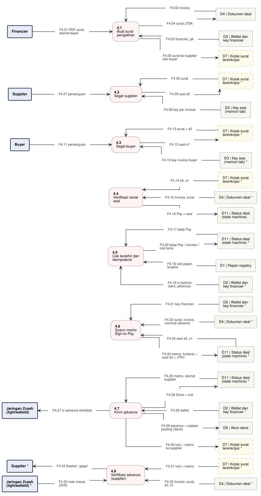

# DFD-2.4 - Pengalihan dan Advance

**Bagian dari:** [[08 - FlowDiagrams]] · Legenda: [[FD-00 - Arsitektur Target dan Legenda]] · Induk: [[DFD-1 - Proses Utama]] · Sequence: [[SEQ-03 - Financier]] · [[SEQ-01 - Supplier]] · [[SEQ-02 - Buyer]]

Proses 4.0 dirinci: surat pengalihan disegel supplier lalu buyer, lalu advance dikirim bersama seal financier dalam satu transaksi shielded (Sign-to-Pay). Surat dibuat sebelum 3.3; seal boleh dikumpulkan lebih awal, tetapi baru diterapkan di state `AwaitAssignment`. Dasar: wasm `assignmentEncode`, `supplierSealAssignment`, `buyerSealAssignment`, `assignmentStatus`; `jitsuin-flow::financier::pay_advance`, `sent_advance`; `jitsuin-flow::supplier::verify_sign_to_pay`; [[Desain Jitsuin Seal]].

Satu jalur = satu proses. Kotak bertanda `*` adalah entitas atau penyimpanan yang sama, digambar ulang supaya garis tidak bersilang. Proses bergaris penuh = ADA atau PARSIAL (rinciannya di kolom Status), kuning putus-putus = USULAN.



```plantuml
@startuml dfd-2-4
!include dfd-style.iuml
left to right direction
skinparam nodesep 12
skinparam ranksep 35
rectangle "Supplier *" <<entity>> as S_8
rectangle "D4 | Dokumen deal\n(salinan tiap pihak) *" <<store>> as D4_8
rectangle "D7 | Kotak surat\nterenkripsi *" <<storeproposal>> as D7_8
rectangle "Jaringan Zcash\n(lightwalletd) *" <<entity>> as Z_8
rectangle "D7 | Kotak surat\nterenkripsi *" <<storeproposal>> as D7_7
rectangle "D6 | Akun dana\n(operasional)" <<store>> as D6_7
rectangle "Jaringan Zcash\n(lightwalletd) *" <<entity>> as Z_7
rectangle "D2 | Node financier\n(wallet, key,\nwatch-only papan) *" <<store>> as D2_7
rectangle "D11 | Status deal\n(node, memori) *" <<store>> as D11_7
rectangle "D11 | Status deal\n(node, memori) *" <<store>> as D11_6
rectangle "D4 | Dokumen deal\n(salinan tiap pihak) *" <<store>> as D4_6
rectangle "D2 | Node financier\n(wallet, key,\nwatch-only papan) *" <<store>> as D2_6
rectangle "Financier *" <<entity>> as F_6
rectangle "D2 | Node financier\n(wallet, key,\nwatch-only papan) *" <<store>> as D2_5
rectangle "Jaringan Zcash\n(lightwalletd)" <<entity>> as Z_5
rectangle "D10 | Hasil pindai papan\n(node, memori)" <<store>> as D10_5
rectangle "D11 | Status deal\n(node, memori) *" <<store>> as D11_5
rectangle "D11 | Status deal\n(node, memori)" <<store>> as D11_4
rectangle "D4 | Dokumen deal\n(salinan tiap pihak) *" <<store>> as D4_4
rectangle "D7 | Kotak surat\nterenkripsi *" <<storeproposal>> as D7_4
rectangle "D3 | Key sesi\n(memori tab) *" <<store>> as D3_3
rectangle "Buyer" <<entity>> as B_3
rectangle "D4 | Dokumen deal\n(salinan tiap pihak) *" <<store>> as D4_3
rectangle "D7 | Kotak surat\nterenkripsi *" <<storeproposal>> as D7_3
rectangle "D3 | Key sesi\n(memori tab)" <<store>> as D3_2
rectangle "Supplier" <<entity>> as S_2
rectangle "D4 | Dokumen deal\n(salinan tiap pihak) *" <<store>> as D4_2
rectangle "D7 | Kotak surat\nterenkripsi *" <<storeproposal>> as D7_2
rectangle "D7 | Kotak surat\nterenkripsi" <<storeproposal>> as D7_1
rectangle "D19 | Kontak rekan\n(mailbox_pk)" <<storeproposal>> as D19_1
rectangle "D2 | Node financier\n(wallet, key,\nwatch-only papan)" <<store>> as D2_1
rectangle "D4 | Dokumen deal\n(salinan tiap pihak)" <<store>> as D4_1
rectangle "Financier" <<entity>> as F_1
rectangle "**4.8**\nVerifikasi advance\n(supplier)" <<process>> as P8
rectangle "**4.7**\nKirim advance" <<process>> as P7
rectangle "**4.6**\nSusun memo\nSign-to-Pay" <<process>> as P6
rectangle "**4.5**\nCek terakhir dan\nidempotensi" <<process>> as P5
rectangle "**4.4**\nVerifikasi rantai\nseal" <<process>> as P4
rectangle "**4.3**\nSegel buyer" <<process>> as P3
rectangle "**4.2**\nSegel supplier" <<process>> as P2
rectangle "**4.1**\nBuat surat\npengalihan" <<process>> as P1
rectangle "F4.01 PDF surat" <<flow>> as f_F4_01
rectangle "F4.02 invoice" <<flow>> as f_F4_02
rectangle "F4.03 financier_pk, alamat bayar\ndiversified baru (USULAN)" <<flow>> as f_F4_03
rectangle "F4.04 mailbox_pk supplier\ndan buyer" <<flow>> as f_F4_04
rectangle "F4.05 surat JTSA" <<flow>> as f_F4_05
rectangle "F4.06 surat + PDF surat ke\nsupplier dan buyer" <<flow>> as f_F4_06
rectangle "F4.07 surat + PDF" <<flow>> as f_F4_07
rectangle "F4.08 invoice" <<flow>> as f_F4_08
rectangle "F4.09 isi surat (assignmentDecode,\nUSULAN P-13), hash PDF" <<flow>> as f_F4_09
rectangle "F4.10 keputusan setuju" <<flow>> as f_F4_10
rectangle "F4.11 key per invoice" <<flow>> as f_F4_11
rectangle "F4.12 seal s0" <<flow>> as f_F4_12
rectangle "F4.13 s0 ke buyer\ndan financier" <<flow>> as f_F4_13
rectangle "F4.14 surat + PDF + s0" <<flow>> as f_F4_14
rectangle "F4.15 invoice (salinan buyer)" <<flow>> as f_F4_15
rectangle "F4.16 isi surat (USULAN P-13):\nalamat, financier, hash PDF" <<flow>> as f_F4_16
rectangle "F4.17 keputusan setuju" <<flow>> as f_F4_17
rectangle "F4.18 key invoice buyer" <<flow>> as f_F4_18
rectangle "F4.19 s1 ke financier\ndan supplier" <<flow>> as f_F4_19
rectangle "F4.20 s0, s1" <<flow>> as f_F4_20
rectangle "F4.21 invoice, surat" <<flow>> as f_F4_21
rectangle "F4.22 AwaitAssignment" <<flow>> as f_F4_22
rectangle "F4.23 Pay + seal" <<flow>> as f_F4_23
rectangle "F4.24 state Pay" <<flow>> as f_F4_24
rectangle "F4.25 cek papan terakhir\n(scan baru)" <<flow>> as f_F4_25
rectangle "F4.26 blok, tip,\ntx wallet (sync)" <<flow>> as f_F4_26
rectangle "F4.27 tx terkirim (sent_advance),\nkey node" <<flow>> as f_F4_27
rectangle "F4.28 tetap Pay / AwaitConfirmation /\nStopped / Done (txid lama)" <<flow>> as f_F4_28
rectangle "F4.29 tanggal kuitansi" <<flow>> as f_F4_29
rectangle "F4.30 key financier" <<flow>> as f_F4_30
rectangle "F4.31 surat, invoice,\nnominal advance" <<flow>> as f_F4_31
rectangle "F4.32 seal s0, s1" <<flow>> as f_F4_32
rectangle "F4.33 memo: kuitansi +\nseal s2 + JTN1" <<flow>> as f_F4_33
rectangle "F4.34 memo, alamat\nsupplier" <<flow>> as f_F4_34
rectangle "F4.35 wallet" <<flow>> as f_F4_35
rectangle "F4.36 tx advance\nshielded" <<flow>> as f_F4_36
rectangle "F4.37 tx advance\nterkirim" <<flow>> as f_F4_37
rectangle "F4.38 Done (terkirim,\nbelum tentu tertambang)" <<flow>> as f_F4_38
rectangle "F4.39 advance + catatan\npiutang (dana)" <<flow>> as f_F4_39
rectangle "F4.40 txid ke supplier;\ns2 ke buyer" <<flow>> as f_F4_40
rectangle "F4.41 output + memo tx advance\n(wallet supplier, CLI lokal)" <<flow>> as f_F4_41
rectangle "F4.42 txid, s1\n(petunjuk)" <<flow>> as f_F4_42
rectangle "F4.43 invoice, surat, s0,\nadvance yang disepakati" <<flow>> as f_F4_43
rectangle "F4.44 nominal di Zodl\n(jalur lemah)" <<flow>> as f_F4_44
rectangle "F4.45 Sealed / gagal" <<flow>> as f_F4_45
F_1 -- f_F4_01
f_F4_01 --> P1
P1 <-- f_F4_02
f_F4_02 -- D4_1
P1 <-- f_F4_03
f_F4_03 -- D2_1
P1 <-- f_F4_04
f_F4_04 -- D19_1
P1 -- f_F4_05
f_F4_05 --> D4_1
P1 -- f_F4_06
f_F4_06 --> D7_1
P2 <-- f_F4_07
f_F4_07 -- D7_2
P2 <-- f_F4_08
f_F4_08 -- D4_2
S_2 <-- f_F4_09
f_F4_09 -- P2
S_2 -- f_F4_10
f_F4_10 --> P2
P2 <-- f_F4_11
f_F4_11 -- D3_2
P2 -- f_F4_12
f_F4_12 --> D4_2
P2 -- f_F4_13
f_F4_13 --> D7_2
P3 <-- f_F4_14
f_F4_14 -- D7_3
P3 <-- f_F4_15
f_F4_15 -- D4_3
B_3 <-- f_F4_16
f_F4_16 -- P3
B_3 -- f_F4_17
f_F4_17 --> P3
P3 <-- f_F4_18
f_F4_18 -- D3_3
P3 -- f_F4_19
f_F4_19 --> D7_3
P4 <-- f_F4_20
f_F4_20 -- D7_4
P4 <-- f_F4_21
f_F4_21 -- D4_4
P4 <-- f_F4_22
f_F4_22 -- D11_4
P4 -- f_F4_23
f_F4_23 --> D11_4
P5 <-- f_F4_24
f_F4_24 -- D11_5
P5 <-- f_F4_25
f_F4_25 -- D10_5
Z_5 -- f_F4_26
f_F4_26 --> P5
P5 <-- f_F4_27
f_F4_27 -- D2_5
P5 -- f_F4_28
f_F4_28 --> D11_5
F_6 -- f_F4_29
f_F4_29 --> P6
P6 <-- f_F4_30
f_F4_30 -- D2_6
P6 <-- f_F4_31
f_F4_31 -- D4_6
P6 <-- f_F4_32
f_F4_32 -- D11_6
P6 -- f_F4_33
f_F4_33 --> D11_6
P7 <-- f_F4_34
f_F4_34 -- D11_7
P7 <-- f_F4_35
f_F4_35 -- D2_7
Z_7 <-- f_F4_36
f_F4_36 -- P7
P7 -- f_F4_37
f_F4_37 --> D2_7
P7 -- f_F4_38
f_F4_38 --> D11_7
P7 -- f_F4_39
f_F4_39 --> D6_7
P7 -- f_F4_40
f_F4_40 --> D7_7
Z_8 -- f_F4_41
f_F4_41 --> P8
P8 <-- f_F4_42
f_F4_42 -- D7_8
P8 <-- f_F4_43
f_F4_43 -- D4_8
S_8 -- f_F4_44
f_F4_44 --> P8
S_8 <-- f_F4_45
f_F4_45 -- P8
rectangle " " <<spacer>> as sp_P4_a
rectangle " " <<spacer>> as sp_P4_b
sp_P4_a -[hidden]- sp_P4_b
sp_P4_b -[hidden]- P4
@enduml
```

## Proses

| Proses | Isi | Status | Kode / item |
|---|---|---|---|
| 4.1 Buat surat pengalihan | JTSA: N, nominal, jatuh tempo, `financier_pk`, alamat bayar (target: alamat diversified baru per deal dari wallet node), `terms_hash` PDF surat; dibuat sebelum 3.3. Surat tidak bertanda tangan sampai s2, jadi pesan relay perlu autentikasi pengirim (P-04) | ADA | wasm `assignmentEncode` |
| 4.2 Segel supplier | Seal langkah 0. Nominal dan jatuh tempo dipaksa sama dengan invoice; yang belum bisa ditampilkan: alamat bayar, `financier_pk`, `terms_hash` (tidak ada `assignmentDecode`) | PARSIAL (P-13) | wasm `supplierSealAssignment` |
| 4.3 Segel buyer | Seal langkah 1, pengakuan tertulis (Pasal 613 KUHPerdata); buyer membuka PDF surat dan mencocokkan hash dengan `terms_hash`; wasm memeriksa surat terhadap invoice dan key k | PARSIAL (P-13) | wasm `buyerSealAssignment` |
| 4.4 Verifikasi rantai seal | Urutan, rantai hash, signer = key role, tanpa `SelfApproval`; event diterima hanya di `AwaitAssignment`; seal tidak lengkap = error, state tetap | ADA | `Assignment::verify`, `AssignmentSealed` |
| 4.5 Cek terakhir dan idempotensi | Scan sekali lagi (3.4); entri hilang: `AwaitConfirmation`; konflik: `Stopped`; key node harus sama dengan `financier_pk` surat (`InvalidDeal`); advance yang sudah terkirim dicatat. Entri yang ditambang ulang di tinggi lain tidak mengulang hitungan konfirmasi | ADA | `pay_advance`, `sent_advance` |
| 4.6 Susun memo Sign-to-Pay | Kuitansi JTR1 atas `advance_zat` + seal financier JTL1 + catatan piutang JTN1 (394 byte) | ADA | `Receipt::sign`, `seal_next`, `ReceivableNote` |
| 4.7 Kirim advance | Satu transaksi shielded ke alamat supplier. `Done` berarti terkirim, belum tentu tertambang; `sent_advance` tidak membedakan tertambang, tertunda, atau kedaluwarsa | ADA (diuji testnet) | `Devtool::pay` |
| 4.8 Verifikasi advance | Jalur kuat: wallet supplier sendiri (CLI lokal) membaca output + memo: kuitansi oleh `financier_pk`, nominal = nilai output = advance yang disepakati, rantai `Sealed`. Jalur lemah: txid lewat relay + nominal di Zodl. Kode belum membandingkan dengan advance yang disepakati | PARSIAL: fungsi ADA (hanya dipanggil unit test); jalur supplier USULAN | `supplier::received_advances`, `verify_sign_to_pay` |

## Aliran data

| Aliran | Dari | Ke | Data |
|---|---|---|---|
| F4.01 | Financier | 4.1 Buat surat pengalihan | PDF surat |
| F4.02 | D4 Dokumen deal (salinan tiap pihak) | 4.1 Buat surat pengalihan | invoice |
| F4.03 | D2 Node financier (wallet, key, watch-only papan) | 4.1 Buat surat pengalihan | financier_pk, alamat bayar diversified baru (USULAN) |
| F4.04 | D19 Kontak rekan (mailbox_pk) | 4.1 Buat surat pengalihan | mailbox_pk supplier dan buyer |
| F4.05 | 4.1 Buat surat pengalihan | D4 Dokumen deal (salinan tiap pihak) | surat JTSA |
| F4.06 | 4.1 Buat surat pengalihan | D7 Kotak surat terenkripsi | surat + PDF surat ke supplier dan buyer |
| F4.07 | D7 Kotak surat terenkripsi | 4.2 Segel supplier | surat + PDF |
| F4.08 | D4 Dokumen deal (salinan tiap pihak) | 4.2 Segel supplier | invoice |
| F4.09 | 4.2 Segel supplier | Supplier | isi surat (assignmentDecode, USULAN P-13), hash PDF |
| F4.10 | Supplier | 4.2 Segel supplier | keputusan setuju |
| F4.11 | D3 Key sesi (memori tab) | 4.2 Segel supplier | key per invoice |
| F4.12 | 4.2 Segel supplier | D4 Dokumen deal (salinan tiap pihak) | seal s0 |
| F4.13 | 4.2 Segel supplier | D7 Kotak surat terenkripsi | s0 ke buyer dan financier |
| F4.14 | D7 Kotak surat terenkripsi | 4.3 Segel buyer | surat + PDF + s0 |
| F4.15 | D4 Dokumen deal (salinan tiap pihak) | 4.3 Segel buyer | invoice (salinan buyer) |
| F4.16 | 4.3 Segel buyer | Buyer | isi surat (USULAN P-13): alamat, financier, hash PDF |
| F4.17 | Buyer | 4.3 Segel buyer | keputusan setuju |
| F4.18 | D3 Key sesi (memori tab) | 4.3 Segel buyer | key invoice buyer |
| F4.19 | 4.3 Segel buyer | D7 Kotak surat terenkripsi | s1 ke financier dan supplier |
| F4.20 | D7 Kotak surat terenkripsi | 4.4 Verifikasi rantai seal | s0, s1 |
| F4.21 | D4 Dokumen deal (salinan tiap pihak) | 4.4 Verifikasi rantai seal | invoice, surat |
| F4.22 | D11 Status deal (node, memori) | 4.4 Verifikasi rantai seal | AwaitAssignment |
| F4.23 | 4.4 Verifikasi rantai seal | D11 Status deal (node, memori) | Pay + seal |
| F4.24 | D11 Status deal (node, memori) | 4.5 Cek terakhir dan idempotensi | state Pay |
| F4.25 | D10 Hasil pindai papan (node, memori) | 4.5 Cek terakhir dan idempotensi | cek papan terakhir (scan baru) |
| F4.26 | Jaringan Zcash (lightwalletd) | 4.5 Cek terakhir dan idempotensi | blok, tip, tx wallet (sync) |
| F4.27 | D2 Node financier (wallet, key, watch-only papan) | 4.5 Cek terakhir dan idempotensi | tx terkirim (sent_advance), key node |
| F4.28 | 4.5 Cek terakhir dan idempotensi | D11 Status deal (node, memori) | tetap Pay / AwaitConfirmation / Stopped / Done (txid lama) |
| F4.29 | Financier | 4.6 Susun memo Sign-to-Pay | tanggal kuitansi |
| F4.30 | D2 Node financier (wallet, key, watch-only papan) | 4.6 Susun memo Sign-to-Pay | key financier |
| F4.31 | D4 Dokumen deal (salinan tiap pihak) | 4.6 Susun memo Sign-to-Pay | surat, invoice, nominal advance |
| F4.32 | D11 Status deal (node, memori) | 4.6 Susun memo Sign-to-Pay | seal s0, s1 |
| F4.33 | 4.6 Susun memo Sign-to-Pay | D11 Status deal (node, memori) | memo: kuitansi + seal s2 + JTN1 |
| F4.34 | D11 Status deal (node, memori) | 4.7 Kirim advance | memo, alamat supplier |
| F4.35 | D2 Node financier (wallet, key, watch-only papan) | 4.7 Kirim advance | wallet |
| F4.36 | 4.7 Kirim advance | Jaringan Zcash (lightwalletd) | tx advance shielded |
| F4.37 | 4.7 Kirim advance | D2 Node financier (wallet, key, watch-only papan) | tx advance terkirim |
| F4.38 | 4.7 Kirim advance | D11 Status deal (node, memori) | Done (terkirim, belum tentu tertambang) |
| F4.39 | 4.7 Kirim advance | D6 Akun dana (operasional) | advance + catatan piutang (dana) |
| F4.40 | 4.7 Kirim advance | D7 Kotak surat terenkripsi | txid ke supplier; s2 ke buyer |
| F4.41 | Jaringan Zcash (lightwalletd) | 4.8 Verifikasi advance (supplier) | output + memo tx advance (wallet supplier, CLI lokal) |
| F4.42 | D7 Kotak surat terenkripsi | 4.8 Verifikasi advance (supplier) | txid, s1 (petunjuk) |
| F4.43 | D4 Dokumen deal (salinan tiap pihak) | 4.8 Verifikasi advance (supplier) | invoice, surat, s0, advance yang disepakati |
| F4.44 | Supplier | 4.8 Verifikasi advance (supplier) | nominal di Zodl (jalur lemah) |
| F4.45 | 4.8 Verifikasi advance (supplier) | Supplier | Sealed / gagal |
