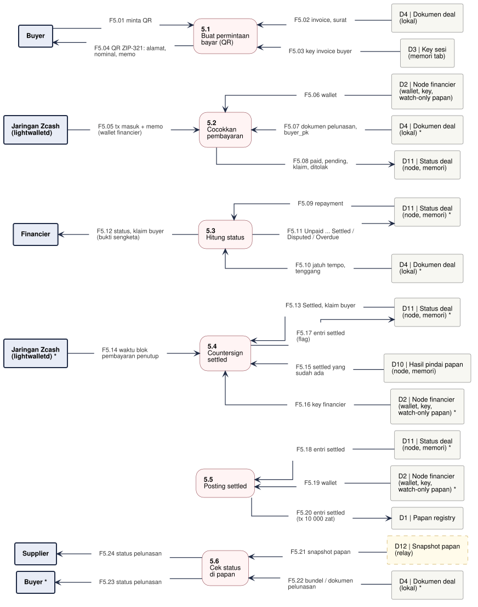

# DFD-2.5 - Pelunasan dan Settled

**Bagian dari:** [[08 - FlowDiagrams]] · Legenda: [[FD-00 - Arsitektur Target dan Legenda]] · Induk: [[DFD-1 - Proses Utama]] · Sequence: [[SEQ-02 - Buyer]] · [[SEQ-03 - Financier]]

Proses 5.0 dirinci: buyer membayar lewat QR ZIP-321 yang membawa kuitansi dan klaim; financier mencocokkan pembayaran, menghitung status, lalu mem-posting entri `settled` dua tanda tangan. Dasar: wasm `buyerRepayment`, `bundleOnBoard`; `jitsuin-flow::buyer::repayment_request`; `jitsuin-flow::settlement` (`repayment`, `Repayment::status`, `covering_height`, `settle`, `post_settled`).

Satu jalur = satu proses. Kotak bertanda `*` adalah entitas atau penyimpanan yang sama, digambar ulang supaya garis tidak bersilang. Kotak bergaris putus-putus kuning = usulan.



```plantuml
@startuml dfd-2-5
!include dfd-style.iuml
left to right direction
skinparam nodesep 12
skinparam ranksep 35
rectangle "Supplier" <<entity>> as S_6
rectangle "Buyer *" <<entity>> as B_6
rectangle "D4 | Dokumen deal\n(lokal) *" <<store>> as D4_6
rectangle "D12 | Snapshot papan\n(relay)" <<storeproposal>> as D12_6
rectangle "D1 | Papan registry" <<store>> as D1_5
rectangle "D2 | Node financier\n(wallet, key,\nwatch-only papan) *" <<store>> as D2_5
rectangle "D11 | Status deal\n(node, memori) *" <<store>> as D11_5
rectangle "D2 | Node financier\n(wallet, key,\nwatch-only papan) *" <<store>> as D2_4
rectangle "D10 | Hasil pindai papan\n(node, memori)" <<store>> as D10_4
rectangle "Jaringan Zcash\n(lightwalletd) *" <<entity>> as Z_4
rectangle "D11 | Status deal\n(node, memori) *" <<store>> as D11_4
rectangle "Financier" <<entity>> as F_3
rectangle "D4 | Dokumen deal\n(lokal) *" <<store>> as D4_3
rectangle "D11 | Status deal\n(node, memori) *" <<store>> as D11_3
rectangle "D11 | Status deal\n(node, memori)" <<store>> as D11_2
rectangle "D4 | Dokumen deal\n(lokal) *" <<store>> as D4_2
rectangle "D2 | Node financier\n(wallet, key,\nwatch-only papan)" <<store>> as D2_2
rectangle "Jaringan Zcash\n(lightwalletd)" <<entity>> as Z_2
rectangle "D3 | Key sesi\n(memori tab)" <<store>> as D3_1
rectangle "D4 | Dokumen deal\n(lokal)" <<store>> as D4_1
rectangle "Buyer" <<entity>> as B_1
rectangle "**5.6**\nCek status\ndi papan" <<process>> as P6
rectangle "**5.5**\nPosting settled" <<process>> as P5
rectangle "**5.4**\nCountersign\nsettled" <<process>> as P4
rectangle "**5.3**\nHitung status" <<process>> as P3
rectangle "**5.2**\nCocokkan\npembayaran" <<process>> as P2
rectangle "**5.1**\nBuat permintaan\nbayar (QR)" <<process>> as P1
rectangle "F5.01 minta QR" <<flow>> as f_F5_01
rectangle "F5.02 invoice, surat" <<flow>> as f_F5_02
rectangle "F5.03 key invoice buyer" <<flow>> as f_F5_03
rectangle "F5.04 QR ZIP-321: alamat,\nnominal, memo" <<flow>> as f_F5_04
rectangle "F5.05 tx masuk + memo\n(wallet financier)" <<flow>> as f_F5_05
rectangle "F5.06 wallet" <<flow>> as f_F5_06
rectangle "F5.07 dokumen pelunasan,\nbuyer_pk" <<flow>> as f_F5_07
rectangle "F5.08 paid, pending,\nklaim, ditolak" <<flow>> as f_F5_08
rectangle "F5.09 repayment" <<flow>> as f_F5_09
rectangle "F5.10 jatuh tempo,\ntenggang" <<flow>> as f_F5_10
rectangle "F5.11 Unpaid ... Settled /\nDisputed / Overdue" <<flow>> as f_F5_11
rectangle "F5.12 status, klaim buyer\n(bukti sengketa)" <<flow>> as f_F5_12
rectangle "F5.13 Settled, klaim buyer" <<flow>> as f_F5_13
rectangle "F5.14 waktu blok\npembayaran penutup" <<flow>> as f_F5_14
rectangle "F5.15 settled yang\nsudah ada" <<flow>> as f_F5_15
rectangle "F5.16 key financier" <<flow>> as f_F5_16
rectangle "F5.17 entri settled\n(flag)" <<flow>> as f_F5_17
rectangle "F5.18 entri settled" <<flow>> as f_F5_18
rectangle "F5.19 wallet" <<flow>> as f_F5_19
rectangle "F5.20 entri settled\n(tx 10 000 zat)" <<flow>> as f_F5_20
rectangle "F5.21 snapshot papan" <<flow>> as f_F5_21
rectangle "F5.22 bundel / dokumen\npelunasan" <<flow>> as f_F5_22
rectangle "F5.23 status pelunasan" <<flow>> as f_F5_23
rectangle "F5.24 status pelunasan" <<flow>> as f_F5_24
B_1 -- f_F5_01
f_F5_01 --> P1
P1 <-- f_F5_02
f_F5_02 -- D4_1
P1 <-- f_F5_03
f_F5_03 -- D3_1
B_1 <-- f_F5_04
f_F5_04 -- P1
Z_2 -- f_F5_05
f_F5_05 --> P2
P2 <-- f_F5_06
f_F5_06 -- D2_2
P2 <-- f_F5_07
f_F5_07 -- D4_2
P2 -- f_F5_08
f_F5_08 --> D11_2
P3 <-- f_F5_09
f_F5_09 -- D11_3
P3 <-- f_F5_10
f_F5_10 -- D4_3
P3 -- f_F5_11
f_F5_11 --> D11_3
F_3 <-- f_F5_12
f_F5_12 -- P3
P4 <-- f_F5_13
f_F5_13 -- D11_4
Z_4 -- f_F5_14
f_F5_14 --> P4
P4 <-- f_F5_15
f_F5_15 -- D10_4
P4 <-- f_F5_16
f_F5_16 -- D2_4
P4 -- f_F5_17
f_F5_17 --> D11_4
P5 <-- f_F5_18
f_F5_18 -- D11_5
P5 <-- f_F5_19
f_F5_19 -- D2_5
P5 -- f_F5_20
f_F5_20 --> D1_5
P6 <-- f_F5_21
f_F5_21 -- D12_6
P6 <-- f_F5_22
f_F5_22 -- D4_6
B_6 <-- f_F5_23
f_F5_23 -- P6
S_6 <-- f_F5_24
f_F5_24 -- P6
rectangle " " <<spacer>> as sp_P5_a
rectangle " " <<spacer>> as sp_P5_b
sp_P5_a -[hidden]- sp_P5_b
sp_P5_b -[hidden]- P5
@enduml
```

## Proses

| Proses | Isi | Status | Kode / item |
|---|---|---|---|
| 5.1 Buat permintaan bayar | Kuitansi JTR1 + seal klaim buyer (346 byte) di memo ZIP-321; QR hanya di layar buyer | ADA | wasm `buyerRepayment` |
| 5.2 Cocokkan pembayaran | Sync + enhance wallet financier; kuitansi untuk N bertanda tangan `buyer_pk`, nominal = nilai output; klaim dikumpulkan | ADA | `Financier::repayment`, `settlement::repayment` |
| 5.3 Hitung status | Unpaid, Pending, Partial, Claimed, Settled, Disputed, Overdue; klaim buyer dan txid menjadi bukti sengketa | ADA (fungsi); penjadwal berkala belum ada | `Repayment::status` |
| 5.4 Countersign settled | Waktu blok pembayaran penutup menentukan flag; seal financier atas klaim buyer; settled valid yang sudah ada dipakai ulang | ADA | `covering_height`, `lwd::block_time`, `settle` |
| 5.5 Posting settled | 10 000 zat + fee ke papan; entri 167 byte dengan `settled_tag`, tanpa N. Memakai spending key (lihat konflik D-23 di FD-00) | ADA | `post_settled` |
| 5.6 Cek status di papan | Pemegang N (buyer, supplier) mencari entri settled yang valid untuk kedua key | PARSIAL (wasm ADA, snapshot USULAN P-06) | wasm `bundleOnBoard` |

## Aliran data

| Aliran | Dari | Ke | Data |
|---|---|---|---|
| F5.01 | Buyer | 5.1 Buat permintaan bayar (QR) | minta QR |
| F5.02 | D4 Dokumen deal (lokal) | 5.1 Buat permintaan bayar (QR) | invoice, surat |
| F5.03 | D3 Key sesi (memori tab) | 5.1 Buat permintaan bayar (QR) | key invoice buyer |
| F5.04 | 5.1 Buat permintaan bayar (QR) | Buyer | QR ZIP-321: alamat, nominal, memo |
| F5.05 | Jaringan Zcash (lightwalletd) | 5.2 Cocokkan pembayaran | tx masuk + memo (wallet financier) |
| F5.06 | D2 Node financier (wallet, key, watch-only papan) | 5.2 Cocokkan pembayaran | wallet |
| F5.07 | D4 Dokumen deal (lokal) | 5.2 Cocokkan pembayaran | dokumen pelunasan, buyer_pk |
| F5.08 | 5.2 Cocokkan pembayaran | D11 Status deal (node, memori) | paid, pending, klaim, ditolak |
| F5.09 | D11 Status deal (node, memori) | 5.3 Hitung status | repayment |
| F5.10 | D4 Dokumen deal (lokal) | 5.3 Hitung status | jatuh tempo, tenggang |
| F5.11 | 5.3 Hitung status | D11 Status deal (node, memori) | Unpaid ... Settled / Disputed / Overdue |
| F5.12 | 5.3 Hitung status | Financier | status, klaim buyer (bukti sengketa) |
| F5.13 | D11 Status deal (node, memori) | 5.4 Countersign settled | Settled, klaim buyer |
| F5.14 | Jaringan Zcash (lightwalletd) | 5.4 Countersign settled | waktu blok pembayaran penutup |
| F5.15 | D10 Hasil pindai papan (node, memori) | 5.4 Countersign settled | settled yang sudah ada |
| F5.16 | D2 Node financier (wallet, key, watch-only papan) | 5.4 Countersign settled | key financier |
| F5.17 | 5.4 Countersign settled | D11 Status deal (node, memori) | entri settled (flag) |
| F5.18 | D11 Status deal (node, memori) | 5.5 Posting settled | entri settled |
| F5.19 | D2 Node financier (wallet, key, watch-only papan) | 5.5 Posting settled | wallet |
| F5.20 | 5.5 Posting settled | D1 Papan registry | entri settled (tx 10 000 zat) |
| F5.21 | D12 Snapshot papan (relay) | 5.6 Cek status di papan | snapshot papan |
| F5.22 | D4 Dokumen deal (lokal) | 5.6 Cek status di papan | bundel / dokumen pelunasan |
| F5.23 | 5.6 Cek status di papan | Buyer | status pelunasan |
| F5.24 | 5.6 Cek status di papan | Supplier | status pelunasan |

Catatan: `financierSettle` di wasm (dipakai landing) menentukan tepat waktu dari tanggal kuitansi; alur backend (5.4) memakai waktu blok. Lihat [[Pra-review Spesifikasi dan Threat Model]] Spec #5.
