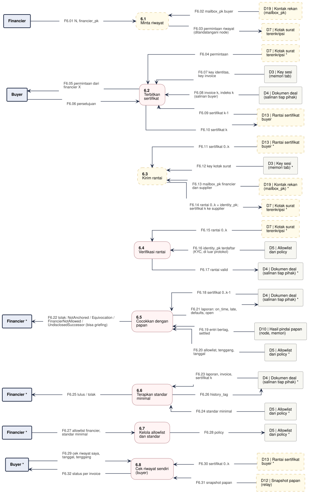

# DFD-2.6 - Riwayat Buyer

**Bagian dari:** [[08 - FlowDiagrams]] · Legenda: [[FD-00 - Arsitektur Target dan Legenda]] · Induk: [[DFD-1 - Proses Utama]] · Sequence: [[SEQ-02 - Buyer]] · [[SEQ-03 - Financier]]

Proses 6.0 dirinci: financier meminta riwayat, buyer menerbitkan sertifikat dengan persetujuan, financier memeriksa rantai terhadap papan dan standar minimalnya; buyer juga bisa memeriksa riwayatnya sendiri. 6.5–6.6 harus selesai sebelum entri bertag diposting (3.8): begitu entri bertag k ada di papan, cek ulang atas rantai yang sama menghasilkan `UndisclosedSuccessor`. Dasar: wasm `buyerHistoryCert`, `verifyHistory`; `jitsuin-core::history` (`HistoryCert::issue`, `verify_certs`); `jitsuin-board::history` (`verify_history`, `MinimumStandard`); `jitsuin-flow::history` (`HistoryPolicy`, `check_buyer`); [[Desain Jitsuin Seal]] §7.

Satu jalur = satu proses. Kotak bertanda `*` adalah entitas atau penyimpanan yang sama, digambar ulang supaya garis tidak bersilang. Proses bergaris penuh = ADA atau PARSIAL (rinciannya di kolom Status), kuning putus-putus = USULAN. Penyimpanan lokal proses ini (tidak muncul di level 1): D5 Allowlist dan policy, D13 Rantai sertifikat buyer.



```plantuml
@startuml dfd-2-6
!include dfd-style.iuml
left to right direction
skinparam nodesep 12
skinparam ranksep 35
rectangle "D12 | Snapshot papan\n(relay)" <<storeproposal>> as D12_8
rectangle "D13 | Rantai sertifikat\nbuyer *" <<storeproposal>> as D13_8
rectangle "Buyer *" <<entity>> as B_8
rectangle "D5 | Allowlist\ndan policy *" <<store>> as D5_7
rectangle "Financier *" <<entity>> as F_7
rectangle "Financier *" <<entity>> as F_6
rectangle "D5 | Allowlist\ndan policy *" <<store>> as D5_6
rectangle "D4 | Dokumen deal\n(salinan tiap pihak) *" <<store>> as D4_6
rectangle "Financier *" <<entity>> as F_5
rectangle "D5 | Allowlist\ndan policy *" <<store>> as D5_5
rectangle "D10 | Hasil pindai papan\n(node, memori)" <<store>> as D10_5
rectangle "D4 | Dokumen deal\n(salinan tiap pihak) *" <<store>> as D4_5
rectangle "D4 | Dokumen deal\n(salinan tiap pihak) *" <<store>> as D4_4
rectangle "D5 | Allowlist\ndan policy" <<store>> as D5_4
rectangle "D7 | Kotak surat\nterenkripsi *" <<storeproposal>> as D7_4
rectangle "D7 | Kotak surat\nterenkripsi *" <<storeproposal>> as D7_3
rectangle "D19 | Kontak rekan\n(mailbox_pk) *" <<storeproposal>> as D19_3
rectangle "D3 | Key sesi\n(memori tab) *" <<store>> as D3_3
rectangle "D13 | Rantai sertifikat\nbuyer *" <<storeproposal>> as D13_3
rectangle "D13 | Rantai sertifikat\nbuyer" <<storeproposal>> as D13_2
rectangle "D4 | Dokumen deal\n(salinan tiap pihak)" <<store>> as D4_2
rectangle "D3 | Key sesi\n(memori tab)" <<store>> as D3_2
rectangle "Buyer" <<entity>> as B_2
rectangle "D7 | Kotak surat\nterenkripsi *" <<storeproposal>> as D7_2
rectangle "D7 | Kotak surat\nterenkripsi" <<storeproposal>> as D7_1
rectangle "D19 | Kontak rekan\n(mailbox_pk)" <<storeproposal>> as D19_1
rectangle "Financier" <<entity>> as F_1
rectangle "**6.8**\nCek riwayat sendiri\n(buyer)" <<process>> as P8
rectangle "**6.7**\nKelola allowlist\ndan standar" <<process>> as P7
rectangle "**6.6**\nTerapkan standar\nminimal" <<process>> as P6
rectangle "**6.5**\nCocokkan dengan\npapan" <<process>> as P5
rectangle "**6.4**\nVerifikasi rantai" <<process>> as P4
rectangle "**6.3**\nKirim rantai" <<proposal>> as P3
rectangle "**6.2**\nTerbitkan\nsertifikat" <<process>> as P2
rectangle "**6.1**\nMinta riwayat" <<proposal>> as P1
rectangle "F6.01 N, financier_pk" <<flow>> as f_F6_01
rectangle "F6.02 mailbox_pk buyer" <<flow>> as f_F6_02
rectangle "F6.03 permintaan riwayat\n(ditandatangani node)" <<flow>> as f_F6_03
rectangle "F6.04 permintaan" <<flow>> as f_F6_04
rectangle "F6.05 permintaan dari\nfinancier X" <<flow>> as f_F6_05
rectangle "F6.06 persetujuan" <<flow>> as f_F6_06
rectangle "F6.07 key identitas,\nkey invoice" <<flow>> as f_F6_07
rectangle "F6.08 invoice k, indeks k\n(salinan buyer)" <<flow>> as f_F6_08
rectangle "F6.09 sertifikat k-1" <<flow>> as f_F6_09
rectangle "F6.10 sertifikat k" <<flow>> as f_F6_10
rectangle "F6.11 sertifikat 0..k" <<flow>> as f_F6_11
rectangle "F6.12 key kotak surat" <<flow>> as f_F6_12
rectangle "F6.13 mailbox_pk financier\ndan supplier" <<flow>> as f_F6_13
rectangle "F6.14 rantai 0..k + identity_pk;\nsertifikat k ke supplier" <<flow>> as f_F6_14
rectangle "F6.15 rantai 0..k" <<flow>> as f_F6_15
rectangle "F6.16 identity_pk terdaftar\n(KYC, di luar protokol)" <<flow>> as f_F6_16
rectangle "F6.17 rantai valid" <<flow>> as f_F6_17
rectangle "F6.18 sertifikat 0..k-1" <<flow>> as f_F6_18
rectangle "F6.19 entri bertag,\nsettled" <<flow>> as f_F6_19
rectangle "F6.20 allowlist, tenggang\n(tanggal dari jam node)" <<flow>> as f_F6_20
rectangle "F6.21 laporan: on_time, late,\ndefaults, open" <<flow>> as f_F6_21
rectangle "F6.22 tolak: NotAnchored / Equivocation /\nFinancierNotAllowed /\nUndisclosedSuccessor (bisa griefing)" <<flow>> as f_F6_22
rectangle "F6.23 laporan, invoice,\nsertifikat k" <<flow>> as f_F6_23
rectangle "F6.24 standar minimal" <<flow>> as f_F6_24
rectangle "F6.25 lulus / tolak" <<flow>> as f_F6_25
rectangle "F6.26 history_tag" <<flow>> as f_F6_26
rectangle "F6.27 allowlist financier,\nstandar minimal" <<flow>> as f_F6_27
rectangle "F6.28 policy" <<flow>> as f_F6_28
rectangle "F6.29 cek riwayat saya,\ntanggal, tenggang" <<flow>> as f_F6_29
rectangle "F6.30 sertifikat 0..k" <<flow>> as f_F6_30
rectangle "F6.31 snapshot papan" <<flow>> as f_F6_31
rectangle "F6.32 status per invoice" <<flow>> as f_F6_32
F_1 -- f_F6_01
f_F6_01 --> P1
P1 <-- f_F6_02
f_F6_02 -- D19_1
P1 -- f_F6_03
f_F6_03 --> D7_1
P2 <-- f_F6_04
f_F6_04 -- D7_2
B_2 <-- f_F6_05
f_F6_05 -- P2
B_2 -- f_F6_06
f_F6_06 --> P2
P2 <-- f_F6_07
f_F6_07 -- D3_2
P2 <-- f_F6_08
f_F6_08 -- D4_2
P2 <-- f_F6_09
f_F6_09 -- D13_2
P2 -- f_F6_10
f_F6_10 --> D13_2
P3 <-- f_F6_11
f_F6_11 -- D13_3
P3 <-- f_F6_12
f_F6_12 -- D3_3
P3 <-- f_F6_13
f_F6_13 -- D19_3
P3 -- f_F6_14
f_F6_14 --> D7_3
P4 <-- f_F6_15
f_F6_15 -- D7_4
P4 <-- f_F6_16
f_F6_16 -- D5_4
P4 -- f_F6_17
f_F6_17 --> D4_4
P5 <-- f_F6_18
f_F6_18 -- D4_5
P5 <-- f_F6_19
f_F6_19 -- D10_5
P5 <-- f_F6_20
f_F6_20 -- D5_5
P5 -- f_F6_21
f_F6_21 --> D4_5
F_5 <-- f_F6_22
f_F6_22 -- P5
P6 <-- f_F6_23
f_F6_23 -- D4_6
P6 <-- f_F6_24
f_F6_24 -- D5_6
F_6 <-- f_F6_25
f_F6_25 -- P6
P6 -- f_F6_26
f_F6_26 --> D4_6
F_7 -- f_F6_27
f_F6_27 --> P7
P7 -- f_F6_28
f_F6_28 --> D5_7
B_8 -- f_F6_29
f_F6_29 --> P8
P8 <-- f_F6_30
f_F6_30 -- D13_8
P8 <-- f_F6_31
f_F6_31 -- D12_8
B_8 <-- f_F6_32
f_F6_32 -- P8
rectangle " " <<spacer>> as sp_P3_a
rectangle " " <<spacer>> as sp_P3_b
sp_P3_a -[hidden]- sp_P3_b
sp_P3_b -[hidden]- P3
rectangle " " <<spacer>> as sp_P4_a
rectangle " " <<spacer>> as sp_P4_b
sp_P4_a -[hidden]- sp_P4_b
sp_P4_b -[hidden]- P4
@enduml
```

## Proses

| Proses | Isi | Status | Kode / item |
|---|---|---|---|
| 6.1 Minta riwayat | Financier meminta rantai untuk deal N; permintaan ditandatangani node supaya tidak bisa dipalsukan (P-04) | USULAN (relay) | P-04 |
| 6.2 Terbitkan sertifikat | JTSH 277 byte untuk invoice k (key invoice, key supplier, N, nominal, jatuh tempo, key financier, hash sebelumnya), ditandatangani key identitas | ADA (fungsi, kartu di layar Buyer) | wasm `buyerHistoryCert` |
| 6.3 Kirim rantai | Rantai ke financier yang diminta; sertifikat k ke supplier untuk entri bertag. Pemegang sertifikat k (supplier, setiap financier yang diminta, termasuk yang menolak) bisa menghitung tag berikutnya dan memantau invoice buyer berikutnya (TM #6) | USULAN | P-04, P-09 |
| 6.4 Verifikasi rantai | Mulai dari 0, tanpa celah, satu identitas, N berbeda. Pencocokan `identity_pk` dengan identitas KYC terjadi di luar protokol | ADA | `verify_certs` |
| 6.5 Cocokkan dengan papan | Atas sertifikat 0..k-1: satu entri bertag per sertifikat, equivocation, penerus tersembunyi, hasil dari entri settled, allowlist. Entri palsu bertag penerus memicu `UndisclosedSuccessor` (griefing, Spec #1) | ADA (dengan celah griefing) | `board::history::verify_history` |
| 6.6 Terapkan standar minimal | Batas gagal bayar, persentase tepat waktu, plafon buyer baru; sertifikat k cocok dengan invoice; hasilnya `history_tag` untuk entri | ADA di flow; layar Financier hanya `verifyHistory` tanpa standar | `MinimumStandard::evaluate`, `check_buyer` |
| 6.7 Kelola allowlist dan standar | Financier menetapkan allowlist dan standar minimal | PARSIAL (struktur ADA, layar USULAN) | `HistoryPolicy` |
| 6.8 Cek riwayat sendiri | Buyer memeriksa rantainya terhadap papan; butuh allowlist (minimal financier di sertifikatnya sendiri), tanggal, tenggang | PARSIAL (wasm ADA; layar Buyer dan snapshot USULAN) | wasm `verifyHistory` |

## Aliran data

| Aliran | Dari | Ke | Data |
|---|---|---|---|
| F6.01 | Financier | 6.1 Minta riwayat | N, financier_pk |
| F6.02 | D19 Kontak rekan (mailbox_pk) | 6.1 Minta riwayat | mailbox_pk buyer |
| F6.03 | 6.1 Minta riwayat | D7 Kotak surat terenkripsi | permintaan riwayat (ditandatangani node) |
| F6.04 | D7 Kotak surat terenkripsi | 6.2 Terbitkan sertifikat | permintaan |
| F6.05 | 6.2 Terbitkan sertifikat | Buyer | permintaan dari financier X |
| F6.06 | Buyer | 6.2 Terbitkan sertifikat | persetujuan |
| F6.07 | D3 Key sesi (memori tab) | 6.2 Terbitkan sertifikat | key identitas, key invoice |
| F6.08 | D4 Dokumen deal (salinan tiap pihak) | 6.2 Terbitkan sertifikat | invoice k, indeks k (salinan buyer) |
| F6.09 | D13 Rantai sertifikat buyer | 6.2 Terbitkan sertifikat | sertifikat k-1 |
| F6.10 | 6.2 Terbitkan sertifikat | D13 Rantai sertifikat buyer | sertifikat k |
| F6.11 | D13 Rantai sertifikat buyer | 6.3 Kirim rantai | sertifikat 0..k |
| F6.12 | D3 Key sesi (memori tab) | 6.3 Kirim rantai | key kotak surat |
| F6.13 | D19 Kontak rekan (mailbox_pk) | 6.3 Kirim rantai | mailbox_pk financier dan supplier |
| F6.14 | 6.3 Kirim rantai | D7 Kotak surat terenkripsi | rantai 0..k + identity_pk; sertifikat k ke supplier |
| F6.15 | D7 Kotak surat terenkripsi | 6.4 Verifikasi rantai | rantai 0..k |
| F6.16 | D5 Allowlist dan policy | 6.4 Verifikasi rantai | identity_pk terdaftar (KYC, di luar protokol) |
| F6.17 | 6.4 Verifikasi rantai | D4 Dokumen deal (salinan tiap pihak) | rantai valid |
| F6.18 | D4 Dokumen deal (salinan tiap pihak) | 6.5 Cocokkan dengan papan | sertifikat 0..k-1 |
| F6.19 | D10 Hasil pindai papan (node, memori) | 6.5 Cocokkan dengan papan | entri bertag, settled |
| F6.20 | D5 Allowlist dan policy | 6.5 Cocokkan dengan papan | allowlist, tenggang (tanggal dari jam node) |
| F6.21 | 6.5 Cocokkan dengan papan | D4 Dokumen deal (salinan tiap pihak) | laporan: on_time, late, defaults, open |
| F6.22 | 6.5 Cocokkan dengan papan | Financier | tolak: NotAnchored / Equivocation / FinancierNotAllowed / UndisclosedSuccessor (bisa griefing) |
| F6.23 | D4 Dokumen deal (salinan tiap pihak) | 6.6 Terapkan standar minimal | laporan, invoice, sertifikat k |
| F6.24 | D5 Allowlist dan policy | 6.6 Terapkan standar minimal | standar minimal |
| F6.25 | 6.6 Terapkan standar minimal | Financier | lulus / tolak |
| F6.26 | 6.6 Terapkan standar minimal | D4 Dokumen deal (salinan tiap pihak) | history_tag |
| F6.27 | Financier | 6.7 Kelola allowlist dan standar | allowlist financier, standar minimal |
| F6.28 | 6.7 Kelola allowlist dan standar | D5 Allowlist dan policy | policy |
| F6.29 | Buyer | 6.8 Cek riwayat sendiri (buyer) | cek riwayat saya, tanggal, tenggang |
| F6.30 | D13 Rantai sertifikat buyer | 6.8 Cek riwayat sendiri (buyer) | sertifikat 0..k |
| F6.31 | D12 Snapshot papan (relay) | 6.8 Cek riwayat sendiri (buyer) | snapshot papan |
| F6.32 | 6.8 Cek riwayat sendiri (buyer) | Buyer | status per invoice |
