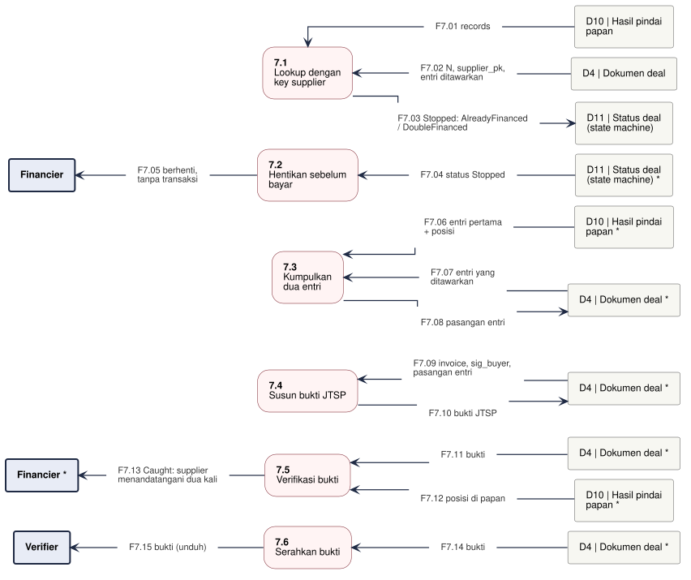

# DFD-2.7 - Deteksi Pembiayaan Ganda

**Bagian dari:** [[08 - FlowDiagrams]] · Legenda: [[FD-00 - Arsitektur Target dan Legenda]] · Induk: [[DFD-1 - Proses Utama]] · Sequence: [[SEQ-03 - Financier]] · [[SEQ-01 - Supplier]] · [[SEQ-04 - Verifier dan Orang Luar]]

Proses 7.0 dirinci: mulai dari state `Stopped` (ditulis 3.5, 3.9, atau 4.5), financier menyusun dan memverifikasi bukti bahwa supplier menandatangani N yang sama untuk dua financier. Dua kasus: `DoubleFinanced` (kedua entri sudah di papan, bukti lengkap) dan `AlreadyFinanced` (hanya entri lawan di papan; bukti hanya bila financier sudah memegang entri yang ditawarkan untuknya, P-14). Dasar: `jitsuin-board` (`lookup`, `proof_from_lookup`, `proof_from_offer`, `verify_proof_on_board`), wasm `doubleSignProof`, `verifyProof`, `jitsuin-core::proof`.

Satu jalur = satu proses. Kotak bertanda `*` adalah entitas atau penyimpanan yang sama, digambar ulang supaya garis tidak bersilang. Proses bergaris penuh = ADA atau PARSIAL (rinciannya di kolom Status), kuning putus-putus = USULAN.



```plantuml
@startuml dfd-2-7
!include dfd-style.iuml
left to right direction
skinparam nodesep 12
skinparam ranksep 35
rectangle "Verifier\n(juri, auditor,\norang luar)" <<entity>> as V_5
rectangle "D4 | Dokumen deal\n(salinan tiap pihak) *" <<store>> as D4_5
rectangle "Financier *" <<entity>> as F_4
rectangle "D10 | Hasil pindai papan\n(node, memori) *" <<store>> as D10_4
rectangle "D4 | Dokumen deal\n(salinan tiap pihak) *" <<store>> as D4_4
rectangle "D4 | Dokumen deal\n(salinan tiap pihak) *" <<store>> as D4_3
rectangle "D4 | Dokumen deal\n(salinan tiap pihak)" <<store>> as D4_2
rectangle "D10 | Hasil pindai papan\n(node, memori)" <<store>> as D10_2
rectangle "Financier" <<entity>> as F_1
rectangle "D11 | Status deal\n(node, memori)" <<store>> as D11_1
rectangle "**7.5**\nSerahkan bukti" <<process>> as P5
rectangle "**7.4**\nVerifikasi bukti" <<process>> as P4
rectangle "**7.3**\nSusun bukti JTSP" <<process>> as P3
rectangle "**7.2**\nKumpulkan\ndua entri" <<process>> as P2
rectangle "**7.1**\nBaca status\nberhenti" <<process>> as P1
rectangle "F7.01 Stopped: AlreadyFinanced\n/ DoubleFinanced" <<flow>> as f_F7_01
rectangle "F7.02 berhenti,\ntanpa transaksi" <<flow>> as f_F7_02
rectangle "F7.03 entri pertama dan entri\nkonflik + posisi" <<flow>> as f_F7_03
rectangle "F7.04 entri yang ditawarkan\n(AlreadyFinanced, P-14)" <<flow>> as f_F7_04
rectangle "F7.05 pasangan entri" <<flow>> as f_F7_05
rectangle "F7.06 invoice, sig_buyer,\npasangan entri + posisi" <<flow>> as f_F7_06
rectangle "F7.07 bukti JTSP" <<flow>> as f_F7_07
rectangle "F7.08 bukti" <<flow>> as f_F7_08
rectangle "F7.09 posisi di papan\n(CLI)" <<flow>> as f_F7_09
rectangle "F7.10 Caught (web: posisi\nhanya diklaim)" <<flow>> as f_F7_10
rectangle "F7.11 bukti" <<flow>> as f_F7_11
rectangle "F7.12 bukti (unduh)" <<flow>> as f_F7_12
P1 <-- f_F7_01
f_F7_01 -- D11_1
F_1 <-- f_F7_02
f_F7_02 -- P1
P2 <-- f_F7_03
f_F7_03 -- D10_2
P2 <-- f_F7_04
f_F7_04 -- D4_2
P2 -- f_F7_05
f_F7_05 --> D4_2
P3 <-- f_F7_06
f_F7_06 -- D4_3
P3 -- f_F7_07
f_F7_07 --> D4_3
P4 <-- f_F7_08
f_F7_08 -- D4_4
P4 <-- f_F7_09
f_F7_09 -- D10_4
F_4 <-- f_F7_10
f_F7_10 -- P4
P5 <-- f_F7_11
f_F7_11 -- D4_5
V_5 <-- f_F7_12
f_F7_12 -- P5
rectangle " " <<spacer>> as sp_P2_a
rectangle " " <<spacer>> as sp_P2_b
sp_P2_a -[hidden]- sp_P2_b
sp_P2_b -[hidden]- P2
rectangle " " <<spacer>> as sp_P3_a
rectangle " " <<spacer>> as sp_P3_b
sp_P3_a -[hidden]- sp_P3_b
sp_P3_b -[hidden]- P3
@enduml
```

## Proses

| Proses | Isi | Status | Kode / item |
|---|---|---|---|
| 7.1 Baca status berhenti | `Stopped` ditulis 3.5, 3.9, atau cek terakhir 4.5; tidak ada uang yang bergerak | ADA | `Flow::on_board`, `Stop` |
| 7.2 Kumpulkan dua entri | `DoubleFinanced`: entri pertama dan entri konflik, keduanya dengan posisi (`proof_from_lookup`). `AlreadyFinanced`: entri pertama dari papan + entri yang ditawarkan supplier ke financier ini (`proof_from_offer`); di urutan sekarang entri tawaran tidak pernah ada karena entri diminta hanya setelah `NotFound` | PARSIAL: fungsi ADA tanpa pemanggil di node; entri tawaran USULAN P-14 | `proof_from_lookup`, `proof_from_offer` |
| 7.3 Susun bukti JTSP | Invoice + tanda tangan buyer + dua entri berbeda komitmen + posisi papan. JTSP membuktikan dua tanda tangan, bukan niat menipu (lihat P-14) | PARSIAL: wasm `doubleSignProof` menerima posisi (HNK-27.T4, lolos `verify_proof_on_board`); kartu bukti di konsol belum (HNK-26.T14) | wasm `doubleSignProof`, `jitsuin-board` |
| 7.4 Verifikasi bukti | CLI: `DoubleSignProof::verify` + `verify_proof_on_board` (ADA). Web: `verifyProof` offline saja; posisi papan hanya diklaim dan file papan yang diunggah tidak dipakai, jadi hasil web bisa berbeda dari CLI | ADA (CLI) / PARSIAL (web) | `jitsuin-cli::verify::check_proof`, wasm `verifyProof` |
| 7.5 Serahkan bukti | Unduh di layar Verify; hanya ke pihak berwenang (juri, auditor, pengadilan), bukan ke supplier | ADA | `src/pages/verify.ts` |

## Aliran data

| Aliran | Dari | Ke | Data |
|---|---|---|---|
| F7.01 | D11 Status deal (node, memori) | 7.1 Baca status berhenti | Stopped: AlreadyFinanced / DoubleFinanced |
| F7.02 | 7.1 Baca status berhenti | Financier | berhenti, tanpa transaksi |
| F7.03 | D10 Hasil pindai papan (node, memori) | 7.2 Kumpulkan dua entri | entri pertama dan entri konflik + posisi |
| F7.04 | D4 Dokumen deal (salinan tiap pihak) | 7.2 Kumpulkan dua entri | entri yang ditawarkan (AlreadyFinanced, P-14) |
| F7.05 | 7.2 Kumpulkan dua entri | D4 Dokumen deal (salinan tiap pihak) | pasangan entri |
| F7.06 | D4 Dokumen deal (salinan tiap pihak) | 7.3 Susun bukti JTSP | invoice, sig_buyer, pasangan entri + posisi |
| F7.07 | 7.3 Susun bukti JTSP | D4 Dokumen deal (salinan tiap pihak) | bukti JTSP |
| F7.08 | D4 Dokumen deal (salinan tiap pihak) | 7.4 Verifikasi bukti | bukti |
| F7.09 | D10 Hasil pindai papan (node, memori) | 7.4 Verifikasi bukti | posisi di papan (CLI) |
| F7.10 | 7.4 Verifikasi bukti | Financier | Caught (web: posisi hanya diklaim) |
| F7.11 | D4 Dokumen deal (salinan tiap pihak) | 7.5 Serahkan bukti | bukti |
| F7.12 | 7.5 Serahkan bukti | Verifier (juri, auditor, orang luar) | bukti (unduh) |
