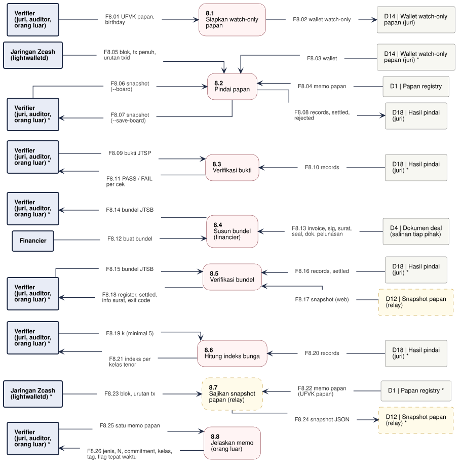

# DFD-2.8 - Verifikasi dan Indeks Publik

**Bagian dari:** [[08 - FlowDiagrams]] · Legenda: [[FD-00 - Arsitektur Target dan Legenda]] · Induk: [[DFD-1 - Proses Utama]] · Sequence: [[SEQ-04 - Verifier dan Orang Luar]]

Proses 8.0 dirinci: juri dan auditor memindai papan sendiri dengan UFVK papan, memverifikasi bukti dan bundel, menghitung indeks bunga; orang luar hanya melihat hash. Dasar: `jitsuin-cli` (`verify`, `index`, `board`), `jitsuin-board` (`scan`, `bundle_on_board`, `verify_proof_on_board`, `rate_index`), wasm `verifyBundle`, `verifyProof`, `bundleOnBoard`, `boardMemoDescribe`.

Kotak bertanda `*` adalah entitas atau penyimpanan yang sama yang digambar ulang di jalur proses lain, supaya garis tidak bersilang. Kotak bergaris putus-putus kuning = usulan.



```plantuml
@startuml dfd-2-8
!include dfd-style.iuml
left to right direction
skinparam nodesep 12
skinparam ranksep 35
rectangle "Verifier *" <<entity>> as V_7
rectangle "D12 | Snapshot papan\n(relay) *" <<storeproposal>> as D12_6
rectangle "D10 | Hasil pindai\npapan *" <<store>> as D10_6
rectangle "D10 | Hasil pindai\npapan *" <<store>> as D10_5
rectangle "Verifier *" <<entity>> as V_5
rectangle "D12 | Snapshot papan\n(relay)" <<storeproposal>> as D12_4
rectangle "D10 | Hasil pindai\npapan *" <<store>> as D10_4
rectangle "Verifier *" <<entity>> as V_4
rectangle "D10 | Hasil pindai\npapan *" <<store>> as D10_3
rectangle "Verifier *" <<entity>> as V_3
rectangle "D10 | Hasil pindai\npapan" <<store>> as D10_2
rectangle "Jaringan Zcash\n(lightwalletd)" <<entity>> as Z_2
rectangle "D1 | Papan registry" <<store>> as D1_2
rectangle "D14 | Wallet watch-only\npapan *" <<store>> as D14_2
rectangle "D14 | Wallet watch-only\npapan" <<store>> as D14_1
rectangle "Verifier" <<entity>> as V_1
rectangle "**8.7**\nJelaskan memo\n(orang luar)" <<process>> as P7
rectangle "**8.6**\nSajikan snapshot\npapan" <<proposal>> as P6
rectangle "**8.5**\nHitung indeks bunga" <<process>> as P5
rectangle "**8.4**\nVerifikasi bundel" <<process>> as P4
rectangle "**8.3**\nVerifikasi bukti" <<process>> as P3
rectangle "**8.2**\nPindai papan" <<process>> as P2
rectangle "**8.1**\nSiapkan watch-only\npapan" <<process>> as P1
rectangle "F8.01 UFVK papan,\nbirthday" <<flow>> as f_F8_01
rectangle "F8.02 wallet watch-only" <<flow>> as f_F8_02
rectangle "F8.03 wallet" <<flow>> as f_F8_03
rectangle "F8.04 memo papan" <<flow>> as f_F8_04
rectangle "F8.05 blok, tx penuh,\nurutan txid" <<flow>> as f_F8_05
rectangle "F8.06 records, settled,\nrejected" <<flow>> as f_F8_06
rectangle "F8.07 bukti JTSP" <<flow>> as f_F8_07
rectangle "F8.08 records" <<flow>> as f_F8_08
rectangle "F8.09 PASS / FAIL\nper cek" <<flow>> as f_F8_09
rectangle "F8.10 bundel JTSB" <<flow>> as f_F8_10
rectangle "F8.11 records, settled" <<flow>> as f_F8_11
rectangle "F8.12 snapshot (web)" <<flow>> as f_F8_12
rectangle "F8.13 register, settled,\nexit code" <<flow>> as f_F8_13
rectangle "F8.14 k (minimal 5)" <<flow>> as f_F8_14
rectangle "F8.15 records" <<flow>> as f_F8_15
rectangle "F8.16 indeks per kelas\ntenor" <<flow>> as f_F8_16
rectangle "F8.17 records (pindaian relay)" <<flow>> as f_F8_17
rectangle "F8.18 snapshot JSON" <<flow>> as f_F8_18
rectangle "F8.19 satu memo papan" <<flow>> as f_F8_19
rectangle "F8.20 jenis, N, commitment,\nbucket, tag (hash)" <<flow>> as f_F8_20
V_1 -- f_F8_01
f_F8_01 --> P1
P1 -- f_F8_02
f_F8_02 --> D14_1
P2 <-- f_F8_03
f_F8_03 -- D14_2
P2 <-- f_F8_04
f_F8_04 -- D1_2
Z_2 -- f_F8_05
f_F8_05 --> P2
P2 -- f_F8_06
f_F8_06 --> D10_2
V_3 -- f_F8_07
f_F8_07 --> P3
P3 <-- f_F8_08
f_F8_08 -- D10_3
V_3 <-- f_F8_09
f_F8_09 -- P3
V_4 -- f_F8_10
f_F8_10 --> P4
P4 <-- f_F8_11
f_F8_11 -- D10_4
P4 <-- f_F8_12
f_F8_12 -- D12_4
V_4 <-- f_F8_13
f_F8_13 -- P4
V_5 -- f_F8_14
f_F8_14 --> P5
P5 <-- f_F8_15
f_F8_15 -- D10_5
V_5 <-- f_F8_16
f_F8_16 -- P5
P6 <-- f_F8_17
f_F8_17 -- D10_6
P6 -- f_F8_18
f_F8_18 --> D12_6
V_7 -- f_F8_19
f_F8_19 --> P7
V_7 <-- f_F8_20
f_F8_20 -- P7
rectangle " " <<spacer>> as sp_P6_a
rectangle " " <<spacer>> as sp_P6_b
sp_P6_a -[hidden]- sp_P6_b
sp_P6_b -[hidden]- P6
@enduml
```

## Proses

| Proses | Isi | Status | Kode / item |
|---|---|---|---|
| 8.1 Siapkan watch-only papan | `init-fvk` dengan UFVK papan dan tinggi awal; jaringan dari awalan UFVK | ADA | `jitsuin-cli::board::scan` |
| 8.2 Pindai papan | Sama dengan 3.2; bisa juga dari snapshot JSON offline | ADA | `scan`, `from_snapshot` |
| 8.3 Verifikasi bukti | `DoubleSignProof::verify` + posisi di papan | ADA | `verify::check_proof` |
| 8.4 Verifikasi bundel | `Bundle::verify` + `bundle_on_board` | ADA | `verify::check_bundle`, wasm `bundleOnBoard` |
| 8.5 Hitung indeks bunga | Tiap N sekali; kelas diskon per kelas tenor dengan ≥ k invoice | ADA (CLI); halaman web HNK-08.T3 belum | `rate_index`, `jitsuin index` |
| 8.6 Sajikan snapshot papan | Relay memindai dengan UFVK papan dan menyajikan JSON; browser memverifikasi sendiri | USULAN P-06 | — |
| 8.7 Jelaskan memo | Halaman orang luar menguraikan memo tanpa bisa mengecek tanda tangan | ADA | wasm `boardMemoDescribe`, `src/pages/outsider.ts` |

## Aliran data

| Aliran | Dari | Ke | Data |
|---|---|---|---|
| F8.01 | Verifier | 8.1 Siapkan watch-only papan | UFVK papan, birthday |
| F8.02 | 8.1 Siapkan watch-only papan | D14 | Wallet watch-only papan | wallet watch-only |
| F8.03 | D14 | Wallet watch-only papan | 8.2 Pindai papan | wallet |
| F8.04 | D1 | Papan registry | 8.2 Pindai papan | memo papan |
| F8.05 | Jaringan Zcash (lightwalletd) | 8.2 Pindai papan | blok, tx penuh, urutan txid |
| F8.06 | 8.2 Pindai papan | D10 | Hasil pindai papan | records, settled, rejected |
| F8.07 | Verifier | 8.3 Verifikasi bukti | bukti JTSP |
| F8.08 | D10 | Hasil pindai papan | 8.3 Verifikasi bukti | records |
| F8.09 | 8.3 Verifikasi bukti | Verifier | PASS / FAIL per cek |
| F8.10 | Verifier | 8.4 Verifikasi bundel | bundel JTSB |
| F8.11 | D10 | Hasil pindai papan | 8.4 Verifikasi bundel | records, settled |
| F8.12 | D12 | Snapshot papan (relay) | 8.4 Verifikasi bundel | snapshot (web) |
| F8.13 | 8.4 Verifikasi bundel | Verifier | register, settled, exit code |
| F8.14 | Verifier | 8.5 Hitung indeks bunga | k (minimal 5) |
| F8.15 | D10 | Hasil pindai papan | 8.5 Hitung indeks bunga | records |
| F8.16 | 8.5 Hitung indeks bunga | Verifier | indeks per kelas tenor |
| F8.17 | D10 | Hasil pindai papan | 8.6 Sajikan snapshot papan | records (pindaian relay) |
| F8.18 | 8.6 Sajikan snapshot papan | D12 | Snapshot papan (relay) | snapshot JSON |
| F8.19 | Verifier | 8.7 Jelaskan memo (orang luar) | satu memo papan |
| F8.20 | 8.7 Jelaskan memo (orang luar) | Verifier | jenis, N, commitment, bucket, tag (hash) |
