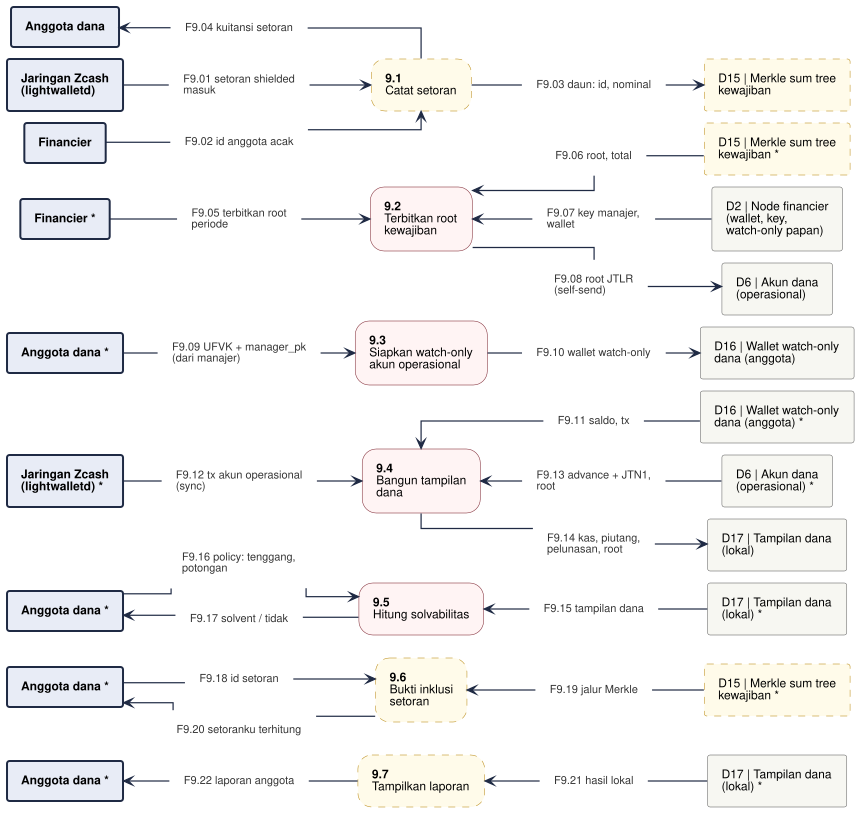

# DFD-2.9 - Solvabilitas Dana

**Bagian dari:** [[08 - FlowDiagrams]] · Legenda: [[FD-00 - Arsitektur Target dan Legenda]] · Induk: [[DFD-1 - Proses Utama]] · Sequence: [[SEQ-05 - Anggota Dana]]

Proses 9.0 dirinci (JitsuinFi Vault, stretch D-24): setoran menjadi daun Merkle sum tree, manajer menerbitkan root kewajiban per periode dan mengirim jalur Merkle tiap periode, anggota memindai akun operasional dengan UFVK di perangkatnya sendiri (CLI lokal) dan menghitung solvabilitas. Sisi aset dinyatakan manajer sendiri (nilai di catatan JTN1); pelanggaran baru terlihat sebagai gagal bayar setelah jatuh tempo + tenggang. Dasar: `jitsuin-flow::fund` (`fund_view`, `member_view`, `post_liability_root`, `solvency`), `jitsuin-core::fund` (`ReceivableNote`, `LiabilityRoot`).

Satu jalur = satu proses. Kotak bertanda `*` adalah entitas atau penyimpanan yang sama, digambar ulang supaya garis tidak bersilang. Proses bergaris penuh = ADA atau PARSIAL (rinciannya di kolom Status), kuning putus-putus = USULAN. Penyimpanan lokal proses ini (tidak muncul di level 1): D15 Merkle sum tree kewajiban, D16 Wallet watch-only dana (anggota), D17 Tampilan dana (lokal).



```plantuml
@startuml dfd-2-9
!include dfd-style.iuml
left to right direction
skinparam nodesep 12
skinparam ranksep 35
rectangle "Anggota dana *" <<entity>> as M_8
rectangle "D17 | Tampilan dana\n(lokal) *" <<store>> as D17_8
rectangle "Anggota dana *" <<entity>> as M_7
rectangle "D17 | Tampilan dana\n(lokal) *" <<store>> as D17_7
rectangle "D7 | Kotak surat\nterenkripsi *" <<storeproposal>> as D7_7
rectangle "D7 | Kotak surat\nterenkripsi *" <<storeproposal>> as D7_6
rectangle "D15 | Merkle sum tree\nkewajiban *" <<storeproposal>> as D15_6
rectangle "Anggota dana *" <<entity>> as M_5
rectangle "D17 | Tampilan dana\n(lokal) *" <<store>> as D17_5
rectangle "D17 | Tampilan dana\n(lokal)" <<store>> as D17_4
rectangle "Anggota dana *" <<entity>> as M_4
rectangle "D6 | Akun dana\n(operasional) *" <<store>> as D6_4
rectangle "Jaringan Zcash\n(lightwalletd) *" <<entity>> as Z_4
rectangle "D16 | Wallet watch-only\ndana (anggota) *" <<store>> as D16_4
rectangle "D16 | Wallet watch-only\ndana (anggota)" <<store>> as D16_3
rectangle "Anggota dana" <<entity>> as M_3
rectangle "D6 | Akun dana\n(operasional)" <<store>> as D6_2
rectangle "D2 | Node financier\n(wallet, key,\nwatch-only papan)" <<store>> as D2_2
rectangle "D15 | Merkle sum tree\nkewajiban *" <<storeproposal>> as D15_2
rectangle "Financier *" <<entity>> as F_2
rectangle "D7 | Kotak surat\nterenkripsi" <<storeproposal>> as D7_1
rectangle "D15 | Merkle sum tree\nkewajiban" <<storeproposal>> as D15_1
rectangle "Financier" <<entity>> as F_1
rectangle "Jaringan Zcash\n(lightwalletd)" <<entity>> as Z_1
rectangle "**9.8**\nTampilkan laporan" <<proposal>> as P8
rectangle "**9.7**\nVerifikasi inklusi\nsetoran" <<proposal>> as P7
rectangle "**9.6**\nKirim jalur Merkle\nper periode" <<proposal>> as P6
rectangle "**9.5**\nHitung solvabilitas" <<process>> as P5
rectangle "**9.4**\nBangun tampilan\ndana" <<process>> as P4
rectangle "**9.3**\nSiapkan watch-only\nakun operasional" <<process>> as P3
rectangle "**9.2**\nTerbitkan root\nkewajiban" <<process>> as P2
rectangle "**9.1**\nCatat setoran" <<proposal>> as P1
rectangle "F9.01 setoran shielded\nmasuk" <<flow>> as f_F9_01
rectangle "F9.02 id anggota acak" <<flow>> as f_F9_02
rectangle "F9.03 daun: id, nominal" <<flow>> as f_F9_03
rectangle "F9.04 kuitansi setoran\n(terenkripsi)" <<flow>> as f_F9_04
rectangle "F9.05 terbitkan root\nperiode" <<flow>> as f_F9_05
rectangle "F9.06 root, total" <<flow>> as f_F9_06
rectangle "F9.07 key manajer,\nwallet" <<flow>> as f_F9_07
rectangle "F9.08 root JTLR\n(self-send)" <<flow>> as f_F9_08
rectangle "F9.09 UFVK, birthday, manager_pk\n(dari manajer)" <<flow>> as f_F9_09
rectangle "F9.10 wallet watch-only" <<flow>> as f_F9_10
rectangle "F9.11 saldo, tx" <<flow>> as f_F9_11
rectangle "F9.12 tx akun operasional\n(sync)" <<flow>> as f_F9_12
rectangle "F9.13 advance + JTN1,\nroot" <<flow>> as f_F9_13
rectangle "F9.14 manager_pk, tenggang,\ntanggal hari ini" <<flow>> as f_F9_14
rectangle "F9.15 kas, piutang (Open / Repaid /\nOverdue), root terbaru" <<flow>> as f_F9_15
rectangle "F9.16 tampilan dana" <<flow>> as f_F9_16
rectangle "F9.17 potongan" <<flow>> as f_F9_17
rectangle "F9.18 solvent / tidak /\nbelum ada root" <<flow>> as f_F9_18
rectangle "F9.19 jalur Merkle periode p" <<flow>> as f_F9_19
rectangle "F9.20 jalur Merkle\nperiode p" <<flow>> as f_F9_20
rectangle "F9.21 kuitansi, jalur Merkle" <<flow>> as f_F9_21
rectangle "F9.22 root + total JTLR terbaru\n(bertanda tangan manajer)" <<flow>> as f_F9_22
rectangle "F9.23 id setoran" <<flow>> as f_F9_23
rectangle "F9.24 setoranku terhitung\n/ tidak" <<flow>> as f_F9_24
rectangle "F9.25 hasil lokal" <<flow>> as f_F9_25
rectangle "F9.26 laporan anggota" <<flow>> as f_F9_26
Z_1 -- f_F9_01
f_F9_01 --> P1
F_1 -- f_F9_02
f_F9_02 --> P1
P1 -- f_F9_03
f_F9_03 --> D15_1
P1 -- f_F9_04
f_F9_04 --> D7_1
F_2 -- f_F9_05
f_F9_05 --> P2
P2 <-- f_F9_06
f_F9_06 -- D15_2
P2 <-- f_F9_07
f_F9_07 -- D2_2
P2 -- f_F9_08
f_F9_08 --> D6_2
M_3 -- f_F9_09
f_F9_09 --> P3
P3 -- f_F9_10
f_F9_10 --> D16_3
P4 <-- f_F9_11
f_F9_11 -- D16_4
Z_4 -- f_F9_12
f_F9_12 --> P4
P4 <-- f_F9_13
f_F9_13 -- D6_4
M_4 -- f_F9_14
f_F9_14 --> P4
P4 -- f_F9_15
f_F9_15 --> D17_4
P5 <-- f_F9_16
f_F9_16 -- D17_5
M_5 -- f_F9_17
f_F9_17 --> P5
M_5 <-- f_F9_18
f_F9_18 -- P5
P6 <-- f_F9_19
f_F9_19 -- D15_6
P6 -- f_F9_20
f_F9_20 --> D7_6
P7 <-- f_F9_21
f_F9_21 -- D7_7
P7 <-- f_F9_22
f_F9_22 -- D17_7
M_7 -- f_F9_23
f_F9_23 --> P7
M_7 <-- f_F9_24
f_F9_24 -- P7
P8 <-- f_F9_25
f_F9_25 -- D17_8
M_8 <-- f_F9_26
f_F9_26 -- P8
rectangle " " <<spacer>> as sp_P6_a
rectangle " " <<spacer>> as sp_P6_b
sp_P6_a -[hidden]- sp_P6_b
sp_P6_b -[hidden]- P6
@enduml
```

## Proses

| Proses | Isi | Status | Kode / item |
|---|---|---|---|
| 9.1 Catat setoran | Daun Merkle sum tree (id acak, nominal); kuitansi ke kotak surat anggota; setoran lalu dipindah ke akun operasional (pemegang UFVK operasional melihat nominal tiap setoran tanpa identitas, kecuali setoran digabung) | USULAN (HNK-15.T1, Dex) | — |
| 9.2 Terbitkan root kewajiban | JTLR ditandatangani manajer, self-send ke akun operasional | ADA | `post_liability_root`, `LiabilityRoot` |
| 9.3 Siapkan watch-only | UFVK, tinggi awal, dan `manager_pk` diterima dari manajer lewat saluran privat; UFVK hanya di perangkat anggota (P-10) | ADA (devtool) | `Devtool::init_fvk` |
| 9.4 Bangun tampilan dana | Advance bertanda tangan manajer + JTN1 menjadi piutang; pelunasan per N; tenggang dan tanggal menentukan Open/Repaid/Overdue; root lain diabaikan. Nilai piutang = nilai yang dinyatakan manajer di JTN1 | ADA | `fund_view`, `member_view` |
| 9.5 Hitung solvabilitas | Kas + piutang berjalan + piutang lewat tempo setelah potongan ≥ total root terbaru; tanpa root valid: tanpa verdict. `SolvencyPolicy.grace_days` tidak dipakai | ADA | `solvency`, `SolvencyPolicy` |
| 9.6 Kirim jalur Merkle per periode | Setelah tiap JTLR, manajer mengirim jalur Merkle tiap anggota untuk periode itu | USULAN (HNK-15.T1) | — |
| 9.7 Verifikasi inklusi setoran | Jalur harus berakhir di root JTLR yang diposting dan jumlah root = total JTLR. Jalur Merkle sum membuka jumlah saudara (termasuk nominal setoran anggota lain) | USULAN (HNK-15.T1) | — |
| 9.8 Tampilkan laporan | Halaman anggota membaca hasil pindaian lokal | USULAN (HNK-15.T3, Dave) | P-10 |

## Aliran data

| Aliran | Dari | Ke | Data |
|---|---|---|---|
| F9.01 | Jaringan Zcash (lightwalletd) | 9.1 Catat setoran | setoran shielded masuk |
| F9.02 | Financier | 9.1 Catat setoran | id anggota acak |
| F9.03 | 9.1 Catat setoran | D15 Merkle sum tree kewajiban | daun: id, nominal |
| F9.04 | 9.1 Catat setoran | D7 Kotak surat terenkripsi | kuitansi setoran (terenkripsi) |
| F9.05 | Financier | 9.2 Terbitkan root kewajiban | terbitkan root periode |
| F9.06 | D15 Merkle sum tree kewajiban | 9.2 Terbitkan root kewajiban | root, total |
| F9.07 | D2 Node financier (wallet, key, watch-only papan) | 9.2 Terbitkan root kewajiban | key manajer, wallet |
| F9.08 | 9.2 Terbitkan root kewajiban | D6 Akun dana (operasional) | root JTLR (self-send) |
| F9.09 | Anggota dana | 9.3 Siapkan watch-only akun operasional | UFVK, birthday, manager_pk (dari manajer) |
| F9.10 | 9.3 Siapkan watch-only akun operasional | D16 Wallet watch-only dana (anggota) | wallet watch-only |
| F9.11 | D16 Wallet watch-only dana (anggota) | 9.4 Bangun tampilan dana | saldo, tx |
| F9.12 | Jaringan Zcash (lightwalletd) | 9.4 Bangun tampilan dana | tx akun operasional (sync) |
| F9.13 | D6 Akun dana (operasional) | 9.4 Bangun tampilan dana | advance + JTN1, root |
| F9.14 | Anggota dana | 9.4 Bangun tampilan dana | manager_pk, tenggang, tanggal hari ini |
| F9.15 | 9.4 Bangun tampilan dana | D17 Tampilan dana (lokal) | kas, piutang (Open / Repaid / Overdue), root terbaru |
| F9.16 | D17 Tampilan dana (lokal) | 9.5 Hitung solvabilitas | tampilan dana |
| F9.17 | Anggota dana | 9.5 Hitung solvabilitas | potongan |
| F9.18 | 9.5 Hitung solvabilitas | Anggota dana | solvent / tidak / belum ada root |
| F9.19 | D15 Merkle sum tree kewajiban | 9.6 Kirim jalur Merkle per periode | jalur Merkle periode p |
| F9.20 | 9.6 Kirim jalur Merkle per periode | D7 Kotak surat terenkripsi | jalur Merkle periode p |
| F9.21 | D7 Kotak surat terenkripsi | 9.7 Verifikasi inklusi setoran | kuitansi, jalur Merkle |
| F9.22 | D17 Tampilan dana (lokal) | 9.7 Verifikasi inklusi setoran | root + total JTLR terbaru (bertanda tangan manajer) |
| F9.23 | Anggota dana | 9.7 Verifikasi inklusi setoran | id setoran |
| F9.24 | 9.7 Verifikasi inklusi setoran | Anggota dana | setoranku terhitung / tidak |
| F9.25 | D17 Tampilan dana (lokal) | 9.8 Tampilkan laporan | hasil lokal |
| F9.26 | 9.8 Tampilkan laporan | Anggota dana | laporan anggota |
