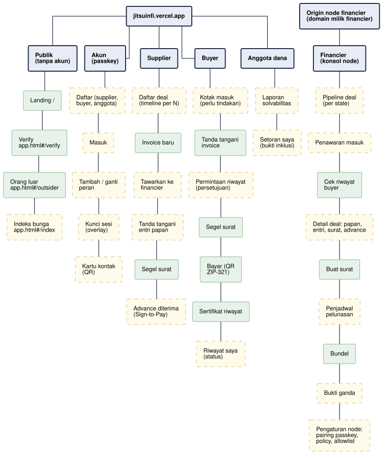

# PG-01 - Peta Halaman per Peran

**Bagian dari:** [[08 - FlowDiagrams]] · Legenda: [[FD-00 - Arsitektur Target dan Legenda]] · Item: [[AC-HNK-21 - Polish halaman internal web app|HNK-21]] · [[AC-HNK-10 - Web app per peran|HNK-10]]

Halaman target web app, diturunkan dari sequence per peran. Sekarang (HNK-22.T3, PR #4) `app.html` punya halaman publik (Verify, What outsiders see), halaman Account, dan layar peran (Supplier, Buyer, Fund member) yang hanya terbuka setelah masuk; simulasi Financier keluar dari navigasi tetapi masih bisa dibuka lewat alamat sampai konsol node ada. Setiap tab adalah kumpulan kartu salin-tempel. Kotak hijau = sudah ada sebagai simulasi, kuning putus-putus = USULAN. Konsol financier tidak berada di jitsuinfi.vercel.app: disajikan oleh node financier di origin node (P-11). Sejak HNK-31 (D-52) semua halaman berupa route React dengan URL bersih (`/try`, `/verify`, `/outsider`, `/rates`, `/account`, `/supplier`, `/buyer`, `/member`, `/apply`, `/console`); alamat `app.html#/x` lama dialihkan.



```plantuml
@startuml pg-01-pages
!include dfd-style.iuml
skinparam nodesep 14
skinparam ranksep 34
skinparam rectangle<<have>> {
  BackgroundColor #E7F3EA
  BorderColor #2E7D32
}
skinparam rectangle<<new>> {
  BackgroundColor #FFFBEA
  BorderColor #B8860B
  BorderStyle dashed
}
skinparam rectangle<<group>> {
  BackgroundColor #E8ECF6
  BorderColor #1F2A44
  BorderThickness 2
  FontStyle bold
}
rectangle "jitsuinfi.vercel.app" <<group>> as ROOT
rectangle "Origin node financier\n(domain milik financier)" <<group>> as NODE
rectangle "Publik\n(tanpa akun)" <<group>> as PUB
rectangle "Akun\n(passkey)" <<group>> as AUTH
rectangle "Supplier" <<group>> as SUP
rectangle "Buyer" <<group>> as BUY
rectangle "Financier\n(konsol node)" <<group>> as FIN
rectangle "Anggota dana" <<group>> as MEM
ROOT -down- PUB
ROOT -down- AUTH
ROOT -down- SUP
ROOT -down- BUY
NODE -down- FIN
ROOT -down- MEM
rectangle "Landing /" <<have>> as p1
rectangle "Verify\n/verify" <<have>> as p2
rectangle "Orang luar\n/outsider" <<have>> as p3
rectangle "Indeks bunga\n/rates" <<new>> as p4
PUB -down- p1
p1 -down- p2
p2 -down- p3
p3 -down- p4
rectangle "Daftar (supplier,\nbuyer, anggota)" <<have>> as a1
rectangle "Masuk" <<have>> as a2
rectangle "Tambah / ganti\nperan" <<have>> as a3
rectangle "Kunci sesi\n(overlay)" <<have>> as a4
rectangle "Kartu kontak\n(QR)" <<new>> as a5
AUTH -down- a1
a1 -down- a2
a2 -down- a3
a3 -down- a4
a4 -down- a5
rectangle "Daftar deal\n(timeline per N)" <<have>> as s1
rectangle "Invoice baru" <<have>> as s2
rectangle "Tawarkan ke\nfinancier" <<have>> as s3
rectangle "Tanda tangani\nentri papan" <<have>> as s4
rectangle "Segel surat" <<have>> as s5
rectangle "Advance diterima\n(Sign-to-Pay)" <<have>> as s6
SUP -down- s1
s1 -down- s2
s2 -down- s3
s3 -down- s4
s4 -down- s5
s5 -down- s6
rectangle "Kotak masuk\n(perlu tindakan)" <<new>> as b1
rectangle "Tanda tangani\ninvoice" <<have>> as b2
rectangle "Permintaan riwayat\n(persetujuan)" <<new>> as b3
rectangle "Segel surat" <<have>> as b4
rectangle "Bayar (QR\nZIP-321)" <<have>> as b5
rectangle "Sertifikat riwayat" <<have>> as b6
rectangle "Riwayat saya\n(status)" <<new>> as b7
BUY -down- b1
b1 -down- b2
b2 -down- b3
b3 -down- b4
b4 -down- b5
b5 -down- b6
b6 -down- b7
rectangle "Pipeline deal\n(per state)" <<new>> as f1
rectangle "Penawaran masuk" <<new>> as f2
rectangle "Cek riwayat\nbuyer" <<have>> as f3
rectangle "Detail deal: papan,\nentri, surat, advance" <<new>> as f4
rectangle "Buat surat" <<have>> as f5
rectangle "Penjadwal\npelunasan" <<new>> as f6
rectangle "Bundel" <<have>> as f7
rectangle "Bukti ganda" <<new>> as f9
rectangle "Pengaturan node:\npairing passkey,\npolicy, allowlist" <<new>> as f8
FIN -down- f1
f1 -down- f2
f2 -down- f3
f3 -down- f4
f4 -down- f5
f5 -down- f6
f6 -down- f7
f7 -down- f9
f9 -down- f8
rectangle "Laporan\nsolvabilitas" <<new>> as m1
rectangle "Setoran saya\n(bukti inklusi)" <<new>> as m2
MEM -down- m1
m1 -down- m2
@enduml
```

## Halaman dan isinya

| Peran | Halaman | Isi | Sequence | Status |
|---|---|---|---|---|
| Publik | Landing | 6 bab, EN/中文 | — | ADA (jitsuinfi.vercel.app) |
| Publik | Coba double-finance (`/try`) | Kit invoice tersegel Case File #0417 (M-02), meja financier A dan B, verdict 偽 / 重; tanpa wallet dan akun (D-40) | [[SEQ-04 - Verifier dan Orang Luar]] | PARSIAL (HNK-30.T3; edit invoice T4, Exhibit A T5) |
| Publik | Verify (`/verify`) | Tempel bundel/bukti, verdict, unduh bukti; snapshot papan otomatis (P-06) | [[SEQ-04 - Verifier dan Orang Luar]] | ADA (snapshot diunggah sebagai file) |
| Publik | Orang luar (`/outsider`) | Tabel publik vs tersembunyi, uraian memo | SEQ-04 | ADA |
| Publik | Indeks bunga (`/rates`) | Kelas tenor × kelas diskon, k = 5; butuh export wasm `rateIndex` | SEQ-04 | USULAN (HNK-08.T3) |
| Akun | Daftar, Masuk, Tambah/ganti peran, Kunci sesi, Kartu kontak | Satu passkey per orang, salt per peran, kotak surat; untuk supplier, buyer, anggota dana (financier lewat pairing node) | [[SEQ-00 - Autentikasi dan Onboarding]] | ADA (PR #4): Daftar, Masuk, Tambah/ganti peran, Kunci sesi (HNK-22.T1 – T4, `#/account`); Kartu kontak dan kotak surat USULAN (HNK-22.T5, P-04) |
| Supplier | Daftar deal | Satu timeline per N: tanda tangan buyer, penawaran, entri, surat, advance (pelunasan menyusul) | [[SEQ-01 - Supplier]] | ADA (HNK-24.T9, tersimpan terenkripsi) |
| Supplier | Invoice baru | Unlock passkey supplier, key per invoice dari master (P-03), file syarat, kirim ke buyer | SEQ-01 | ADA (HNK-24.T2; kirim lewat salin-tempel) |
| Supplier | Tawarkan, Tanda tangani entri | Financier dari key yang ditempel (kontak menyusul, HNK-22), tanda tangani entri untuk komitmennya | SEQ-01 | ADA (HNK-24.T5 – T6; salin-tempel sampai relay) |
| Supplier | Segel surat, Advance diterima | Seal supplier dengan isi surat dan cek PDF (P-13); status advance. Verifikasi Sign-to-Pay yang kuat berjalan di CLI lokal supplier, bukan di halaman ini | SEQ-01 | ADA (HNK-24.T7 – T8) |
| Buyer | Kotak masuk | Invoice untuk ditandatangani, surat untuk disegel, tagihan jatuh tempo, permintaan riwayat | [[SEQ-02 - Buyer]] | USULAN |
| Buyer | Tanda tangani invoice, Segel surat, Bayar | Tanda tangan, seal, QR; cek hash file (HNK-21) dan isi surat (P-13) belum ada; QR hanya untuk surat `Sealed` (USULAN) | SEQ-02 | ADA (simulasi, sebagian) |
| Buyer | Sertifikat riwayat | Terbitkan sertifikat (nomor `k` masih diketik) | SEQ-02 | ADA (simulasi) |
| Buyer | Permintaan riwayat, Riwayat saya | Persetujuan, `k` otomatis (P-09), status per invoice | SEQ-02 | USULAN (wasm ADA) |
| Financier | Pipeline deal, Penawaran, Detail deal, Penjadwal pelunasan | State `Flow` per N, tombol aksi per state, status pelunasan; di origin node | [[SEQ-03 - Financier]] | USULAN (butuh API HNK-05.T3, P-11) |
| Financier | Cek riwayat, Buat surat, Bundel | Kartu yang sudah ada (sekarang di jitsuinfi.vercel.app), dipindah ke detail deal di konsol node | SEQ-03 | ADA (simulasi) |
| Financier | Bukti ganda | Bukti JTSP dengan posisi papan: `DoubleFinanced` dari `proof_from_lookup`, `AlreadyFinanced` hanya dengan P-14 | SEQ-03 | USULAN |
| Financier | Pengaturan node | Pairing passkey, policy standar minimal, allowlist | SEQ-00 (pairing), [[DFD-2.6 - Riwayat Buyer]] 6.7 | USULAN |
| Anggota dana | Laporan solvabilitas, Setoran saya | Membaca hasil pindaian lokal (P-10); kuitansi dan jalur Merkle dari kotak surat | [[SEQ-05 - Anggota Dana]] | USULAN (HNK-15.T3) |
