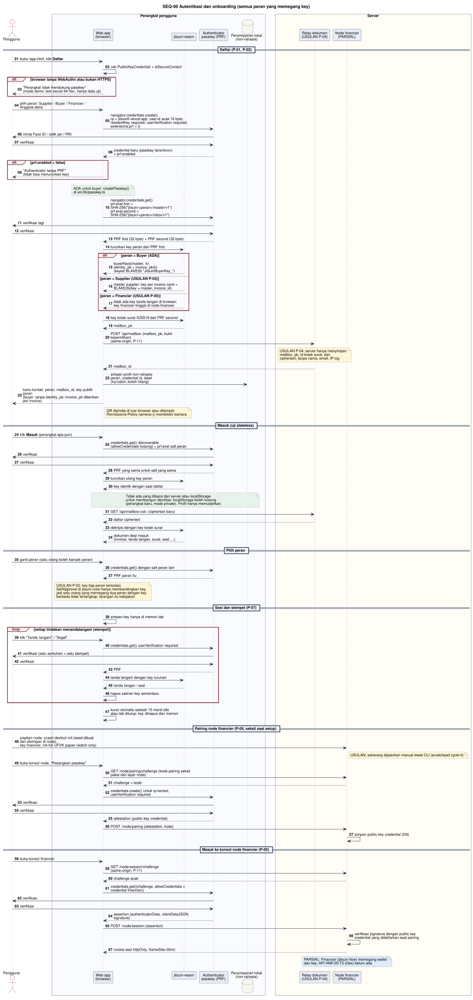

# SEQ-00 - Autentikasi dan Onboarding

**Bagian dari:** [[08 - FlowDiagrams]] · Legenda dan usulan: [[FD-00 - Arsitektur Target dan Legenda]] · Dipakai oleh: [[SEQ-01 - Supplier]] · [[SEQ-02 - Buyer]] · [[SEQ-03 - Financier]] · [[SEQ-05 - Anggota Dana]] · DFD: [[DFD-2.1 - Identitas dan Sesi]]

Alur bersama semua peran yang memegang key: **daftar**, **masuk**, **tambah atau ganti peran**, **sesi dan stempel**, lalu **pairing** dan **masuk ke konsol node financier**. Supplier, buyer, dan anggota dana mendaftar di web app; financier tidak mendaftar di web app, karena key-nya tinggal di node dan konsolnya disajikan oleh node itu sendiri (P-05, P-11). Verifier dan orang luar tidak perlu akun ([[SEQ-04 - Verifier dan Orang Luar]]).

Dasar: pola Mera / WebAuthn PRF ([[Desain Jitsuin Seal]] §9). Yang sudah ada di kode: `src/lib/passkey.ts` (salt SHA-256 dari `jitsuin/buyer/master/v1`, `createPasskey`, `masterFromPasskey`) dan `buyerKeys` di `jitsuin-wasm`. Sisanya usulan P-01, P-02, P-03, P-04, P-05, P-07, P-11 di [[FD-00 - Arsitektur Target dan Legenda]].



[Buka diagram ukuran penuh](assets/seq-00-auth.svg)

```plantuml
@startuml seq-00-auth
!include seq-style.iuml
title SEQ-00 Autentikasi dan onboarding (semua peran yang memegang key)
actor "Pengguna" as U
box "Perangkat pengguna" #FAFBFE
  participant "Web app\n(browser)" as W
  participant "jitsuin-wasm" as X
  participant "Authenticator\npasskey (PRF)" as A
  database "Penyimpanan lokal\n(non-rahasia)" as L
end box
box "Server" #FFFDF5
  participant "Relay dokumen\n(USULAN P-04)" as R
  participant "Node financier\n(PARSIAL)" as NF
end box

== Daftar: supplier, buyer, anggota dana (P-01, P-02) ==
U -> W : buka /app.html, klik **Daftar**
W -> W : cek PublicKeyCredential + isSecureContext
alt browser tanpa WebAuthn atau bukan HTTPS
  W --> U : "Perangkat tidak mendukung passkey"\n(mode demo: test secret 64 hex;\nawalan TES- hanya kebijakan, kode tidak memeriksa)
end
U -> W : pilih peran pertama: Supplier / Buyer / Anggota dana
W -> A : navigator.credentials.create()\nrp.id = host halaman (default),\nuser.id acak 16 byte, user.name netral peran,\nexcludeCredentials = credential di profil,\nresidentKey + userVerification required,\nextensions.prf = {} (atau prf.eval langsung)
A -> U : minta Face ID / sidik jari / PIN
U -> A : verifikasi
A --> W : credential baru + prf.enabled
alt prf.enabled = false (atau tidak ada)
  W --> U : "Authenticator tanpa PRF".\nMinta pengguna menghapus credential yatim ini\n(atau signalUnknownCredential)
end
note over W #E7F3EA
ADA (HNK-22.T1, PR #4): registerPasskey()
di src/lib/passkey.ts dengan excludeCredentials
dari profil, nama "JitsuinFi", rp.id eksplisit
untuk produksi; authenticator nyata belum diuji
end note
W -> A : navigator.credentials.get() + allowCredentials\nprf.eval.first = SHA-256("jitsuin/<peran>/master/v1")\nprf.eval.second = SHA-256("jitsuin/<peran>/inbox/v1")
A -> U : verifikasi lagi (dilewati bila create()\nsudah mengembalikan output PRF)
U -> A : verifikasi
A --> W : PRF first (32 byte) + PRF second (32 byte)
W -> X : turunkan key peran dari PRF first
alt peran = Buyer (ADA)
  X --> W : buyerKeys(master, k):\nidentity_pk + invoice_pk(k)\n(keyed BLAKE2b "JitsuinBuyerKey_")
else peran = Supplier (USULAN P-03)
  X --> W : master supplier; key per invoice nanti dari\nBLAKE2b berpersonalisasi + input unik per invoice
else peran = Anggota dana
  X --> W : tidak ada key tanda tangan;\nhanya kotak surat (kuitansi, jalur Merkle)
end
W --> U : sidik jari key publik peran (pendek),\nsupaya pengguna tahu passkey yang dipilih benar
W -> X : key kotak surat X25519 dari PRF second
X --> W : mailbox_pk, mailbox_id = BLAKE2b(mailbox_pk)
W -> R : POST /api/mailbox {mailbox_pk, bukti kepemilikan}\n(same-origin, P-11)
note over R #FFF6D6
USULAN P-04: relay menyimpan mailbox_pk,
mailbox_id turunan, ciphertext, dan masa
simpan. Isi tidak terbaca, tetapi relay
dan proxy melihat metadata: IP pengirim,
kotak surat tujuan, ukuran, waktu
end note
R --> W : diterima (id sama dengan yang dihitung klien)
W -> L : simpan profil non-rahasia:\nperan, credential id, label\n(try/catch; boleh hilang)
W --> U : kartu kontak: peran, mailbox_pk, key publik peran\n(buyer: tanpa identity_pk; invoice_pk per invoice)
note right of W #FFF6D6
QR dipindai di luar browser atau ditempel:
Permissions-Policy camera=() memblokir kamera
end note

== Masuk (uji stateless) ==
U -> W : klik **Masuk** (perangkat lain: hanya\ndengan passkey tersinkron atau security key dibawa)
W -> A : credentials.get() + prf.eval salt peran\n(allowCredentials dari profil bila ada)
A -> U : verifikasi
U -> A : verifikasi
A --> W : PRF yang sama untuk credential dan salt yang sama
W -> X : turunkan ulang key peran dan key kotak surat
X --> W : key identik dengan saat daftar,\nmailbox_id dihitung ulang dari mailbox_pk
W --> U : sidik jari key publik (cek passkey yang dipilih)
note over W, L #E7F3EA
Identitas tidak dibangun dari server atau localStorage:
localStorage boleh kosong (perangkat baru, mode private).
Profil hanya memudahkan memilih credential.
end note
W -> R : GET /api/mailbox/<mailbox_id>/challenge
R --> W : challenge sekali pakai, dienkripsi ke mailbox_pk
W -> X : buka challenge dengan key kotak surat
W -> R : GET /api/mailbox/<mailbox_id> + challenge terbuka
R --> W : daftar ciphertext (hanya untuk pemilik)
W -> X : dekripsi dengan key kotak surat
X --> W : dokumen deal masuk\n(invoice, tanda tangan, surat, seal, ...)

== Tambah atau ganti peran ==
U -> W : tambah atau ganti peran\n(satu orang boleh banyak peran)
W -> A : credentials.get() credential yang sama,\nsalt peran lain (bukan create() baru)
A --> W : PRF peran itu
note over W #FFF6D6
USULAN P-02: key tiap peran terisolasi.
SelfApproval di jitsuin-core hanya membandingkan
key, jadi satu orang dengan dua peran dan key
berbeda tidak tertangkap; larangan itu kebijakan
end note

== Sesi dan stempel (P-07) ==
W -> W : di memori tab hanya key kotak surat\ndan key publik peran
loop setiap tindakan menandatangani (stempel)
  U -> W : klik "Tanda tangani" / "Segel"
  W -> A : credentials.get() userVerification required,\nsalt peran
  A -> U : verifikasi (satu sentuhan = satu stempel)
  U -> A : verifikasi
  A --> W : PRF (stempel)
  W -> X : turunkan key tanda tangan sebagai Uint8Array,\ntanda tangani
  X --> W : tanda tangan / seal
  W -> W : isi Uint8Array dengan nol
end
note over W #FDECEC
Ini cek niat (UX), bukan kontrol keamanan:
skrip di tab yang sama tetap bisa meminta PRF.
ADA (HNK-22.T4, PR #4): account.stamp() per tanda
tangan, varian *Bytes menolkan Uint8Array (HNK-27.T9);
sesi hanya memegang key kotak surat dan sidik jari
end note
W -> W : kunci otomatis setelah 15 menit idle\natau tab ditutup

== Pairing node financier (P-05, satu kali; pendaftaran financier) ==
U -> NF : siapkan node: zcash-devtool init (seed di node),\nkey financier, key kotak surat, init-fvk UFVK papan
note right of NF #FFF6D6
USULAN; sekarang dijalankan manual
lewat CLI (scratchpad cycle-it)
end note
note over NF #FFF6D6
Syarat WebAuthn: rp.id harus domain (bukan IP),
konsol di HTTPS (atau localhost / tunnel SSH)
end note
U -> W : buka konsol di origin node, "Pasangkan passkey"
W -> NF : GET /node/pairing/challenge\n(kode pairing sekali pakai dari layar node)
NF --> W : challenge + kode
W -> A : credentials.create() untuk rp.id domain node,\nuserVerification required
A -> U : verifikasi
U -> A : verifikasi
A --> W : attestation (public key credential)
W -> NF : POST /node/pairing {attestation, kode}
NF -> NF : simpan public key credential (D9)

== Masuk ke konsol node financier (P-05, P-11) ==
U -> W : buka konsol financier (origin node)
W -> NF : GET /node/session/challenge
NF --> W : challenge acak, sekali pakai, kedaluwarsa
W -> A : credentials.get({challenge,\nallowCredentials = credential financier})
A -> U : verifikasi
U -> A : verifikasi
A --> W : assertion (authenticatorData,\nclientDataJSON, signature)
W -> NF : POST /node/session {assertion}
NF -> NF : periksa challenge, origin, rpIdHash, flag UV,\nsignature dengan credential dari pairing
NF --> W : cookie sesi Secure, __Host-, HttpOnly,\nSameSite=Strict
note over NF #DDEBFA
PARSIAL: Financier (jitsuin-flow) memegang wallet
dan key; API HNK-05.T3 (Dex) belum ada. Node
memegang key kotak surat financier dan meneruskan
relay di /node/mail/*, jadi konsol tetap same-origin
end note
@enduml
```

## Langkah penting

| Bagian | Langkah | Status | Sumber |
|---|---|---|---|
| Daftar | `create()` dengan ekstensi PRF, cek `prf.enabled` | ADA (HNK-22.T1, PR #4): `excludeCredentials`, nama netral, tolak tanpa PRF; authenticator nyata belum diuji (HNK-22.T7) | `src/lib/passkey.ts` `registerPasskey` |
| Daftar | `get()` dengan `prf.eval.first = SHA-256("jitsuin/<peran>/master/v1")`, `second` = salt inbox | ADA (HNK-22.T2, PR #4); uji PRF nyata belum tercatat | `evaluatePrf` |
| Daftar | Satu passkey per orang, menambah peran lewat `get()`, sidik jari key | ADA (HNK-22.T1 – T3, PR #4; sidik jari HMAC master, DEV-18) | `src/lib/session.ts`, `src/pages/account.ts` |
| Daftar | Salt supplier dan anggota dana, salt inbox untuk semua peran di web app (financier tanpa salt di browser) | ADA (HNK-22.T2, PR #4) | `src/lib/account.ts` |
| Daftar | Turunan key buyer `identity_pk`, `invoice_pk(k)` | ADA | `jitsuin-core::history::BuyerIdentity`, wasm `buyerKeys` |
| Daftar | Key per invoice supplier dari master | USULAN P-03 | menggantikan `downloadSecret` di `src/pages/supplier.ts` |
| Daftar | Kotak surat, `mailbox_id` turunan, kartu kontak | USULAN P-04 | — |
| Masuk | Key identik di perangkat baru (credential tersinkron yang sama) | Belum diuji | sifat PRF; belum ada kasus di TEST-HNK-10 |
| Masuk | Baca kotak surat dengan bukti kepemilikan | USULAN P-04 | — |
| Sesi | Master di memori modul | Dihapus (HNK-22.T4, PR #4): tidak ada master di memori tab; API wasm berbasis byte yang menolkan key (HNK-27.T9) | U-HNK-22.1, U-HNK-27.10 |
| Sesi | Satu sentuhan per stempel, key stempel sebagai `Uint8Array` lalu dinolkan, kunci 15 menit | ADA (HNK-22.T4, PR #4) | `account.stamp()`, U-HNK-22.1 |
| Pairing node | Seed, key financier, dan key kotak surat dibuat di node, UFVK papan diimpor, credential disimpan | USULAN P-05 | sekarang manual lewat CLI |
| Konsol financier | Assertion passkey ke node, konsol di origin node | USULAN P-05, P-11 | API HNK-05.T3 |

Status "Belum diuji" berarti kode ada tetapi belum ada kasus uji yang tercatat (lihat legenda di FD-00).

## Catatan keamanan

- Output PRF tidak pernah keluar dari browser dan tidak pernah disimpan. Yang disimpan lokal hanya profil non-rahasia (peran, id credential).
- PRF terikat ke credential. Kalau pengguna memilih passkey lain, key yang keluar berbeda tetapi tetap valid, jadi web app selalu menampilkan sidik jari key publik.
- WebAuthn mengikat passkey ke `rp.id`. Kode sekarang tidak mengisi `rp.id`, jadi nilainya host halaman: preview Vercel dan localhost menghasilkan passkey dan key yang berbeda dari jitsuinfi.vercel.app. Isi `rp.id` secara eksplisit setelah domain final dipilih, dan pilih domain itu sebelum ada pengguna sungguhan.
- Passkey tersinkron bisa dipakai di perangkat lain dalam ekosistem yang sama. Security key dan sebagian authenticator platform terikat ke satu perangkat; masuk dari perangkat lain hanya dengan membawa security key itu (USB atau hybrid).
- Belum ada pemulihan. Passkey hilang = semua key hilang; buyer tidak bisa menandatangani klaim untuk `settled`, jadi deal berjalan tercatat sebagai gagal bayar, dan key identitas yang terikat KYC tidak bisa dirotasi. Passkey kedua tidak menghasilkan PRF yang sama. Perlu keputusan (lihat P-01 di FD-00).
- Perangkat tanpa PRF tidak bisa memakai alur ini. Mode demo memakai test secret 64 karakter hex. Aturan "hanya data uji berawalan `TES-`" adalah kebijakan; kode menerima test secret apa pun dan menandatangani invoice apa pun.
- CSP `connect-src 'self'` memblokir panggilan ke origin lain. Web app menjangkau relay lewat rewrite Vercel `/api/*`; konsol financier disajikan oleh node dan menjangkau relay lewat node (`/node/mail/*`). Karena `vercel.app` ada di Public Suffix List, web app dan node selalu beda site: cookie `SameSite=Strict` dari node tidak terkirim dari web app, dan `connect-src 'self'` memblokir fetch-nya.
- Begitu relay ada, CSP tidak lagi mencegah pencurian key: skrip yang disuntikkan bisa meminta PRF dan mengirim hasilnya ke kotak surat penyerang lewat `POST /api/mailbox` di origin yang sama. Mitigasi: Trusted Types atau render ketat untuk dokumen yang ditempel, penulisan kotak surat hanya sealed box dengan rate limit, SRI atau build yang bisa direproduksi. Catat di [[Threat Model]].
- Satu `mailbox_pk` per peran diberikan ke setiap rekan, jadi rekan yang bersekongkol (atau relay) bisa menghubungkan semua invoice seorang buyer meskipun `invoice_pk(k)` berbeda. Pertimbangkan kotak surat per deal untuk surat ke buyer; sisa keterhubungan ini dicatat di [[Threat Model]].
- Kartu kontak buyer tidak memuat `identity_pk`. Ini tidak cukup untuk menyembunyikan riwayat: supplier menerima sertifikat k dan setiap financier yang diminta menerima rantai, sehingga bisa menghitung tag berikutnya (TM #6, lihat [[SEQ-02 - Buyer]]).
