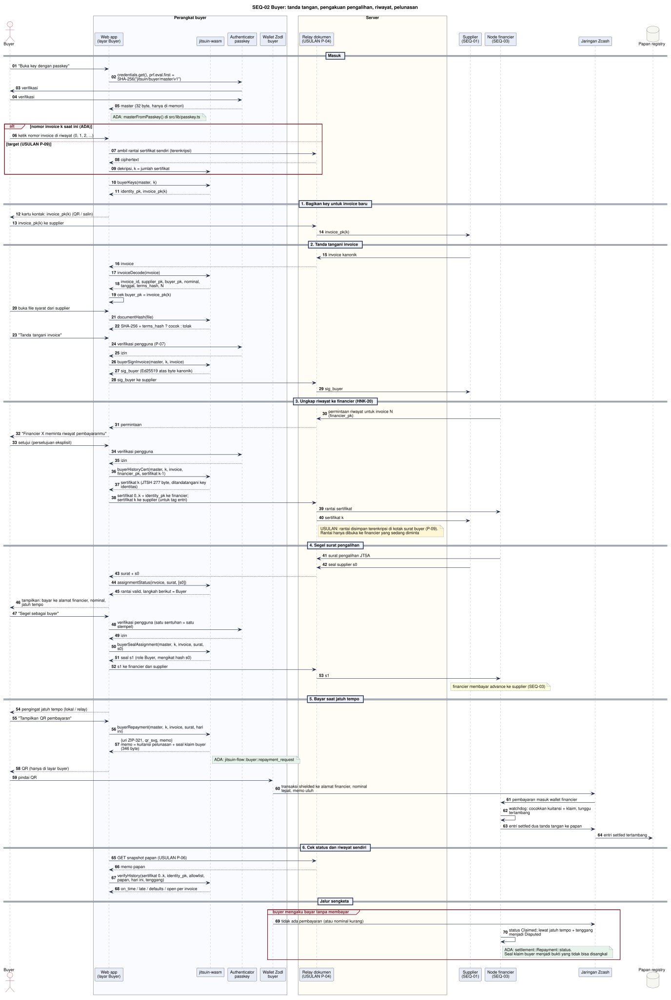

# SEQ-02 - Buyer

**Bagian dari:** [[08 - FlowDiagrams]] · Legenda: [[FD-00 - Arsitektur Target dan Legenda]] · Auth: [[SEQ-00 - Autentikasi dan Onboarding]] · Pasangan: [[SEQ-01 - Supplier]] · [[SEQ-03 - Financier]] · DFD: [[DFD-2.2 - Penerbitan dan Tanda Tangan Invoice]] · [[DFD-2.4 - Pengalihan dan Advance]] · [[DFD-2.5 - Pelunasan dan Settled]] · [[DFD-2.6 - Riwayat Buyer]]

Buyer adalah attestor: tanda tangannya membuat invoice sah, seal-nya di surat pengalihan adalah pengakuan tertulis atas pengalihan (Pasal 613 KUHPerdata), dan pembayarannya ke financier menutup deal. Semua key buyer diturunkan dari satu passkey: key identitas dan satu key per invoice berdasarkan nomor urut `k`, jadi papan publik tidak bisa menautkan invoice-invoice satu buyer. Rekan buyer tetap bisa: kotak surat buyer sama untuk semua deal (lihat [[SEQ-00 - Autentikasi dan Onboarding]]), dan pemegang sertifikat riwayat bisa mengikuti tag berikutnya (bagian 3).

Kode yang dipakai: `src/lib/passkey.ts`, `src/pages/buyer.ts`, `jitsuin-wasm` (`buyerKeys`, `invoiceDecode`, `documentHash`, `buyerSignInvoice`, `buyerHistoryCert`, `buyerSealAssignment`, `assignmentStatus`, `buyerRepayment`, `verifyHistory`), `jitsuin-flow::buyer` (`repayment_request`, `seal_assignment`, `qr_svg`).



[Buka diagram ukuran penuh](assets/seq-02-buyer.svg)

```plantuml
@startuml seq-02-buyer
!include seq-style.iuml
title SEQ-02 Buyer: tanda tangan, pengakuan pengalihan, riwayat, pelunasan
actor "Buyer" as B
box "Perangkat buyer" #FAFBFE
  participant "Web app\n(layar Buyer)" as W
  participant "jitsuin-wasm" as X
  participant "Authenticator\npasskey" as A
  participant "Wallet Zodl\nbuyer" as ZW
end box
box "Server" #FFFDF5
  participant "Relay dokumen\n(USULAN P-04)" as R
end box
participant "Supplier\n(SEQ-01)" as S
participant "Node financier\n(SEQ-03)" as F
participant "Jaringan Zcash" as Z
database "Papan registry" as P

== Masuk ==
B -> W : "Buka key dengan passkey"
W -> A : credentials.get(),\nprf.eval.first = SHA-256("jitsuin/buyer/master/v1")
A -> B : verifikasi
B -> A : verifikasi
A --> W : master (32 byte, hanya di memori)
note right of W #E7F3EA : ADA: masterFromPasskey() di src/lib/passkey.ts
alt nomor invoice k saat ini (ADA)
  B -> W : ketik nomor invoice di riwayat (0, 1, 2, ...)
else target (USULAN P-09)
  W -> R : ambil rantai sertifikat sendiri (terenkripsi)
  R --> W : ciphertext + kepala rantai bertanda tangan\n(indeks, hash)
  W -> X : dekripsi; verifyHistory rantai sendiri terhadap papan
  X --> W : k = jumlah sertifikat yang sudah tertambat di papan
  note right of W #FDECEC
  Sertifikat yang tidak pernah tertambat (financier
  tidak jadi registrasi) dibuang sebelum pengungkapan
  berikutnya. Kepala rantai bertanda tangan mendeteksi
  relay yang menghapus sertifikat terakhir (k dipakai
  ulang = riwayat bercabang). Aturan alokasi k: P-09
  end note
end
W -> X : buyerKeys(master, k)
X --> W : identity_pk, invoice_pk(k)

== 1. Bagikan key untuk invoice baru ==
W --> B : invoice_pk(k) (QR / salin)
B -> R : invoice_pk(k) ke supplier
R -> S : invoice_pk(k)

== 2. Tanda tangani invoice ==
S -> R : invoice kanonik + PDF syarat
R --> W : invoice + PDF syarat
W -> X : invoiceDecode(invoice)
X --> W : invoice_id, supplier_pk, buyer_pk, nominal,\ntanggal, terms_hash, N
W --> B : tampilkan isi; buyer_pk = invoice_pk(k)?
W -> X : documentHash(PDF syarat)
X --> W : SHA-256 = terms_hash ? cocok : tolak
note right of W #DDEBFA
PARSIAL: layar Buyer belum punya input file,
cek hash, dan perbandingan buyer_pk di layar
end note
B -> W : "Tanda tangani invoice"
W -> A : verifikasi pengguna (USULAN P-07)
A --> W : PRF (stempel)
W -> X : buyerSignInvoice(master, k, invoice)
X -> X : tolak bila buyer_pk bukan invoice_pk(k) (ADA)
X --> W : buyer_signature (Ed25519 atas byte kanonik)
W -> R : buyer_signature ke supplier
R -> S : buyer_signature

== 3. Ungkap riwayat ke financier (HNK-20) ==
F -> R : permintaan riwayat untuk invoice N\n(financier_pk, ditandatangani node)
R --> W : permintaan
W -> X : cek tanda tangan permintaan terhadap\nkontak financier yang diverifikasi di luar sistem
W --> B : "Financier X meminta riwayat pembayaranmu"
B -> W : setujui (persetujuan eksplisit)
W -> A : verifikasi pengguna (USULAN P-07)
A --> W : PRF (stempel)
W -> X : buyerHistoryCert(master, k, invoice,\nfinancier_pk, sertifikat k-1)
X --> W : sertifikat k (JTSH 277 byte,\nditandatangani key identitas)
W -> R : sertifikat 0..k + identity_pk ke financier;\nsertifikat k ke supplier (untuk entri bertag)
R -> F : rantai sertifikat
R -> S : sertifikat k
note right of R #FDECEC
Supplier dan setiap financier yang diminta (termasuk
yang menolak) memegang sertifikat k, jadi bisa menghitung
tag invoice berikutnya dan memantau atau mengganggu
(TM #6). Varian wasm yang hanya menerima history_tag
sudah ADA (HNK-27.T8); pengiriman tag saja ke supplier
menunggu relay (HNK-23.T7)
end note

== 4. Segel surat pengalihan ==
F -> R : surat JTSA + PDF surat\n(SEQ-03 bagian 1b, ditandatangani node)
S -> R : seal supplier s0
R --> W : surat + PDF surat + s0
W -> X : assignmentStatus(invoice, surat, [s0])
X --> W : rantai valid, langkah berikut = Buyer
B -> W : buka PDF surat
W -> X : documentHash(PDF surat) = terms_hash surat?
W --> B : tampilkan: alamat bayar, financier_pk,\nnominal, jatuh tempo
note right of W #DDEBFA
PARSIAL: assignmentDecode ADA di wasm (HNK-27.T3);
layar Buyer masih menyegel surat tanpa menampilkan
isi dan tanpa cek PDF surat (HNK-25.T3). Seal ini
pengakuan tertulis (Pasal 613), jadi isi wajib terbaca
end note
B -> W : "Segel sebagai buyer"
W -> A : verifikasi pengguna (USULAN P-07)
A --> W : PRF (stempel)
W -> X : buyerSealAssignment(master, k, invoice, surat, s0)
X --> W : seal s1 (role Buyer, mengikat hash s0)
W -> R : s1 ke financier dan supplier
R -> F : s1
F -> Z : advance ke supplier, memo dengan seal s2 (SEQ-03)
F -> R : s2 ke buyer (USULAN)
R --> W : s2

== 5. Bayar saat jatuh tempo ==
W --> B : pengingat jatuh tempo (lokal di perangkat;\natau pesan terenkripsi dari node financier)
B -> W : "Tampilkan QR pembayaran"
W -> X : assignmentStatus(invoice, surat, [s0, s1, s2]) = Sealed?
note right of X #FFF6D6
USULAN: QR hanya untuk surat Sealed, alamat
bayar ditampilkan. Sekarang wasm membuat QR dari
surat apa pun yang ditempel; surat palsu dengan
alamat lain juga menghasilkan QR
end note
W -> X : buyerRepayment(master, k, invoice, surat, hari ini)
X --> W : {uri ZIP-321, qr_svg, memo}\nmemo = kuitansi pelunasan + seal klaim buyer\n(346 byte)
note right of X #E7F3EA : ADA: jitsuin-flow::buyer::repayment_request
W --> B : QR (hanya di layar buyer)
B -> ZW : pindai QR
ZW -> Z : transaksi shielded ke alamat financier,\nnominal tepat, memo utuh
Z -> F : pembayaran masuk wallet financier
F -> F : penjadwal: cocokkan kuitansi + klaim,\ntunggu tertambang
F -> Z : entri settled dua tanda tangan ke papan
Z -> P : entri settled tertambang

== 6. Cek status dan riwayat sendiri ==
W -> R : GET snapshot papan (USULAN P-06)
R --> W : memo papan
W -> X : verifyHistory(sertifikat 0..k, identity_pk,\nallowlist = financier di sertifikat sendiri,\npapan, hari ini, tenggang)
X --> W : on_time / late / defaults / open per invoice
note right of W #FFF6D6 : USULAN: layar Buyer belum memanggil verifyHistory

== Jalur sengketa ==
group buyer mengaku bayar tetapi nominal kurang
  ZW -> Z : tx dengan memo klaim, nominal kurang (atau dust)
  F -> F : status Claimed; lewat jatuh tempo + tenggang\nmenjadi Disputed
  note right of F #E7F3EA
  ADA: settlement::Repayment::status.
  Seal klaim buyer menjadi bukti yang tidak bisa
  disangkal. Tanpa tx sama sekali tidak ada klaim:
  statusnya Overdue
  end note
end
@enduml
```

## Ringkasan langkah dan status

| Bagian | Langkah | Status | Kode |
|---|---|---|---|
| Masuk | Master dari passkey PRF | ADA | `src/lib/passkey.ts` |
| Masuk | Nomor invoice `k` otomatis dari rantai yang tertambat | USULAN P-09 | sekarang diketik di layar Buyer |
| 1 | Bagikan `invoice_pk(k)` | ADA (salin) / USULAN (relay) | wasm `buyerKeys` |
| 2 | Tolak invoice yang bukan untuk key k | ADA | wasm `buyerSignInvoice` |
| 2 | Tampilkan isi, cek hash PDF syarat, tanda tangani | PARSIAL: decode + tanda tangan ADA; input file, cek hash, dan perbandingan di layar belum ada (HNK-21) | wasm `invoiceDecode`, `documentHash`, `buyerSignInvoice` |
| 3 | Terbitkan sertifikat riwayat dengan persetujuan | ADA (fungsi) / USULAN (alur persetujuan, permintaan bertanda tangan) | wasm `buyerHistoryCert` |
| 4 | Segel surat pengalihan | PARSIAL: seal ADA; isi surat dan cek PDF surat USULAN P-13 | wasm `buyerSealAssignment` |
| 5 | QR ZIP-321 dengan kuitansi + klaim | ADA (cek `Sealed` sebelum QR USULAN) | wasm `buyerRepayment`, `assignmentStatus`, `jitsuin-flow::buyer` |
| 5 | Bayar dari Zodl | Belum diuji (SPK-04 TODO); fallback: wallet `zcash-devtool` | `jitsuin-wallet::Devtool::pay_uri` |
| 6 | Cek riwayat sendiri terhadap papan | PARSIAL: wasm ADA; kartu di layar Buyer dan snapshot (P-06) USULAN | wasm `verifyHistory` |
| Sengketa | Klaim dengan nominal kurang berakhir `Disputed`; tanpa tx `Overdue` | ADA | `jitsuin-flow::settlement` |
