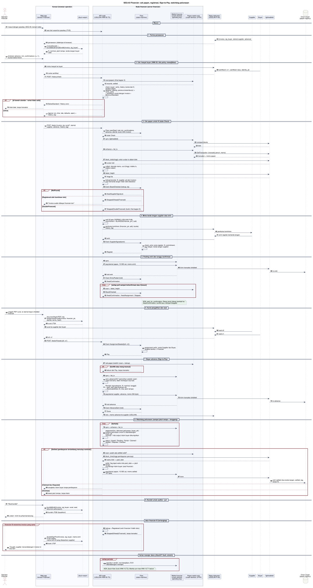

# SEQ-03 - Financier

**Bagian dari:** [[08 - FlowDiagrams]] · Legenda: [[FD-00 - Arsitektur Target dan Legenda]] · Auth: [[SEQ-00 - Autentikasi dan Onboarding]] · Pasangan: [[SEQ-01 - Supplier]] · [[SEQ-02 - Buyer]] · DFD: [[DFD-2.3 - Registrasi Papan]] · [[DFD-2.4 - Pengalihan dan Advance]] · [[DFD-2.5 - Pelunasan dan Settled]] · [[DFD-2.6 - Riwayat Buyer]] · [[DFD-2.7 - Deteksi Pembiayaan Ganda]] · [[DFD-2.8 - Verifikasi dan Indeks Publik]]

Financier memakai dua lapisan:
- **Konsol web** (browser operator, disajikan oleh node di origin node, P-11) untuk membaca penawaran, membuat surat pengalihan, memeriksa riwayat buyer, dan membuat bundel.
- **Node financier** (server milik financier) yang memegang wallet, spending key, key financier, dan key kotak surat financier (USULAN P-05; node sekarang PARSIAL). Node menjalankan state machine `jitsuin-flow::financier::Flow` dan penjadwal pelunasan, dan meneruskan relay di `/node/mail/*` sehingga konsol tetap same-origin.

Advance hanya dibayar dari state `Pay`: entri financier ini adalah entri valid pertama untuk N, sudah terkonfirmasi, dan surat pengalihan sudah disegel supplier dan buyer. Keluaran uang lain hanya posting papan (entri register dan entri `settled`, masing-masing 10 000 zat + fee). Semua jalur lain berhenti sebelum advance keluar.

Kode yang dipakai: `jitsuin-flow::financier` (`Flow`, `State`, `Event`, `Financier::{check, register, wait_for_confirmation, pay_advance}`, `sent_advance`), `jitsuin-flow::history::check_buyer`, `jitsuin-flow::settlement` (`repayment`, `Repayment::status`, `settle`, `Financier::post_settled`), `jitsuin-board` (`scan`, `lookup`, `settled`, `proof_from_lookup`, `proof_from_offer`, `lwd::{block_txids, latest_height, block_time}`), `jitsuin-wallet::Devtool`, `src/pages/financier.ts`.



[Buka diagram ukuran penuh](assets/seq-03-financier.svg)

```plantuml
@startuml seq-03-financier
!include seq-style.iuml
title SEQ-03 Financier: cek papan, registrasi, Sign-to-Pay, pelunasan
actor "Operator\nfinancier" as O
box "Konsol (browser operator, origin node)" #FAFBFE
  participant "Web app\n(konsol Financier)" as W
  participant "jitsuin-wasm" as X
end box
box "Node financier (server financier)" #F3F6FB
  participant "API node\n(USULAN HNK-05.T3)" as API
  participant "Flow\n(state machine)" as FL
  participant "Wallet financier\n(zcash-devtool,\nspending key)" as WF
  participant "Papan watch-only\n(zcash-devtool, UFVK)" as WB
end box
participant "Relay dokumen\n(USULAN P-04)" as R
participant "Supplier" as S
participant "Buyer" as B
participant "Verifier / pihak\nberwenang" as V
participant "lightwalletd" as LW
database "Chain Zcash\n(papan registry)" as C

== Masuk ==
O -> W : masuk dengan passkey konsol (SEQ-00, P-05)
W -> API : sesi dari assertion passkey

== 1. Terima penawaran ==
S -> R : {invoice, buyer_signature, alamat supplier, advance}
R -> API : penawaran (GET /node/mail, didekripsi\ndengan key kotak surat financier di node)
API --> W : penawaran
W -> X : invoiceDecode + bundleBuild({invoice, buyer_signature})
X --> W : N, nominal, jatuh tempo; gagal bila tanda tangan\nbuyer tidak valid (tolak tanpa transaksi)
O -> W : tentukan advance dan min_confirmations (>= 1)

== 1b. Siapkan komitmen dan surat (sebelum Flow::new) ==
W -> API : POST /node/deals/N/commitment
API -> API : salt 32 byte CSPRNG, disimpan per (invoice, financier)\ndan dipakai ulang saat retry (USULAN P-08);\ncommitment = BLAKE2b(financier_pk || salt)
API -> API : kelas diskon/tenor = classes_for(nominal, advance,\ntanggal advance, jatuh tempo) (USULAN: belum dipanggil)
API --> W : commitment, kelas (operator mengonfirmasi)
API -> WF : alamat shielded diversified baru untuk deal ini (USULAN)
WF --> API : alamat bayar financier
O -> W : unggah PDF surat
W -> X : documentHash(PDF) lalu assignmentEncode(invoice,\nfinancier_pk, alamat, terms_hash)
X --> W : surat JTSA
W -> API : surat + PDF surat
API -> R : ke supplier: pembuka komitmen {financier_pk, salt}, kelas,\nsurat + PDF; ke buyer: surat + PDF (ditandatangani node)
note right of API #E7F3EA
Flow::new butuh surat dan komitmen (assignment.verify
di awal). Seal boleh dikumpulkan lebih awal, tetapi baru
diterapkan di AwaitAssignment. Teks kartu surat di
financier.ts ("After your board entry is confirmed")
bertentangan dengan urutan ini (perbaiki di HNK-21)
end note

== 2. Cek riwayat buyer (HNK-20, bila policy mewajibkan) ==
API -> R : permintaan riwayat ke buyer (ditandatangani node)
B -> R : sertifikat 0..k-1, sertifikat k baru, identity_pk
R -> API : rantai sertifikat
W -> API : POST /node/history/check
API -> WB : scan(papan) (lihat bagian 3)
WB --> API : records, settled
API -> API : check_buyer: verify_certs(0..k) + sertifikat k cocok\ndengan invoice; verify_history(0..k-1): jangkar papan,\nallowlist, cabang, penerus tersembunyi; MinimumStandard
alt di bawah standar / rantai tidak valid
  API --> W : BelowStandard / History error
  W --> O : tolak deal, tanpa transaksi
else entri palsu bertag penerus (griefing, Spec #1)
  API --> W : UndisclosedSuccessor
  W --> O : riwayat ditolak walau buyer jujur;\nbelum ada jalur bantahan
else lulus
  API -> API : simpan laporan (on_time, late, defaults, open)\n+ history_tag di deal
  API --> W : laporan
end
note right of API #FDECEC
Bagian 2 harus selesai sebelum entri bertag diposting
(bagian 5): begitu entri bertag k ada di papan, cek ulang
menghasilkan UndisclosedSuccessor. Setelah crash, lanjut dari
history_tag yang tersimpan, jangan jalankan ulang cek riwayat
end note

== 3. Cek papan untuk N (state Check) ==
W -> API : POST /node/deals {invoice, buyer_signature, surat,\nkomitmen, alamat supplier, advance, min_confirmations,\nhistory_tag}
API -> FL : Flow::new(Deal) (cek min_confirmations, advance,\nalamat, surat milik invoice)
FL --> API : state Check
API -> WB : sync (lightwalletd)
WB -> LW : compact blocks
LW --> WB : blok
API -> WB : enhance + list_tx
WB -> LW : GetTransaction (transaksi penuh, memo)
LW --> WB : transaksi + memo papan
API -> LW : block_txids(tinggi) untuk urutan tx dalam blok
LW --> API : urutan txid
API -> API : collect: decode memo, urut (tinggi, indeks tx,\nindeks output); tx belum tertambang dilewati
API -> LW : latest_height
LW --> API : tinggi tip
API -> API : lookup(records, N, supplier_pk dari invoice):\nentri bertanda tangan tidak valid diabaikan
API -> FL : Event BoardChecked {lookup, tip}
alt NotFound
  FL --> API : AwaitSupplierSignature
else Registered oleh komitmen lain
  FL --> API : Stopped(AlreadyFinanced)
  API --> W : "Invoice sudah dibiayai financier lain"
else Registered oleh komitmen sendiri (lanjut setelah crash)
  FL --> API : AwaitConfirmation (belum cukup konfirmasi)\n/ AwaitAssignment
else DoubleFinanced (dua komitmen di papan)
  FL --> API : Stopped(DoubleFinanced)
  API -> API : proof_from_lookup: entri pertama + entri konflik,\nkeduanya dengan posisi di papan
  API --> W : bukti JTSP lengkap (lolos jitsuin verify)
end

== 4. Minta tanda tangan supplier atas entri ==
API -> R : minta entri untuk komitmen ini (+ history_tag)
R -> S : permintaan (pembuka komitmen sudah dikirim di 1b)
S -> R : entri register bertanda tangan
R -> API : entri
API -> FL : Event SupplierSigned(entri)
FL -> FL : check_entry: jenis register, N, commitment,\ntag riwayat (bila deal punya tag), tanda tangan supplier
alt entri salah (EntryMismatch)
  FL --> API : error, state tetap AwaitSupplierSignature
else lolos
  FL --> API : Register
end
note right of FL #FDECEC
Entri yang ditawarkan tidak disimpan setelah Register
(diganti txid). Tidak ada cek papan ulang: BoardChecked
ditolak di AwaitSupplierSignature dan Register (UnexpectedEvent).
register() tidak punya pemulihan seperti sent_advance: crash
sebelum tertambang bisa membuat posting ganda (entri bertag
ganda = Equivocation, Spec #2)
end note

== 5. Posting entri dan tunggu konfirmasi ==
API -> WF : sync
API -> WF : pay(alamat papan, 10 000 zat, memo entri)
WF -> LW : kirim transaksi shielded
LW -> C : tx entri
WF --> API : txid entri
API -> FL : Event EntryPosted {txid}
FL --> API : AwaitConfirmation
loop setiap poll sampai terkonfirmasi atau timeout
  API -> WB : scan + latest_height
  API -> FL : BoardChecked
  FL --> API : AwaitConfirmation / AwaitAssignment / Stopped
end
note right of FL #E7F3EA
ADA: wait_for_confirmation. Entri hilang saat scan kembali
ke AwaitConfirmation; konflik baru menjadi Stopped
end note
note right of FL #FDECEC
Entri yang ditambang ulang di tinggi lain di antara dua poll
tidak mengulang hitungan konfirmasi: Flow memakai posisi lama
end note

== 6. Kumpulkan seal (surat dikirim di 1b) ==
S -> R : seal s0
B -> R : seal s1
R -> API : s0, s1
API --> W : s0, s1
W -> API : POST /node/deals/N/seals [s0, s1]
API -> FL : Event AssignmentSealed([s0, s1])
FL -> FL : assignment.verify: rantai Supplier lalu Buyer,\nlangkah berikut = Financier
alt seal tidak lengkap atau signer salah
  FL --> API : error (InvalidDeal / UnexpectedSigner),\nstate tetap AwaitAssignment
else lolos
  FL --> API : Pay
end

== 7. Bayar advance (Sign-to-Pay) ==
opt jeda acak sebelum Pay (USULAN, menunggu keputusan TM #12/#15)
  API -> API : tunda
end
O -> W : setujui pembayaran advance deal ini
W -> API : assertion passkey operator per deal\n(USULAN P-07)
API -> API : key node = financier_pk surat?\n(bukan: InvalidDeal, tanpa transaksi)
API -> WB : cek papan terakhir (scan + lookup)
alt entri hilang
  FL --> API : AwaitConfirmation, tanpa transaksi
else konflik baru
  FL --> API : Stopped, tanpa transaksi
end
API -> WF : sync + list_tx
API -> API : sent_advance(N)? (pemulihan setelah crash:\ncatat txid lama, tidak membayar dua kali)
API -> API : Receipt::sign(Advance, N, advance_zat, tanggal)\n+ seal_next (seal financier s2)\n+ ReceivableNote (N, nilai, jatuh tempo)
API -> WF : pay(alamat supplier, advance, memo 394 byte)
WF -> LW : kirim transaksi shielded
LW -> C : tx advance
WF --> API : txid advance
API -> FL : Event AdvanceSent {txid}
FL --> API : Done (terkirim, belum tentu tertambang)
note right of FL #FDECEC
sent_advance tidak membedakan tx tertambang, tertunda,
atau kedaluwarsa. Retry setelah advance kedaluwarsa
mencatat Done tanpa uang sampai. Usulan: cek konfirmasi
end note
API -> R : txid ke supplier; s2 ke buyer (USULAN)

== 8. Penjadwal pelunasan (sampai jatuh tempo + tenggang) ==
note right of API #DDEBFA
PARSIAL: fungsi ADA; penjadwal berkala belum ada. Posting
settled memakai spending key, padahal D-23 menulis akses
baca saja (P-12)
end note
loop berkala
  API -> WF : sync + enhance + list_tx
  API -> API : repayment(txs, dokumen pelunasan, buyer_pk):\nkuitansi pelunasan untuk N, ditandatangani buyer_pk,\nnominal = nilai output; klaim buyer dikumpulkan
  API -> API : status (prioritas): Settled > Pending >\nClaimed/Disputed > Overdue > Partial > Unpaid
end
alt Settled (pembayaran tertambang menutup nominal)
  API -> WB : scan: sudah ada settled valid yang tertambang?
  API -> API : txid settled yang sudah dikirim tersimpan?\n(scan tidak melihat tx belum tertambang)
  API -> LW : block_time(tinggi pembayaran penutup)
  LW --> API : waktu blok -> paid_date
  API -> API : settle: flag tepat waktu bila paid_date <= jatuh\ntempo; countersign klaim buyer (seal financier);\ntanpa klaim: error, tanpa entri settled
  API -> WF : pay(alamat papan, 10 000 zat, memo settled 167 byte)
  WF -> LW : kirim
  LW -> C : entri settled (dua tanda tangan, settled_tag, tanpa N)
  API -> API : simpan txid settled
else Claimed lalu Disputed
  API --> W : sengketa: klaim buyer, nominal kurang
else Overdue
  API --> W : lewat jatuh tempo, tanpa klaim
end

== 9. Bundel untuk auditor / juri ==
O -> W : "Buat bundel"
W -> X : bundleBuild({invoice, buyer_signature, surat,\nseal, dokumen pelunasan})
X --> W : bundel JTSB (base64url)
W --> O : unduh / kirim ke pihak berwenang (DFD-2.8 8.4)

== Jalur financier B (AlreadyFinanced) ==
group financier B menerima invoice yang sama
  API -> API : lookup = Registered (entri financier A lebih dulu)
  FL --> API : Stopped(AlreadyFinanced), tanpa transaksi
  API -> API : proof_from_offer(entri A di papan + posisi,\nentri B yang ditawarkan)\n(hanya bila supplier sudah memberi entri B, P-14)
  API --> W : bukti JTSP dengan posisi entri A
  note right of W #FDECEC
  Di urutan sekarang entri B tidak pernah ada (diminta hanya
  setelah NotFound). wasm doubleSignProof tidak mengisi posisi
  papan; bukti seperti itu ditolak jitsuin verify. JTSP
  membuktikan dua tanda tangan, bukan niat menipu (P-14)
  end note
  W --> O : kartu "Bukti ganda" (USULAN, PG-01): supplier\nmenandatangani invoice ini dua kali
  W -> V : unduh bukti untuk pihak berwenang
end

== Varian manajer dana (JitsuinFi Vault, stretch) ==
group setiap periode
  API -> WF : pay(akun sendiri, root kewajiban JTLR\nditandatangani manajer) (self-send)
  note right of API #E7F3EA
  ADA: jitsuin-flow::fund (HNK-15.T2);
  Merkle sum tree HNK-15.T1 belum
  end note
end
@enduml
```

## State machine `Flow`

| State | Masuk dari | Keluar ke | Uang bergerak? |
|---|---|---|---|
| `Check` | `Flow::new` | `AwaitSupplierSignature`; `AwaitConfirmation` / `AwaitAssignment` (entri sendiri sudah ada, lanjut setelah crash); `Stopped` | Tidak |
| `AwaitSupplierSignature` | papan `NotFound` | `Register` (entri lolos `check_entry`); entri salah: error, state tetap | Tidak |
| `Register` | `SupplierSigned` | `AwaitConfirmation` | Hanya 10 000 zat + fee ke papan |
| `AwaitConfirmation` | `Check` (entri sendiri belum cukup konfirmasi), `EntryPosted`, entri hilang saat scan | `AwaitAssignment`, `Stopped` | Tidak |
| `AwaitAssignment` | konfirmasi ≥ `min_confirmations` | `Pay` (seal Supplier + Buyer valid; seal salah: error, state tetap); `AwaitConfirmation` (entri hilang saat scan); `Stopped` (konflik baru) | Tidak |
| `Pay` | `AssignmentSealed` | `Done`; `AwaitConfirmation` (entri hilang saat scan); `Stopped` (konflik baru) | Advance + seal financier dalam satu transaksi |
| `Done` | `AdvanceSent` (terkirim, belum tentu tertambang) | — | — |
| `Stopped` | `AlreadyFinanced` / `DoubleFinanced` | — | Tidak pernah |

`BoardChecked` tidak diterima di `AwaitSupplierSignature` dan `Register` (`UnexpectedEvent`). Entri yang ditambang ulang di tinggi lain tidak mengulang hitungan konfirmasi.

## Ringkasan status

| Bagian | Status | Catatan |
|---|---|---|
| 1b, 2, 9 (konsol) | PARSIAL | Layar Financier punya kartu surat, riwayat, bundel; teks kartu surat bertentangan dengan urutan 1b (HNK-21) |
| 1, 6 (konsol) | USULAN | Penawaran dan seal lewat relay belum ada |
| 2 riwayat | PARSIAL | `check_buyer` ADA di flow; layar Financier hanya `verifyHistory` tanpa standar minimal |
| 3–5, 7 state machine dan wallet | ADA, diuji testnet (TEST-HNK-19 I-HNK-19.1) | Dijalankan lewat scratchpad CLI, belum lewat API |
| API node, konsol di origin node | USULAN | HNK-05.T3 (Dex), HNK-05.T4 (integrasi layar), P-05, P-11 |
| Alamat diversified per deal, jeda acak | USULAN | Menunggu keputusan Hans (TM #4, #12, #15 di pra-review) |
| 8 penjadwal | PARSIAL | Fungsi ADA (`Repayment::status`, `post_settled`); penjadwal belum ada; konflik dengan D-23 (P-12) |
| Bukti `DoubleFinanced` | PARSIAL | `proof_from_lookup` ADA tanpa pemanggil di node |
| Jalur B (`AlreadyFinanced`) | PARSIAL | Butuh entri B sebelum cek papan (P-14); wasm `doubleSignProof` tanpa posisi papan |
| Jaringan | — | Development di testnet (D-13, `testnet.zec.rocks:443`); mainnet hanya demo akhir |
| Salt CSPRNG di library | USULAN P-08 | |
