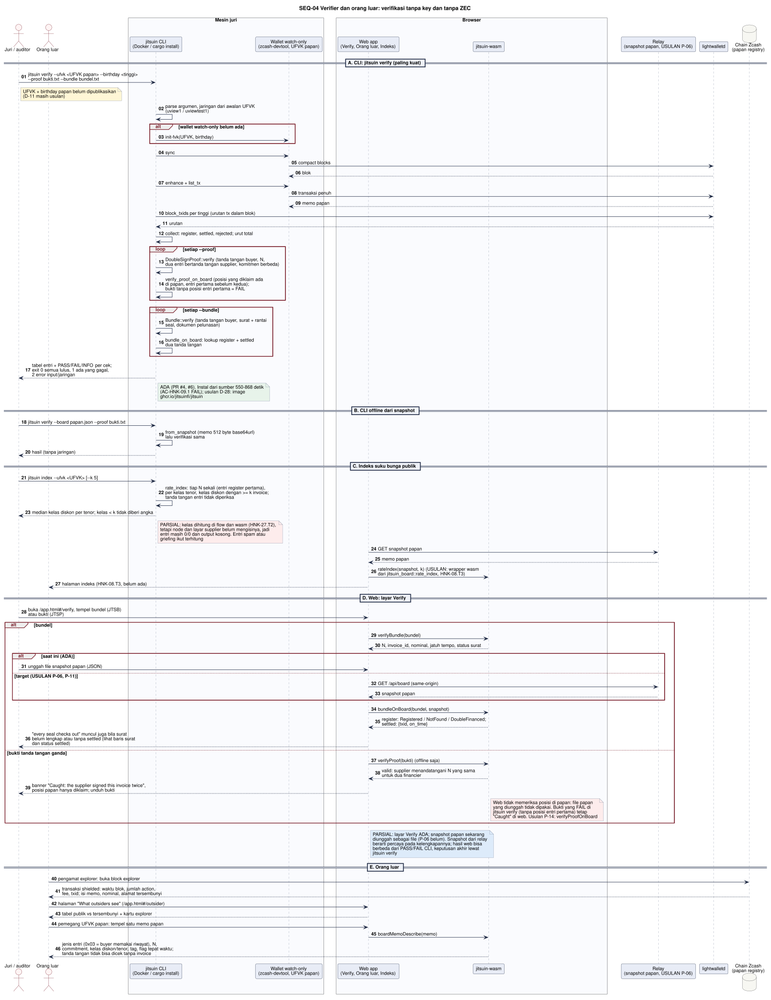

# SEQ-04 - Verifier dan Orang Luar

**Bagian dari:** [[08 - FlowDiagrams]] · Legenda: [[FD-00 - Arsitektur Target dan Legenda]] · DFD: [[DFD-2.7 - Deteksi Pembiayaan Ganda]] · [[DFD-2.8 - Verifikasi dan Indeks Publik]]

Peran tanpa akun dan tanpa key. Tiga jenis pengguna:
- **Juri / auditor.** Memegang bundel (JTSB) atau bukti tanda tangan ganda (JTSP) dari pihak deal, dan UFVK papan. Memverifikasi lewat CLI `jitsuin verify` (paling kuat, memindai chain sendiri) atau lewat layar Verify di web.
- **Pengamat indeks.** Membaca indeks suku bunga publik (`jitsuin index`, halaman indeks HNK-08.T3).
- **Orang luar.** Membaca papan atau block explorer dan hanya melihat hash, tanda tangan opak, dan waktu.

Kode yang dipakai: `jitsuin-cli` (`args`, `board::{load, scan, from_snapshot, to_snapshot}`, `verify::{run, check_proof, check_bundle}`, `index::run`), `jitsuin-board` (`collect`, `lookup`, `verify_proof_on_board`, `bundle_on_board`, `rate_index`), `jitsuin-wasm` (`verifyBundle`, `verifyProof`, `bundleOnBoard`, `boardMemoDescribe`), `src/pages/verify.ts`, `src/pages/outsider.ts`.



```plantuml
@startuml seq-04-verifier
!include seq-style.iuml
title SEQ-04 Verifier dan orang luar: verifikasi tanpa key dan tanpa ZEC
actor "Juri / auditor" as J
actor "Orang luar" as OL
box "Mesin juri" #FAFBFE
  participant "jitsuin CLI\n(Docker / cargo install)" as CLI
  participant "Wallet watch-only\n(zcash-devtool, UFVK papan)" as WB
end box
box "Browser" #FAFBFE
  participant "Web app\n(Verify, Orang luar, Indeks)" as W
  participant "jitsuin-wasm" as X
end box
participant "Relay\n(snapshot papan, USULAN P-06)" as R
participant "lightwalletd" as LW
database "Chain Zcash\n(papan registry)" as C

== A. CLI: jitsuin verify (paling kuat) ==
J -> CLI : jitsuin verify --ufvk <UFVK papan> --birthday <tinggi>\n--proof bukti.txt --bundle bundel.txt
note right of J #FFF6D6 : UFVK + birthday papan belum dipublikasikan (D-11 masih usulan)
CLI -> CLI : parse argumen, jaringan dari awalan UFVK (uview1 / uviewtest1)
alt wallet watch-only belum ada
  CLI -> WB : init-fvk(UFVK, birthday)
end
CLI -> WB : sync
WB -> LW : compact blocks
LW --> WB : blok
CLI -> WB : enhance + list_tx
WB -> LW : transaksi penuh
LW --> WB : memo papan
CLI -> LW : block_txids per tinggi (urutan tx dalam blok)
LW --> CLI : urutan
CLI -> CLI : collect: register, settled, rejected; urut total
loop setiap --proof
  CLI -> CLI : DoubleSignProof::verify (tanda tangan buyer, N, dua entri\nbertanda tangan supplier, komitmen berbeda)
  CLI -> CLI : verify_proof_on_board (posisi yang diklaim ada di papan,\nentri pertama sebelum kedua); bukti tanpa posisi entri pertama = FAIL
end
loop setiap --bundle
  CLI -> CLI : Bundle::verify (tanda tangan buyer, surat + rantai seal,\ndokumen pelunasan)
  CLI -> CLI : bundle_on_board: lookup register + settled dua tanda tangan
end
CLI --> J : tabel entri + PASS/FAIL per cek;\nexit 0 semua lulus, 1 ada yang gagal, 2 error input/jaringan
note right of CLI #E7F3EA
ADA (PR #4, #6). Instal dari sumber 550-868 detik (AC-HNK-09.1 FAIL);
usulan D-28: image ghcr.io/jitsuinfi/jitsuin
end note

== B. CLI offline dari snapshot ==
J -> CLI : jitsuin verify --board papan.json --proof bukti.txt
CLI -> CLI : from_snapshot (memo 512 byte base64url) lalu verifikasi sama
CLI --> J : hasil (tanpa jaringan)

== C. Indeks suku bunga publik ==
J -> CLI : jitsuin index --ufvk <UFVK> [--k 5]
CLI -> CLI : rate_index: tiap N sekali (entri register pertama),\nper kelas tenor, kelas diskon dengan >= k invoice
CLI --> J : median kelas diskon per tenor; kelas < k tidak diberi angka
W -> R : GET snapshot papan
R --> W : memo papan
W --> OL : halaman indeks (HNK-08.T3, belum ada)

== D. Web: layar Verify ==
J -> W : buka /app.html#/verify, tempel bundel (JTSB) atau bukti (JTSP)
alt bundel
  W -> X : verifyBundle(bundel)
  X --> W : N, invoice_id, nominal, jatuh tempo, status surat
  alt saat ini (ADA)
    J -> W : unggah file snapshot papan (JSON)
  else target (USULAN P-06, P-11)
    W -> R : GET /api/board (same-origin)
    R --> W : snapshot papan
  end
  W -> X : bundleOnBoard(bundel, snapshot)
  X --> W : register: Registered / NotFound / DoubleFinanced;\nsettled: {txid, on_time}
else bukti tanda tangan ganda
  W -> X : verifyProof(bukti)
  X --> W : valid: supplier menandatangani N yang sama untuk dua financier
  W --> J : banner "Caught", unduh bukti
end
note right of W #DDEBFA
PARSIAL: layar Verify ADA; snapshot papan sekarang diunggah sebagai file
(P-06 belum). Snapshot dari relay = kepercayaan pada kelengkapan;
keputusan akhir tetap lewat jitsuin verify
end note

== E. Orang luar ==
OL -> C : buka block explorer
C --> OL : transaksi shielded: waktu blok, jumlah action, fee;\nisi memo, nominal, alamat tersembunyi
OL -> W : halaman "What outsiders see" (/app.html#/outsider)
W --> OL : tabel publik vs tersembunyi + kartu explorer
OL -> W : tempel satu memo papan
W -> X : boardMemoDescribe(memo)
X --> OL : jenis entri, N, commitment, bucket, tag (hash saja);\ntanda tangan tidak bisa dicek tanpa invoice
@enduml
```

## Yang bisa dan tidak bisa dipastikan

| Pengguna | Bisa memastikan | Tidak bisa |
|---|---|---|
| Juri dengan UFVK papan + bukti | Supplier menandatangani satu invoice untuk dua financier; urutan entri di chain | Siapa supplier, buyer, financier |
| Auditor dengan bundel | Invoice ditandatangani buyer, surat disegel lengkap, pelunasan dua tanda tangan ada di papan, tepat waktu atau terlambat | Deal lain |
| Pengamat indeks | Harga kredit per kelas tenor dan diskon (ambang k = 5) | Nominal, pihak, satu deal |
| Orang luar | Ada aktivitas papan pada waktu tertentu; ada N yang muncul dua kali | Isi invoice, pihak, apakah konflik itu penipuan atau griefing |

Lihat juga temuan pra-review TM #3, #6, #13 di [[Pra-review Spesifikasi dan Threat Model]]: pemegang N bisa menautkan entri `settled`, dan bucket serta jenis entri terbaca pemegang UFVK papan.
