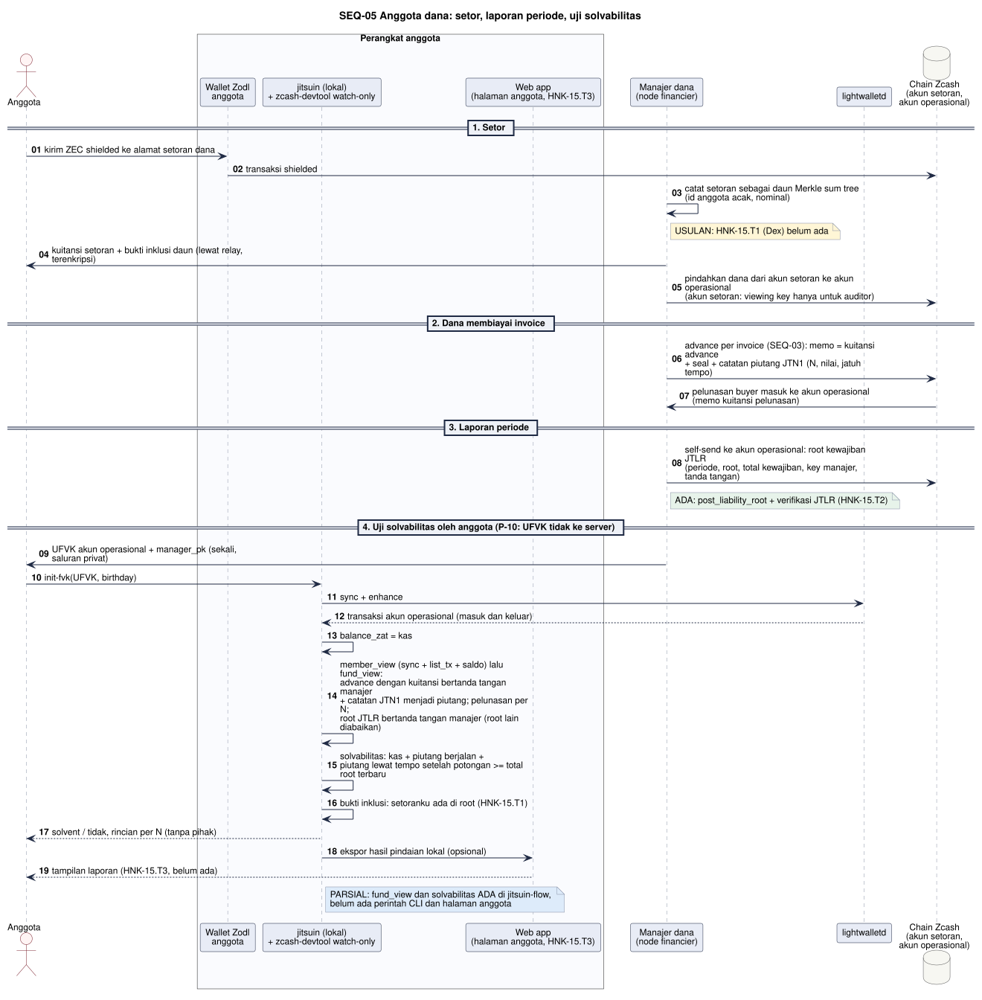

# SEQ-05 - Anggota Dana

**Bagian dari:** [[08 - FlowDiagrams]] · Legenda: [[FD-00 - Arsitektur Target dan Legenda]] · Auth: [[SEQ-00 - Autentikasi dan Onboarding]] · DFD: [[DFD-2.9 - Solvabilitas Dana]] · Item: [[AC-HNK-15 - Stretch JitsuinFi Vault|HNK-15]]

JitsuinFi Vault (stretch, D-24): banyak anggota menyetor ZEC shielded ke satu dana; manajer dana membiayai invoice lewat JitsuinFi sebagai financier ([[SEQ-03 - Financier]]); setiap anggota menghitung sendiri apakah aset dana menutup kewajibannya, tanpa melihat supplier, buyer, atau isi invoice.

Kode yang dipakai: `jitsuin-flow::fund` (`fund_view`, `SolvencyPolicy`, `Solvency`, pembacaan catatan piutang `JTN1` dan root kewajiban `JTLR`), `jitsuin-core::fund`, wallet watch-only `zcash-devtool`. Belum ada: Merkle sum tree kewajiban (HNK-15.T1, Dex), halaman anggota (HNK-15.T3, Dave), perintah CLI untuk solvabilitas.



```plantuml
@startuml seq-05-fund
!include seq-style.iuml
title SEQ-05 Anggota dana: setor, laporan periode, uji solvabilitas
actor "Anggota" as M
box "Perangkat anggota" #FAFBFE
  participant "Wallet Zodl\nanggota" as ZM
  participant "jitsuin (lokal)\n+ zcash-devtool watch-only" as LOC
  participant "Web app\n(halaman anggota, HNK-15.T3)" as W
end box
participant "Manajer dana\n(node financier)" as MG
participant "lightwalletd" as LW
database "Chain Zcash\n(akun setoran,\nakun operasional)" as C

== 1. Setor ==
M -> ZM : kirim ZEC shielded ke alamat setoran dana
ZM -> C : transaksi shielded
MG -> MG : catat setoran sebagai daun Merkle sum tree\n(id anggota acak, nominal)
note right of MG #FFF6D6 : USULAN: HNK-15.T1 (Dex) belum ada
MG -> M : kuitansi setoran + bukti inklusi daun (lewat relay, terenkripsi)

== 2. Dana membiayai invoice ==
MG -> C : advance per invoice (SEQ-03): memo = kuitansi advance\n+ seal + catatan piutang JTN1 (N, nilai, jatuh tempo)
C -> MG : pelunasan buyer masuk ke akun operasional (memo kuitansi pelunasan)

== 3. Laporan periode ==
MG -> C : self-send ke akun operasional: root kewajiban JTLR\n(periode, root, total kewajiban, key manajer, tanda tangan)
note right of MG #E7F3EA : ADA: format JTLR dan verifikasinya (HNK-15.T2)

== 4. Uji solvabilitas oleh anggota (P-10: UFVK tidak ke server) ==
MG -> M : UFVK akun operasional (sekali, saluran privat)
M -> LOC : init-fvk(UFVK, birthday)
LOC -> LW : sync + enhance
LW --> LOC : transaksi akun operasional (masuk dan keluar)
LOC -> LOC : balance_zat = kas
LOC -> LOC : fund_view: advance dengan kuitansi bertanda tangan manajer\n+ catatan JTN1 menjadi piutang; pelunasan per N;\nroot JTLR bertanda tangan manajer (root lain diabaikan)
LOC -> LOC : solvabilitas: kas + piutang berjalan +\npiutang lewat tempo setelah potongan >= total root terbaru
LOC -> LOC : bukti inklusi: setoranku ada di root (HNK-15.T1)
LOC --> M : solvent / tidak, rincian per N (tanpa pihak)
LOC -> W : ekspor hasil pindaian lokal (opsional)
W --> M : tampilan laporan (HNK-15.T3, belum ada)
note right of LOC #DDEBFA
PARSIAL: fund_view dan solvabilitas ADA di jitsuin-flow,
belum ada perintah CLI dan halaman anggota
end note
@enduml
```

## Yang dilihat anggota

| Melihat (lewat UFVK akun operasional) | Tidak melihat |
|---|---|
| Kas, setiap advance (N, nominal, jatuh tempo), pelunasan per N, root kewajiban | Supplier, buyer, isi invoice, simpanan anggota lain |

Catatan: pra-review TM #4 (belum pasti) menyebut kemungkinan anggota melihat alamat penerima advance lewat OVK. Lihat [[Pra-review Spesifikasi dan Threat Model]].
