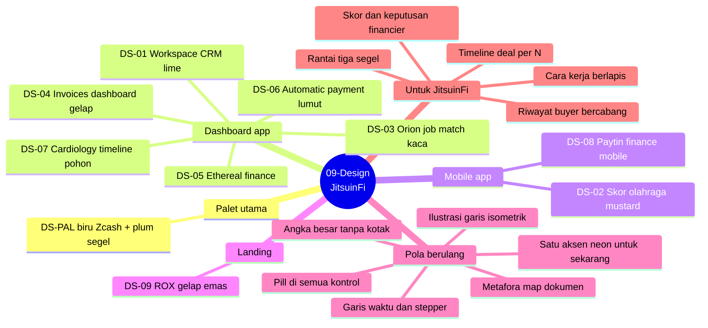

# DS-00 - Peta Visual Design

> **Peta link:** [[09 - Design|Hub modul]] · [[DS-PAL - Palet Utama JitsuinFi|Palet utama]] · [[FE-00 - Peta Tools FE|Tools FE]] · [[Landing Page - Brief]]

Mind map semua referensi visual di `09-Design/`, dibaca satu per satu (2026-10-20): gaya, sudut pandang (POV), makna, warna terukur, tipografi, komponen, gerak tersirat, dan relevansinya untuk JitsuinFi. Kerangka analisis meminjam panduan [ai-design-vault](https://github.com/textura-agency/ai-design-vault): token tiga tingkat (primitive → semantic → component), aturan fidelity (catat yang ada, jangan mengarang), kontrak gerak (`Inview`, `SpringTrigger`, `Hover`, `Handle`), dan template catatan komponen.

## Mind map


## Daftar referensi
| ID | Judul | File | Jenis | Mode | Aksen | Relevansi utama |
|---|---|---|---|---|---|---|
| [[DS-PAL - Palet Utama JitsuinFi\|DS-PAL]] | Palet utama | `ColorPalette-JitsuinFi/` (2 gambar) | Palet | — | Dark Raspberry, Button Blue | Sumber warna semua permukaan |
| [[DS-01 - Workspace CRM Lime\|DS-01]] | Workspace CRM | `20c32c7a….jpg` | Dashboard | Operate | Lime `#B6FF65` | Bar waktu "sekarang", KPI tanpa kotak, chip filter |
| [[DS-02 - Sports Score App Mustard\|DS-02]] | Skor olahraga | `52f185f7….jpg` | Mobile | Operate | Mustard `#FACE6E` | Kartu dua angka uang, aksi uang besar, lencana status |
| [[DS-03 - Orion Job Match Glass\|DS-03]] | Orion job match | `5b6667b6….jpg` | Dashboard + hero | Persuade/Operate | Lime `#BFFD01` | Objek 3D jangkar, cincin skor + keputusan, pita berarsir |
| [[DS-04 - Invoices Dashboard Dark\|DS-04]] | Invoices | `6483e2cb….jpg` | Dashboard | Operate | Lime `#94FF04` | **Domain invoice**: master–detail, status, jatuh tempo, payout |
| [[DS-05 - Ethereal Finance Dashboard\|DS-05]] | Ethereal finance | `7fd6f8f9….jpg` | Dashboard | Operate | Gradasi mint-lime, lavender | Donat komposisi, tagihan berikutnya, tabel txid |
| [[DS-06 - Automatic Payment Moss\|DS-06]] | Automatic payment (RonDesignLab) | `8628ae96….jpg` | Dashboard | Operate | Hijau daun `#93C870` | **Stepper tiga centang = rantai tiga segel**, tekstur kertas |
| [[DS-07 - Cardiology Timeline Tree\|DS-07]] | Cardiology (RON Design) | `9a7830b3….jpg` | Timeline | Operate | Kuning neon `#F3FE51` | **Garis waktu bercabang = riwayat buyer**, tab map, scrubber |
| [[DS-08 - Paytin Finance Mobile\|DS-08]] | Paytin | `bf2cdcf1….jpg` | Mobile | Persuade/Operate | Lime `#C4E860` | Ilustrasi garis onboarding, progres titik, kartu bertab |
| [[DS-09 - ROX Landing Dark Gold\|DS-09]] | ROX (Refero) | `refero.design 31fd7d97….jpg` | Landing | Persuade | Emas `#DCC1A1` | **Tumpukan lapisan meledak**, ilustrasi isometrik, grid konstruksi |

File non-gambar di folder ini (belum dipetakan karena permintaan hanya gambar): `button.md` (tombol "Learn More" dari Uiverse, cssbuttons-io), `card1.md` (kartu tiket dari Uiverse, zeeshan_2112), `rox.md` (kosong).

## Pola yang berulang
| Pola | Muncul di | Catatan untuk JitsuinFi |
|---|---|---|
| **Satu aksen terang hanya untuk "sekarang / aktif"** | DS-01, 03, 04, 06, 07, 08 (lime, kuning, hijau) | Disiplin yang sama, tetapi warnanya **Dark Raspberry** di kertas dan **Button Blue** di dalam "air" ([[DS-PAL - Palet Utama JitsuinFi]]) |
| Pill untuk semua kontrol, radius besar | Semua | `MASTER.md`: pill satu-satunya bentuk bulat di landing; app (`src/style.css`) radius 10 px |
| Angka besar tanpa kotak, label kecil di atas | DS-01, 04, 05, 06 | Nilai invoice, advance, sisa tagihan |
| Garis waktu / stepper | DS-01 (jarum waktu), 06 (stepper centang), 07 (pohon), 09 (alur langkah + jeda) | Timeline deal per N, rantai segel, riwayat buyer |
| Metafora map dokumen | DS-07 (kepala tab), DS-08 (kartu bertab) | Cocok dengan "lembar", surat pengalihan, segel jitsuin |
| Ilustrasi garis | DS-08 (tangan), DS-09 (isometrik) | **hairline** (isometrik, belum dipakai) |
| Hitam sebagai warna perintah | DS-01, 02, 06, 08 | Padanan: Cetacean `#020D2F` (judul) atau Dark Raspberry (aksi) |
| Kaca buram | DS-03, DS-05 | `MASTER.md`: kaca hanya untuk pill di atas adegan |
| Wajah, nama, logo merek | Hampir semua | **Tidak boleh** di JitsuinFi: pihak = key, sidik jari, segel |

## Perbandingan dengan palet utama
- **Tidak ada satu pun referensi yang memakai palet JitsuinFi.** Aksennya lime, kuning, mustard, hijau, atau emas. Ambil **perannya**, bukan warnanya.
- Padanan peran yang diusulkan: aksen "aktif/sekarang" → Dark Raspberry (kertas) atau Button Blue (air); permukaan gelap → Cetacean dan Catalina; teks → Brown Coffee dan Japanese Violet; tepi dan dekorasi → Classic Rose dan Pearly Purple.

## Peta ke permukaan JitsuinFi
| Permukaan | Referensi paling relevan | Pola |
|---|---|---|
| Landing: "cara kerja" | DS-09 | Tumpukan lapisan meledak + figur garis isometrik |
| Landing bab 3 (tiga segel) | DS-06 | Stepper tiga simpul centang |
| Landing bab 5 / layar buyer: riwayat | DS-07 | Garis waktu bercabang + scrubber |
| App supplier: daftar deal (HNK-24.T9) | DS-04, DS-01 | Master–detail, status per deal, chip filter |
| App buyer: tagihan dan bayar | DS-02, DS-05, DS-08 | Kartu dua angka, "next due", aksi bulat |
| App financier / konsol node (HNK-26) | DS-03, DS-04 | Cincin skor riwayat + terima/tolak; payout |
| App anggota dana (`#/member`) | DS-05 | Donat komposisi, daftar kuitansi |
| Sign in / Account (HNK-22) | DS-08 | Ilustrasi garis, satu CTA |

## Keputusan yang perlu user
1. ~~Kartu boleh dipakai di **app**?~~ **Dijawab 2026-10-20 (D-36): tidak.** App juga tanpa kartu; bagian layar diset di atas kertas.
2. ~~App diselaraskan ke palet utama?~~ **Dijawab 2026-10-20 (D-36): ya, sekarang.** `src/style.css` memakai token landing (jitsuinfi-frontend `0cce4e8`).
3. hairline dipakai sebagai gaya ilustrasi resmi (DS-08, DS-09)?
4. Referensi mana yang jadi acuan utama layar app (usulan: DS-04 untuk struktur, DS-06/DS-07 untuk timeline)?

## Daftar otomatis
```dataview
TABLE kind, mode, source_file
FROM "09-Design"
WHERE type = "design-ref"
SORT id ASC
```
