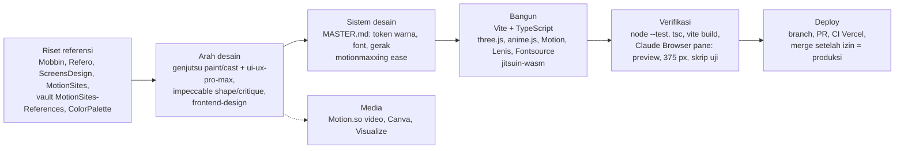

# FE-00 - Peta Tools FE

> **Peta link:** [[10 - FE Vault|Hub modul]] · [[FE-01 - Batasan Platform FE|Batasan platform]] · [[Landing Page - Brief]] · [[Backlog]]

Semua tool frontend yang tersedia untuk JitsuinFi per 2026-10-20, dari awal proyek sampai sekarang: library di repo, skill, server MCP, tool yang diminta tetapi belum terpasang, dan referensi di vault (di luar `09-Design`). Satu tool = satu file `FE-xx`, berisi akar (sumber, versi, lisensi, lokasi pasang), cara kerja, tempat dipakai, batasan, dan status.

## Status
| Status | Arti |
|---|---|
| AKTIF | Terpasang dan dipakai, atau terhubung dan siap dipakai |
| TERPASANG-TIDAK-DIPAKAI | Ada di proyek, tidak dipakai di kode |
| TERPASANG-BELUM-INIT | Terpasang, langkah setup pertama belum dijalankan |
| TERSEDIA-BELUM-DIPAKAI | Bawaan atau terhubung, belum pernah dipakai untuk JitsuinFi |
| REFERENSI / REFERENSI-DIPAKAI | Bahan acuan; nilai atau pola sudah diambil ke kode |
| BELUM-TERPASANG | Diminta di brief, belum dipasang |
| PERLU-LOGIN | Connector ada, belum diautentikasi |

## Peta lengkap
| ID | Tool | Lapisan | Versi / sumber | Lokasi | Dipakai di | Status |
|---|---|---|---|---|---|---|
| [[FE-M0 - Mandat FE\|FE-M0]] | Mandat FE user (level PortoWeb, anti-mainstream, 65/35, tanpa kartu, semua MCP dan tool) | Mandat | [[Landing Page - Brief]] | Vault | Landing (HNK-18.T4) | AKTIF |
| [[FE-01 - Batasan Platform FE\|FE-01]] | Batasan platform (CSP, tanpa CDN) | Platform | `vercel.json`, meta CSP | Repo frontend | Semua | AKTIF |
| [[FE-02 - Vite\|FE-02]] | Vite | Build | 8.3.4 | `devDependencies` | Landing dan app | AKTIF |
| [[FE-03 - TypeScript\|FE-03]] | TypeScript | Build | 5.9.3 | `devDependencies` | Semua kode | AKTIF |
| [[FE-04 - Node Test Runner\|FE-04]] | Node test runner | Tes | Node 26 | Bawaan Node | `tests/*.test.ts` | AKTIF |
| [[FE-05 - jitsuin-wasm Bindings\|FE-05]] | jitsuin-wasm | Inti kripto | zcash `a252568`, wasm-bindgen 0.2.129 | `src/wasm/` | Landing dan app | AKTIF |
| [[FE-06 - Vercel Deploy dan CI\|FE-06]] | Vercel | Deploy, CI | Proyek `jitsuinfi` | `vercel.json`, `.vercel/` | Produksi `jitsuinfi.vercel.app` | AKTIF |
| [[FE-07 - three.js\|FE-07]] | three.js | Library 3D | 0.186.1 | `dependencies` | `src/landing/city.ts` | AKTIF |
| [[FE-08 - anime.js\|FE-08]] | anime.js | Library gerak | 4.5.0 | `dependencies` | 7 file `src/landing/` | AKTIF |
| [[FE-09 - Motion\|FE-09]] | Motion | Library gerak | 14.3.0 | `dependencies` | 6 file `src/landing/` | AKTIF |
| [[FE-10 - Lenis\|FE-10]] | Lenis | Library scroll | 1.3.27 | `dependencies` | `src/landing/main.ts` | AKTIF |
| [[FE-11 - hairline\|FE-11]] | hairline | Library ilustrasi | 0.5.1 | `dependencies` | Tidak di mana pun | TERPASANG-TIDAK-DIPAKAI |
| [[FE-12 - Font Fontsource\|FE-12]] | Shippori Mincho B1, Geist, Geist Mono | Font | 5.3.0 | `dependencies` | `src/landing/tokens.css` | AKTIF |
| [[FE-13 - genjutsu\|FE-13]] | genjutsu (+17 sub-skill, termasuk `ui-ux-pro-max`) | Skill | v4.1.1 | `~/.agents/skills/genjutsu` | Desain landing, `MASTER.md` | AKTIF |
| [[FE-14 - impeccable\|FE-14]] | impeccable (+4 agent) | Skill | 4.7.0, engine 0.1.16 | `zkSNARK/.claude/` | Belum | TERPASANG-BELUM-INIT |
| [[FE-15 - Skill Artifact dan dataviz\|FE-15]] | artifact-design, artifact-diagramming, artifact-capabilities, dataviz | Skill | Bawaan | Claude Code | Belum | TERSEDIA-BELUM-DIPAKAI |
| [[FE-28 - frontend-design\|FE-28]] | frontend-design (Anthropic) | Skill | `claude-plugins-official`, Apache 2.0 | `~/.claude/plugins/` (scope user) | Belum | AKTIF |
| [[FE-16 - Claude Browser Pane\|FE-16]] | Claude Browser (pane) | MCP verifikasi | Bawaan desktop | `.claude/launch.json` | Semua uji browser | AKTIF |
| [[FE-17 - Claude in Chrome\|FE-17]] | Claude in Chrome | MCP verifikasi | Ekstensi | Chrome user | Belum | TERSEDIA-BELUM-DIPAKAI |
| [[FE-18 - Mobbin\|FE-18]] | Mobbin | MCP riset | `api.mobbin.com/mcp` | Scope user | Belum | AKTIF |
| [[FE-19 - ScreensDesign\|FE-19]] | ScreensDesign | MCP riset | `api.screensdesign.com/v1/mcp` | Scope user | Belum | AKTIF |
| [[FE-20 - MotionSites\|FE-20]] | MotionSites | MCP riset | Supabase Edge Function | Scope user | Prompt 1 – 4 untuk hero | AKTIF |
| [[FE-21 - Refero\|FE-21]] | Refero | MCP riset | `refero_server` 0.2.0 | Scope local `zkSNARK` | Belum | AKTIF |
| [[FE-22 - Visualize Widget\|FE-22]] | Visualize (`show_widget`) | MCP presentasi | Bawaan + claude.ai | Chat | Belum | TERSEDIA-BELUM-DIPAKAI |
| [[FE-23 - Motion.so\|FE-23]] | Motion.so | MCP media (video) | `mcp.motion.so` | Connector claude.ai | Render hero (ditolak) | AKTIF |
| [[FE-24 - Canva\|FE-24]] | Canva | MCP media | `mcp.canva.com` | Connector claude.ai | Belum | PERLU-LOGIN |
| [[FE-25 - React Bits shadcn MCP\|FE-25]] | React Bits (shadcn MCP) | Komponen | `npx shadcn@latest mcp init` | — | — | BELUM-TERPASANG |
| [[FE-26 - motionmaxxing\|FE-26]] | motionmaxxing | Skill referensi | GitHub, Apache-2.0 | — | Ease di `src/landing/motion.ts` | REFERENSI-DIPAKAI |
| [[FE-27 - Referensi Visual Vault\|FE-27]] | `MotionSites-References/`, `ColorPalette-JitsuinFi/` | Referensi | Vault | Vault, untracked | `MASTER.md` §1, §2 | REFERENSI |
| [[FE-29 - PortoWeb Benchmark\|FE-29]] | PortoWeb (tolok ukur level + basis pengetahuan FE di `_resources/notes`) | Benchmark | `Hans_Porto_Web` `3f47e4a` | `/Users/Shenhan/HansProject/PortoWeb` | Acuan M1 | REFERENSI |
| [[FE-30 - Mera\|FE-30]] | Mera | library | https://mera.category.xyz | — | Belum | REFERENSI |
| [[FE-31 - iso-glow\|FE-31]] | iso-glow | skill | https://iso-glow.vercel.app | — | Belum | REFERENSI |
| [[FE-32 - colorfigures\|FE-32]] | colorfigures | skill | https://april-zhu.com/colorfigures | `~/.claude/skills` | Belum | TERSEDIA-BELUM-DIPAKAI |
| [[FE-33 - playable\|FE-33]] | playable | skill | https://april-zhu.com/playable | — | Belum | REFERENSI |
| [[FE-34 - ZzFX\|FE-34]] | ZzFX | library | https://github.com/KilledByAPixel/ZzFX | — | Belum | REFERENSI |
| [[FE-35 - canvas-confetti\|FE-35]] | canvas-confetti | library | https://github.com/catdad/canvas-confetti | — | Belum | REFERENSI |
| [[FE-36 - Howler.js\|FE-36]] | Howler.js | library | https://howlerjs.com | — | Belum | REFERENSI |
| [[FE-37 - React Three Fiber dan drei\|FE-37]] | React Three Fiber dan drei | library | https://github.com/pmndrs/drei | — | Belum | REFERENSI |
| [[FE-38 - gltfjsx dan glTF-Transform\|FE-38]] | gltfjsx dan glTF-Transform | tool | https://gltf-transform.dev | — | Belum | REFERENSI |
| [[FE-39 - PixiJS\|FE-39]] | PixiJS | library | https://pixijs.com | — | Belum | REFERENSI |
| [[FE-40 - KAPLAY\|FE-40]] | KAPLAY | library | https://kaplayjs.com | — | Belum | REFERENSI |
| [[FE-41 - Phaser\|FE-41]] | Phaser | library-game | https://phaser.io | — | Belum | REFERENSI |
| [[FE-42 - Lottie (dotLottie)\|FE-42]] | Lottie (dotLottie) | library | https://lottiefiles.com | — | Belum | REFERENSI |
| [[FE-43 - Kenney\|FE-43]] | Kenney | aset | https://kenney.nl/assets | — | Belum | REFERENSI |
| [[FE-44 - Quaternius\|FE-44]] | Quaternius | aset | https://quaternius.com | — | Belum | REFERENSI |
| [[FE-45 - Poly Pizza\|FE-45]] | Poly Pizza | aset | https://poly.pizza | — | Belum | REFERENSI |
| [[FE-46 - Blender MCP\|FE-46]] | Blender MCP | mcp | https://github.com/ahujasid/mcp-for-blender | — | Belum | REFERENSI |
| [[FE-47 - game-creator (opusgamelabs)\|FE-47]] | game-creator (opusgamelabs) | skill | https://claudemarketplaces.com/skills/opusgamelabs/game-creator | — | Belum | REFERENSI |
| [[FE-48 - iso-figure\|FE-48]] | iso-figure | skill | https://github.com/MrBongoC/ai-iso-skill | `~/.claude/skills` | Belum | TERSEDIA-BELUM-DIPAKAI |
| [[FE-49 - Anatomy\|FE-49]] | Anatomy | skill | https://github.com/wheresryan22/anatomy | `~/.claude/skills` | Belum | TERSEDIA-BELUM-DIPAKAI |
| [[FE-50 - Neon Diagrams\|FE-50]] | Neon Diagrams | skill | https://april-zhu.com/neondiagrams | — | Belum | REFERENSI |
| [[FE-51 - isometric-motion\|FE-51]] | isometric-motion | skill | https://github.com/dzhng/skills | — | Belum | REFERENSI |
| [[FE-52 - isometric-objects (gist)\|FE-52]] | isometric-objects (gist) | skill | https://gist.github.com/mehh/b2aa7b990f1d4fa0d6e06fcefc38f2ee | — | Belum | REFERENSI |
| [[FE-53 - isometric-ops\|FE-53]] | isometric-ops | skill | https://github.com/0xDarkMatter/claude-mods | — | Belum | REFERENSI |
| [[FE-54 - heerich\|FE-54]] | heerich | library | https://github.com/meodai/heerich | — | Belum | REFERENSI |
| [[FE-55 - Zdog\|FE-55]] | Zdog | library | https://github.com/metafizzy/zdog | — | Belum | REFERENSI |
| [[FE-56 - isometric (elchininet)\|FE-56]] | isometric (elchininet) | library | https://github.com/elchininet/isometric | — | Belum | REFERENSI |
| [[FE-57 - Recraft MCP\|FE-57]] | Recraft MCP | mcp | https://github.com/recraft-ai/mcp-recraft-server | — | Belum | REFERENSI |
| [[FE-58 - Threejs Awesome Graphics Agent Skills\|FE-58]] | Threejs Awesome Graphics Agent Skills | skill | https://github.com/scottstts/Threejs-Awesome-Graphics-Agent-Skills | — | Belum | REFERENSI |
| [[FE-59 - SVGO\|FE-59]] | SVGO | tool | https://github.com/svg/svgo | — | Belum | REFERENSI |
| [[FE-60 - model-viewer\|FE-60]] | model-viewer | library-3d | https://github.com/google/model-viewer | — | Belum | REFERENSI |
| [[FE-61 - Spline MCP\|FE-61]] | Spline MCP | mcp | https://docs.spline.design/generate/spline-mcp-server.md | — | Belum | REFERENSI |
| [[FE-62 - Meshy dan Tripo\|FE-62]] | Meshy dan Tripo | layanan | Meshy: https://docs.meshy.ai/en/api/text-to-3d | — | Belum | REFERENSI |
| [[FE-63 - Riset Aset 3D Ringan\|FE-63]] | Riset Aset 3D Ringan | referensi | vault Monad Blitz | — | Belum | REFERENSI |
| [[FE-64 - mobile-native (Emil Kowalski)\|FE-64]] | mobile-native (Emil Kowalski) | skill | https://github.com/emilkowalski/skills `2d22863` | `~/.claude/skills` | Belum; disarikan ke [[DS-MOB - Aturan Layout Mobile JitsuinFi\|DS-MOB]] | TERSEDIA-BELUM-DIPAKAI |
| [[FE-65 - responsive-design (Mindrally)\|FE-65]] | responsive-design (Mindrally) | skill | https://github.com/Mindrally/skills `7682ca7` | `~/.claude/skills` | Belum; disarikan ke [[DS-MOB - Aturan Layout Mobile JitsuinFi\|DS-MOB]] | TERSEDIA-BELUM-DIPAKAI |
| [[FE-66 - responsive-design (supercent-io)\|FE-66]] | responsive-design (supercent-io), tidak dipasang: repo 404 | skill | https://github.com/supercent-io/skills-template | — | Belum; disarikan ke [[DS-MOB - Aturan Layout Mobile JitsuinFi\|DS-MOB]] | REFERENSI |
| [[FE-67 - responsive-design (flitzrrr)\|FE-67]] | responsive-design (flitzrrr) | skill | https://github.com/flitzrrr/frontend-design-skills `d607ba3` | `~/.claude/skills` | Belum; disarikan ke [[DS-MOB - Aturan Layout Mobile JitsuinFi\|DS-MOB]] | TERSEDIA-BELUM-DIPAKAI |
| [[FE-68 - mobile-responsive-ux (jacob-balslev)\|FE-68]] | mobile-responsive-ux (jacob-balslev) | skill | https://github.com/jacob-balslev/skill-graph `ee6f58e` | `~/.claude/skills` | Belum; disarikan ke [[DS-MOB - Aturan Layout Mobile JitsuinFi\|DS-MOB]] | TERSEDIA-BELUM-DIPAKAI |
| [[FE-69 - mobile-app-ui-design (ceorkm)\|FE-69]] | mobile-app-ui-design (ceorkm) | skill | https://github.com/ceorkm/mobile-app-ui-design `4c67a0e` | `~/.claude/skills` | Belum; disarikan ke [[DS-MOB - Aturan Layout Mobile JitsuinFi\|DS-MOB]] | TERSEDIA-BELUM-DIPAKAI |
| [[FE-70 - mobile-design-skill (evgeniyvorobey)\|FE-70]] | mobile-design-skill (evgeniyvorobey) | skill | https://github.com/evgeniyvorobey/mobile-design-skill `0c0ce13` | `~/.claude/skills` | Belum; disarikan ke [[DS-MOB - Aturan Layout Mobile JitsuinFi\|DS-MOB]] | TERSEDIA-BELUM-DIPAKAI |
| [[FE-71 - mobile-ux-design (phazurlabs)\|FE-71]] | mobile-ux-design (phazurlabs) | skill | https://github.com/phazurlabs/ux-ui-mastery `3a3693b` | `~/.claude/skills` | Belum; disarikan ke [[DS-MOB - Aturan Layout Mobile JitsuinFi\|DS-MOB]] | TERSEDIA-BELUM-DIPAKAI |
| [[FE-72 - mobile-design (HDShinobi)\|FE-72]] | mobile-design (HDShinobi) | skill | https://github.com/HDShinobi/ai-agentic-kit `d10a862` | `~/.claude/skills` | Belum; disarikan ke [[DS-MOB - Aturan Layout Mobile JitsuinFi\|DS-MOB]] | TERSEDIA-BELUM-DIPAKAI |

## Alur end to end

Batasan [[FE-01 - Batasan Platform FE]] berlaku di setiap tahap.

## Temuan audit 2026-10-20
1. **hairline terpasang tetapi tidak dipakai** di kode mana pun ([[FE-11 - hairline]]).
2. **React Bits (shadcn MCP) dan motionmaxxing belum terpasang**, walaupun diminta di brief. motionmaxxing sudah dipakai sebagai sumber kurva ease ([[FE-26 - motionmaxxing]]).
3. **Motion.so adalah generator video motion graphics**, bukan aplikasi kalender seperti yang sempat disebut ([[FE-23 - Motion.so]]).
4. **impeccable belum `init`**; desain landing tercatat di `MASTER.md`, bukan DESIGN.md ([[FE-14 - impeccable]]).
5. **Refero menyarankan skill `refero-design`**, belum dipasang ([[FE-21 - Refero]]).
6. **Folder referensi vault belum di-commit** ([[FE-27 - Referensi Visual Vault]]).
7. **CI frontend hanya build Vercel**; `npm test` belum otomatis ([[FE-06 - Vercel Deploy dan CI]]).
8. **Bundle landing 796 KB** dengan peringatan chunk Vite ([[FE-02 - Vite]]).
9. **App dan landing memakai sistem visual berbeda**: font Fontsource dan library gerak hanya di landing; app memakai font sistem dan `src/style.css` (redesain app = HNK-21, Dex).
10. **README frontend usang**: masih menyebut secret tidak pernah ditulis ke storage, padahal sekarang ada store IndexedDB terenkripsi (HNK-24.T3).
11. **Mandat FE belum terpenuhi penuh** ([[FE-M0 - Mandat FE]]): rasio 65/35 belum diukur, hairline dan React Bits belum dipakai, Mobbin/ScreensDesign/Refero belum dipakai untuk landing.
12. **PortoWeb sudah punya basis pengetahuan FE** yang terverifikasi (`_resources/notes`) dan klon semua tool di mandat; dipakai ulang lewat [[FE-29 - PortoWeb Benchmark]].

## Audit 2026-10-20 (akurasi)
Setiap klaim dicek ulang ke sumbernya. Koreksi:
| File | Sebelum | Sesudah |
|---|---|---|
| FE-01 | Satu string CSP untuk `vercel.json` dan kedua `<meta>` | Tiga versi: header lengkap; meta landing tanpa `frame-ancestors`; meta app tanpa `font-src` |
| FE-02 | "796 KB" | Ukuran file di disk, belum gzip |
| FE-04, FE-05 | Versi dari ingatan | Node v26.11.1 dan `wasm-bindgen` 0.2.129 dicek langsung |
| FE-13 | `/genjutsu:cast` dst. sebagai cara panggil | Hanya untuk instalasi plugin; instalasi ini dipanggil lewat skill `genjutsu` |
| FE-18, FE-19 | Terhubung | Sempat `ECONNRESET`, lalu tersambung lagi |
| FE-21, FE-28 | Aktif di sesi berikutnya | Sudah aktif di sesi ini |
| FE-25 | Lisensi `NOASSERTION`, cara pasang tidak jelas | MIT + Commons Clause; `npx shadcn@latest add @react-bits/<Nama>-<varian>`; 102 komponen WebGL dengan hanya 16 yang memakai `ogl`/`three` |
| FE-11, FE-26, FE-08 | Tanpa basis pengetahuan | Ditautkan ke catatan PortoWeb: API dan ukuran hairline, figur relevan, 12 ease, peringatan "premium pastiche", digest anime.js |

## Di luar cakupan (sengaja tidak dipetakan)
| Tool | Alasan |
|---|---|
| iOS Simulator MCP | Untuk app iOS native; JitsuinFi web app |
| Skill `supabase`, `supabase-postgres-best-practices` | Backend (relay, D-33) |
| `code-review`, `simplify`, `security-review`, `run` | Umum untuk semua kode, bukan khusus FE |
| Connector Claude Docs | Dokumen, bukan antarmuka |
| Plugin caveman | Gaya respons agent |

## Tambahan dari vault Monad Blitz (2026-10-23)
FE-30 – FE-63 disalin dari vault Monad Blitz (`/Users/Shenhan/HansProject/MOnadBlitz/vault`, modul `06-FE-vault` dan `07-Research`): skill figur isometrik, library audio/efek/3D/game, sumber aset, MCP dan layanan generasi 3D, serta riset aset 3D ringan ([[FE-63 - Riset Aset 3D Ringan]], author Gpt 6.1 sol - agentrouter). Setiap file menyimpan vonis aslinya di Monad Blitz dan catatan kecocokan dengan [[FE-01 - Batasan Platform FE|FE-01]] (CSP same-origin, tanpa CDN, izin dependensi). Status di tabel adalah status untuk JitsuinFi: belum ada yang dipakai di kode.

**Sudah ada di vault ini, tidak disalin ulang:** anime.js ([[FE-08 - anime.js|FE-08]]), Motion ([[FE-09 - Motion|FE-09]]), hairline ([[FE-11 - hairline|FE-11]]), genjutsu ([[FE-13 - genjutsu|FE-13]]), React Bits ([[FE-25 - React Bits shadcn MCP|FE-25]]), motionmaxxing ([[FE-26 - motionmaxxing|FE-26]]), frontend-design ([[FE-28 - frontend-design|FE-28]]). **Khusus proyek Monad, tidak disalin:** viem, React + Vite (JitsuinFi memakai TypeScript vanilla + Vite, FE-02).

### Skill figur isometrik (terpasang di `~/.claude/skills`, scope user)
| Skill | ID | Review | Output | Catatan FE-01 |
|---|---|---|---|---|
| iso-figure | [[FE-48 - iso-figure\|FE-48]] | Aman (commit `44b4da7`) | SVG murni satu HTML | Jangan bawa Google Fonts dari contoh |
| Anatomy | [[FE-49 - Anatomy\|FE-49]] | Aman dengan catatan (commit `1482e84`); jangan publish ke galeri | SVG, opsional WebGL/3D | Mode SVG aman |
| colorfigures | [[FE-32 - colorfigures\|FE-32]] | Aman (tarball sha256 `b74809ac…26257ff`) | HTML interaktif, engine ter-inline | Matikan footer kredit (`credit: false`) |

Silsilah: iso-figure → iso-glow ([[FE-31 - iso-glow|FE-31]]) → colorfigures (juga memakai Anatomy). Contoh hasil colorfigures (mesin fotokopi, printer, laminator, ±90 KB per figur) ada di `/Users/Shenhan/HansProject/MOnadBlitz/Project/assets/figures/`.

### Prosedur pasang skill pihak ketiga (dipakai di Monad Blitz)
1. Jangan jalankan `curl … | tar -xz -C ~/.claude/skills`: unduh dulu ke folder sementara, `tar -tzf`, cek tidak ada path keluar folder.
2. Baca SKILL.md utuh dan pindai semua script (proses, jaringan, git, hapus file, `eval`).
3. Pasang dari commit/arsip yang sama dengan yang direview; catat asalnya di file `.reviewed-commit` di folder skill.
4. Verifikasi figur lewat Claude Browser pane ([[FE-16 - Claude Browser Pane|FE-16]]), bukan Chrome headless berulang (laptop cepat panas).

## Skill mobile (2026-10-26)
FE-64 – FE-72 dari daftar user `Notes/mobileResources.md`. Dipasang dengan prosedur di atas: clone `--depth 1` ke folder sementara, SKILL.md dibaca utuh, script dipindai, dipasang tanpa `.git` dari commit yang sama, asal dicatat di `.reviewed-commit`. `npx skills add` tidak dijalankan. Delapan dipasang; supercent-io ([[FE-66 - responsive-design (supercent-io)|FE-66]]) tidak dipasang karena repo sumbernya 404. Isinya disarikan menjadi aturan layout dan struktur (bukan gaya visual) di [[DS-MOB - Aturan Layout Mobile JitsuinFi|DS-MOB]].

| ID | Fokus | Catatan |
|---|---|---|
| FE-64 | Lapisan platform web di HP (`dvh`, safe area, hover, input 16 px, `theme-color`) | Paling langsung terpakai |
| FE-65, FE-67 | Responsive web dasar | Hampir duplikat; `name:` diubah agar tidak bentrok |
| FE-68 | Dashboard operasional di HP (tabel → baris ringkas, bottom sheet, zona jempol) | Paling dekat dengan layar peran |
| FE-69 | Proses desain layar | Pakai bagian struktur saja; tanpa LICENSE |
| FE-70 | Desain dan review layar/alur | Dipasang tanpa `scripts/` maintainer |
| FE-71 | Navigasi, form, konvensi platform | Referensi Liquid Glass bukan gaya JitsuinFi |
| FE-72 | Mobile native RN/Flutter | Relevansi rendah ("NOT for web apps") |

## Daftar otomatis
```dataview
TABLE layer, status, updated
FROM "10-FE-vault"
WHERE type = "fe-tool"
SORT id ASC
```
