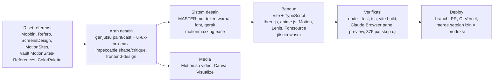

# FE-00 - Peta Tools FE

> **Peta link:** [[10 - FE Vault|Hub modul]] · [[FE-01 - Batasan Platform FE|Batasan platform]] · [[Landing Page - Brief]] · [[Backlog]]

Semua tool frontend yang tersedia untuk JitsuinFi per 2026-10-20, dari awal proyek sampai sekarang: library di repo, skill, server MCP, tool yang diminta tetapi belum terpasang, dan referensi di vault (di luar `09-Design`). Satu tool = satu file `FE-xx`, berisi akar (sumber, versi, lisensi, lokasi pasang), cara kerja, tempat dipakai, batasan, dan status.

## Status
| Status | Arti |
|---|---|
| AKTIF | Terpasang dan dipakai, atau terhubung dan siap dipakai |
| TERPASANG-TIDAK-DIPAKAI | Ada di proyek, tidak dipakai di kode |
| TERPASANG-BELUM-INIT | Terpasang, langkah setup pertama belum dijalankan |
| TERSEDIA-BELUM-DIPAKAI | Bawaan atau terhubung, belum pernah dipakai untuk JitsuinFi |
| REFERENSI / REFERENSI-DIPAKAI | Bahan acuan; nilai atau pola sudah diambil ke kode |
| BELUM-TERPASANG | Diminta di brief, belum dipasang |
| PERLU-LOGIN | Connector ada, belum diautentikasi |

## Peta lengkap
| ID | Tool | Lapisan | Versi / sumber | Lokasi | Dipakai di | Status |
|---|---|---|---|---|---|---|
| [[FE-01 - Batasan Platform FE\|FE-01]] | Batasan platform (CSP, tanpa CDN) | Platform | `vercel.json`, meta CSP | Repo frontend | Semua | AKTIF |
| [[FE-02 - Vite\|FE-02]] | Vite | Build | 8.3.4 | `devDependencies` | Landing dan app | AKTIF |
| [[FE-03 - TypeScript\|FE-03]] | TypeScript | Build | 5.9.3 | `devDependencies` | Semua kode | AKTIF |
| [[FE-04 - Node Test Runner\|FE-04]] | Node test runner | Tes | Node 26 | Bawaan Node | `tests/*.test.ts` | AKTIF |
| [[FE-05 - jitsuin-wasm Bindings\|FE-05]] | jitsuin-wasm | Inti kripto | zcash `a252568`, wasm-bindgen 0.2.129 | `src/wasm/` | Landing dan app | AKTIF |
| [[FE-06 - Vercel Deploy dan CI\|FE-06]] | Vercel | Deploy, CI | Proyek `jitsuinfi` | `vercel.json`, `.vercel/` | Produksi `jitsuinfi.vercel.app` | AKTIF |
| [[FE-07 - three.js\|FE-07]] | three.js | Library 3D | 0.186.1 | `dependencies` | `src/landing/city.ts` | AKTIF |
| [[FE-08 - anime.js\|FE-08]] | anime.js | Library gerak | 4.5.0 | `dependencies` | 7 file `src/landing/` | AKTIF |
| [[FE-09 - Motion\|FE-09]] | Motion | Library gerak | 14.3.0 | `dependencies` | 6 file `src/landing/` | AKTIF |
| [[FE-10 - Lenis\|FE-10]] | Lenis | Library scroll | 1.3.27 | `dependencies` | `src/landing/main.ts` | AKTIF |
| [[FE-11 - hairline\|FE-11]] | hairline | Library ilustrasi | 0.5.1 | `dependencies` | Tidak di mana pun | TERPASANG-TIDAK-DIPAKAI |
| [[FE-12 - Font Fontsource\|FE-12]] | Shippori Mincho B1, Geist, Geist Mono | Font | 5.3.0 | `dependencies` | `src/landing/tokens.css` | AKTIF |
| [[FE-13 - genjutsu\|FE-13]] | genjutsu (+17 sub-skill, termasuk `ui-ux-pro-max`) | Skill | v4.1.1 | `~/.agents/skills/genjutsu` | Desain landing, `MASTER.md` | AKTIF |
| [[FE-14 - impeccable\|FE-14]] | impeccable (+4 agent) | Skill | 4.7.0, engine 0.1.16 | `zkSNARK/.claude/` | Belum | TERPASANG-BELUM-INIT |
| [[FE-15 - Skill Artifact dan dataviz\|FE-15]] | artifact-design, artifact-diagramming, artifact-capabilities, dataviz | Skill | Bawaan | Claude Code | Belum | TERSEDIA-BELUM-DIPAKAI |
| [[FE-28 - frontend-design\|FE-28]] | frontend-design (Anthropic) | Skill | `claude-plugins-official`, Apache 2.0 | `~/.claude/plugins/` (scope user) | Belum | AKTIF |
| [[FE-16 - Claude Browser Pane\|FE-16]] | Claude Browser (pane) | MCP verifikasi | Bawaan desktop | `.claude/launch.json` | Semua uji browser | AKTIF |
| [[FE-17 - Claude in Chrome\|FE-17]] | Claude in Chrome | MCP verifikasi | Ekstensi | Chrome user | Belum | TERSEDIA-BELUM-DIPAKAI |
| [[FE-18 - Mobbin\|FE-18]] | Mobbin | MCP riset | `api.mobbin.com/mcp` | Scope user | Belum | AKTIF |
| [[FE-19 - ScreensDesign\|FE-19]] | ScreensDesign | MCP riset | `api.screensdesign.com/v1/mcp` | Scope user | Belum | AKTIF |
| [[FE-20 - MotionSites\|FE-20]] | MotionSites | MCP riset | Supabase Edge Function | Scope user | Prompt 1 – 4 untuk hero | AKTIF |
| [[FE-21 - Refero\|FE-21]] | Refero | MCP riset | `refero_server` 0.2.0 | Scope local `zkSNARK` | Belum | AKTIF |
| [[FE-22 - Visualize Widget\|FE-22]] | Visualize (`show_widget`) | MCP presentasi | Bawaan + claude.ai | Chat | Belum | TERSEDIA-BELUM-DIPAKAI |
| [[FE-23 - Motion.so\|FE-23]] | Motion.so | MCP media (video) | `mcp.motion.so` | Connector claude.ai | Render hero (ditolak) | AKTIF |
| [[FE-24 - Canva\|FE-24]] | Canva | MCP media | `mcp.canva.com` | Connector claude.ai | Belum | PERLU-LOGIN |
| [[FE-25 - React Bits shadcn MCP\|FE-25]] | React Bits (shadcn MCP) | Komponen | `npx shadcn@latest mcp init` | — | — | BELUM-TERPASANG |
| [[FE-26 - motionmaxxing\|FE-26]] | motionmaxxing | Skill referensi | GitHub, Apache-2.0 | — | Ease di `src/landing/motion.ts` | REFERENSI-DIPAKAI |
| [[FE-27 - Referensi Visual Vault\|FE-27]] | `MotionSites-References/`, `ColorPalette-JitsuinFi/` | Referensi | Vault | Vault, untracked | `MASTER.md` §1, §2 | REFERENSI |

## Alur end to end

Batasan [[FE-01 - Batasan Platform FE]] berlaku di setiap tahap.

## Temuan audit 2026-10-20
1. **hairline terpasang tetapi tidak dipakai** di kode mana pun ([[FE-11 - hairline]]).
2. **React Bits (shadcn MCP) dan motionmaxxing belum terpasang**, walaupun diminta di brief. motionmaxxing sudah dipakai sebagai sumber kurva ease ([[FE-26 - motionmaxxing]]).
3. **Motion.so adalah generator video motion graphics**, bukan aplikasi kalender seperti yang sempat disebut ([[FE-23 - Motion.so]]).
4. **impeccable belum `init`**; desain landing tercatat di `MASTER.md`, bukan DESIGN.md ([[FE-14 - impeccable]]).
5. **Refero menyarankan skill `refero-design`**, belum dipasang ([[FE-21 - Refero]]).
6. **Folder referensi vault belum di-commit** ([[FE-27 - Referensi Visual Vault]]).
7. **CI frontend hanya build Vercel**; `npm test` belum otomatis ([[FE-06 - Vercel Deploy dan CI]]).
8. **Bundle landing 796 KB** dengan peringatan chunk Vite ([[FE-02 - Vite]]).
9. **App dan landing memakai sistem visual berbeda**: font Fontsource dan library gerak hanya di landing; app memakai font sistem dan `src/style.css` (redesain app = HNK-21, Dex).
10. **README frontend usang**: masih menyebut secret tidak pernah ditulis ke storage, padahal sekarang ada store IndexedDB terenkripsi (HNK-24.T3).

## Di luar cakupan (sengaja tidak dipetakan)
| Tool | Alasan |
|---|---|
| iOS Simulator MCP | Untuk app iOS native; JitsuinFi web app |
| Skill `supabase`, `supabase-postgres-best-practices` | Backend (relay, D-33) |
| `code-review`, `simplify`, `security-review`, `run` | Umum untuk semua kode, bukan khusus FE |
| Connector Claude Docs | Dokumen, bukan antarmuka |
| Plugin caveman | Gaya respons agent |

## Daftar otomatis
```dataview
TABLE layer, status, updated
FROM "10-FE-vault"
WHERE type = "fe-tool"
SORT id ASC
```
