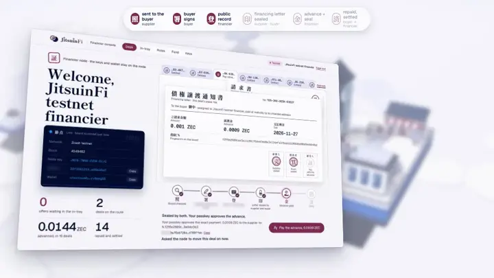
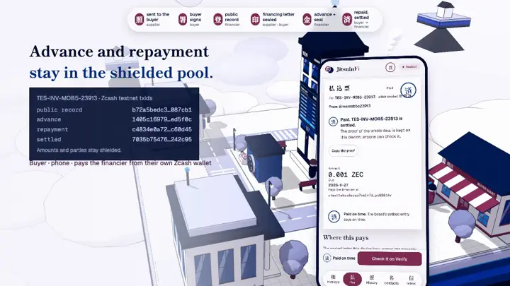
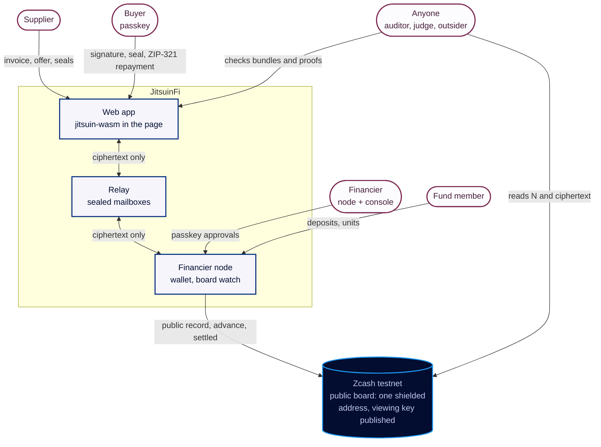
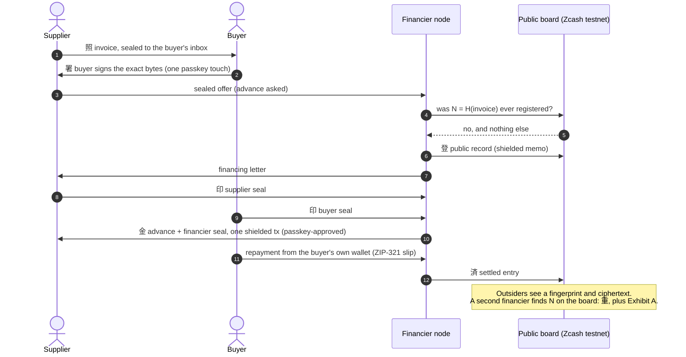
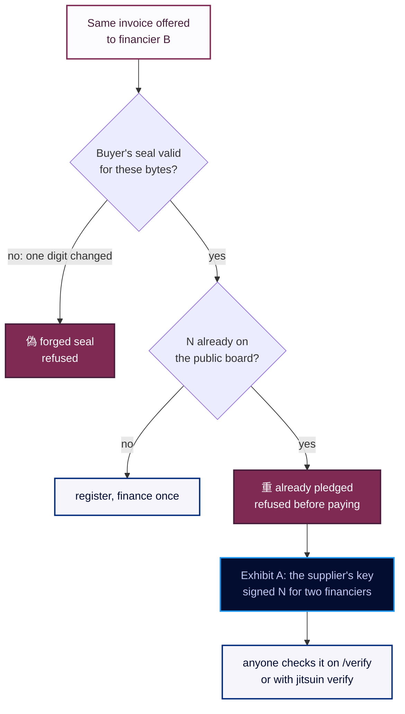

  

  
  
  

  <b>Vault proyek JitsuinFi (Obsidian): workflow, spike, backlog, arsitektur, alur, desain, judging, dan produksi video.</b>

  <a href="https://jitsuinfi.vercel.app"><b>Landing</b></a> ·
  <a href="https://jitsuinfi.vercel.app/app"><b>App</b></a> ·
  <a href="https://jitsuinfi.vercel.app/try"><b>Try to double-finance</b></a> ·
  <a href="https://jitsuinfi.vercel.app/verify"><b>Verify</b></a> ·
  <a href="https://jitsuinfi-console-demo.vercel.app/console"><b>Console demo</b></a> ·
  <a href="https://youtu.be/RB9hKSLarJo"><b>2-min video</b></a>

  
   Video demo 2 menit (dirakit di Remotion dari folder Video-Workspace/ vault ini).

> **JitsuinFi** adalah pembiayaan invoice (factoring) yang privat di Zcash: buyer menyegel invoice dengan passkey, hanya sidik jarinya N yang masuk papan publik, pembiayaan kedua atas invoice yang sama tertangkap (重) dan menghasilkan bukti portabel (Exhibit A). Advance, segel, dan pelunasan tetap di shielded pool.

<table>
  <tr>
    <td width="50%" valign="top"> <b>偽 lalu 重 di papan testnet hidup</b> /try: ubah satu digit → segel buyer patah; kirim apa adanya → N sudah ada di papan.</td>
    <td width="50%" valign="top"> <b>Konsol financier (production, testnet)</b> Penawaran tersegel → financing letter dengan segel 売 買 → passkey menyetujui advance.</td>
  </tr>
  <tr>
    <td width="50%" valign="top"> <b>Supplier dan buyer di HP</b> Invoice ditulis di HP supplier, masuk inbox HP buyer, satu sentuhan passkey menandatangani.</td>
    <td width="50%" valign="top"> <b>真: deal settled nyata</b> Deal production TES-INV-MOB5-23913 diverifikasi di /verify pada HP buyer.</td>
  </tr>
</table>

## Mulai dari sini

| Baca | Isi |
|---|---|
| [START-HERE](START-HERE.md) | Peta vault, tim, aturan emas |
| [JitsuinFi - Ringkasan Proyek](00-Project/JitsuinFi%20-%20Ringkasan%20Proyek.md) | Apa yang dibangun dan kenapa |
| [ZECATHON - Aturan dan Deadline](00-Project/ZECATHON%20-%20Aturan%20dan%20Deadline.md) | Aturan, kriteria juri, deadline |
| [Workflow Development](01-Workflow/Workflow%20Development.md) | 5 langkah wajib per item |
| [Backlog](03-Backlog/Backlog.md) | Item HNK-xx, task, log deviasi |
| [Decision Log](07-Architecture/Decision%20Log.md) | Keputusan D-xx |
| [FD-00 - Arsitektur Target dan Legenda](08-FlowDiagrams/FD-00%20-%20Arsitektur%20Target%20dan%20Legenda.md) | Arsitektur target, legenda diagram |
| [JDG-00 - Peta Judging](11-Judging/JDG-00%20-%20Peta%20Judging.md) | Sudut pandang juri, titik lemah W-xx, narasi N-xx |
| [Video-Workspace](Video-Workspace/Video-Workspace.md) | Naskah, storyboard, video final (Remotion: `Video-Workspace/README.md`) |

## Isi vault

| Folder | Isi |
|---|---|
| `00-Project/` | Ringkasan proyek, aturan ZECATHON, deskripsi dan runbook submission |
| `01-Workflow/` | Workflow development dan rencana fase |
| `02-Spikes/` | Spike SPK-xx: uji kelayakan tools sebelum build |
| `03-Backlog/` | Backlog HNK-xx dan log deviasi |
| `04-Acceptance-Criteria/`, `05-Testing/`, `06-Executive-Summary/` | AC, tes, dan exec summary per item |
| `07-Architecture/` | Arsitektur, format data, threat model, decision log |
| `08-FlowDiagrams/` | DFD level 0–2, sequence per peran, peta halaman (PlantUML → SVG) |
| `09-Design/`, `10-FE-vault/`, `ColorPalette-JitsuinFi/` | Referensi visual, palet DS-PAL, peta tool frontend |
| `11-Judging/` | Vonis per putaran, kartu skor, register titik lemah, benchmark |
| `Video-Workspace/` | Produksi video demo (Remotion, VO ElevenLabs, footage) |
| `Concepts/`, `Module-Guides/`, `Notes/`, `Templates/`, `scripts/` | Konsep atomik, panduan modul, catatan, template, otomasi (`scripts/sync-vault.py`) |

## Diagram

**Sistem dalam satu gambar** (ringkasan DFD-0, dalam bahasa Inggris seperti di README repo):

**Satu deal, ujung ke ujung** (ringkasan SEQ-01 – SEQ-03):

**Cara pembiayaan kedua tertangkap** (ringkasan DFD-2.7):

**Diagram lengkap dari `08-FlowDiagrams/`** (PlantUML, klik untuk membuka):

<b>DFD-0, diagram konteks</b>: semua entitas luar dan aliran K1 – K14

<b>DFD-1, proses utama</b>: proses 1.0 – 9.0 dan penyimpanan D1 – D19

<b>SEQ-01, supplier</b>: tulis invoice, tawarkan, segel surat, terima advance

<b>SEQ-02, buyer</b>: tanda tangan, segel, bayar lewat QR ZIP-321, riwayat

<b>SEQ-03, financier</b>: cek papan, public record, Sign-to-Pay, settled

<b>SEQ-04, verifier dan orang luar</b>: apa yang bisa dicek siapa saja

<b>SEQ-05, anggota dana</b>: setoran, unit, penarikan

<b>DFD-2.4, pengalihan dan advance</b>: surat pengalihan, segel, Sign-to-Pay

<b>DFD-2.7, deteksi pembiayaan ganda</b>: AlreadyFinanced, DoubleFinanced, Exhibit A

<b>PG-01, peta halaman per peran</b>: semua halaman app dan konsol

## Repo

| Repo | What lives there |
|---|---|
| [**jitsuinfi-zcash**](https://github.com/JitsuinFi/jitsuinfi-zcash) | The protocol: canonical invoices, the fingerprint N, board entries, seals, settlement, proofs; the board scanner, the `jitsuin` CLI, `jitsuin-wasm` for the browser, and the ZIP-style spec |
| [**jitsuinfi-frontend**](https://github.com/JitsuinFi/jitsuinfi-frontend) | The web app: landing, supplier / buyer / fund-member desks, `/try`, `/verify`, `/outsider`, `/rates`, and the financier console UI |
| [**jitsuinfi-node**](https://github.com/JitsuinFi/jitsuinfi-node) | The financier's node: keys, Zcash wallet, board watch, Sign-to-Pay, deal API and console |
| [**jitsuinfi-backend**](https://github.com/JitsuinFi/jitsuinfi-backend) | The relay: sealed mailboxes between supplier, buyer and financier; it only ever sees ciphertext |

## Aturan vault

- Setelah mengedit vault: `python3 scripts/sync-vault.py` harus `Broken: 0`.
- Push dan deploy hanya setelah user menyetujui hasil langkah 2 – 4 di workflow.
- Tidak ada seed, key, atau data pribadi di vault.

